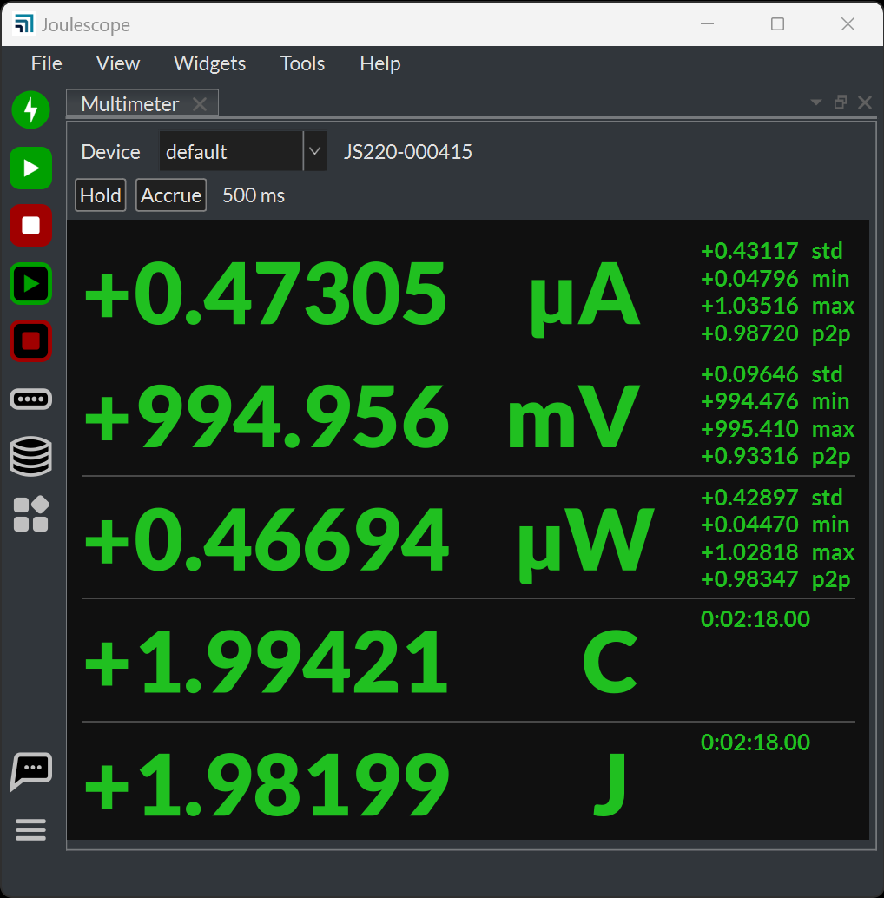

<!--
Include-only fragment: the quick start for the JS320, JS220 and JS220+, which
share the same connections.  Included by getting_started/first_steps.md and
the JS320 and JS220 quick_start.md, with :relative-images:.  The obsolete
JS110 has its own quick start.  No labels here, since each label would be
defined more than once.
-->

Install the Joulescope User Interface (UI) on your computer, as described in
{ref}`Installing the Joulescope UI <getting-started-install-ui>`.

Start the Joulescope UI.

Connect the Joulescope USB port to the host computer using the provided USB
cable.  The UI automatically detects the connected Joulescope and starts
displaying statistics data.

The Joulescope JS320 front panel has the **Voltage** and **Current**
binding posts.  The JS220 and JS220+ have the same connections.

To measure the current and charge, connect the Joulescope **Current** port
inline between the positive output from your power source and your target
device under test.  The maximum voltage between any port **Current +**,
**Current -**, **Voltage +**, and **Voltage -** should never exceed ±15V.  All
sensor ports are electrically isolated from USB, but the voltage between any
port and USB ground should never exceed ±48V.

To also measure voltage, power, and energy, connect the Joulescope **Voltage**
ports across your power source's positive and negative connections.
Alternatively, you can connect the **Voltage** port across your target
device's positive and negative connections.

The Joulescope can be used in a variety of measurement configurations.  For
more common connection scenarios, see
{ref}`How to Connect Your Joulescope <js320-how-to-connect-your-joulescope>`.

Operate your device under test.  The **Multimeter** view shows current,
voltage, power, charge, and energy.  When you want to see waveforms over
time, use the **Oscilloscope** view.  Select **View** → **Oscilloscope**.

Have questions about a feature?  In many cases, you can hover the mouse over
an area of interest to see a **Tooltip**.  Right-click (control-click on
macOS) often brings up a context-sensitive menu.

For more information on the Joulescope UI, see the
{doc}`Joulescope UI User's Guide </software/joulescope_ui/index>`.
