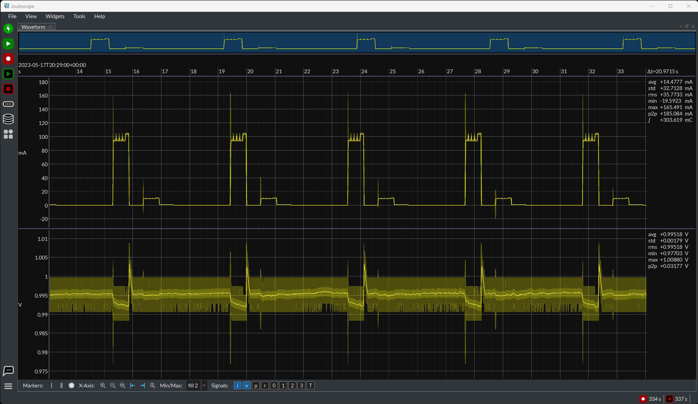

(introduction)=

# Introduction

Joulescope instruments are precision DC energy analyzers.  They measure
current and voltage, then compute power, energy and charge.

Many modern battery-powered and IoT devices have a high dynamic current
range, which makes accurate measurement difficult.  When "sleeping", the
devices consume nanoamps (nA) or microamps (µA), but when active, they
consume milliamps (mA) or amps (A).  Joulescope combines high-speed sampling
and rapid dynamic current range switching to provide accurate and seamless
current and energy measurements, even for devices with rapidly varying
current consumption.  Joulescope gives rapid feedback on how changes affect
the overall product battery life.

Joulescope displays instantaneous voltage, current, power, and energy, like a
multimeter.  The multimeter provides a quick and easy summary of the present
state of your device.

Joulescope also displays waveforms of voltage and current over time, like an
oscilloscope.  This oscilloscope view allows you to identify and to
troubleshoot dynamic behavior and short events, including inrush current,
event handlers, and tasks.

## Applications

- Microprocessor and microcontroller power profiling and optimization
- Hardware power optimization
- Microcontroller and device sleep current optimization
- Hardware and software troubleshooting
- Software characterization and interrupt service routine profiling
- USB inrush and suspend current pre-compliance testing
- General-purpose current, voltage, power, charge, and energy measurement

## Instruments

| Instrument | Description |
|---|---|
| {doc}`Joulescope JS320 <products/js320/index>` | Precision DC energy analyzer. |
| {doc}`Joulescope JS220 <products/js220/index>` | Precision DC energy analyzer. |
| {doc}`Joulescope JS220+ <products/js220plus/index>` | A limited-edition, performance-enhanced version of the JS220 with ±1 nanoamp accuracy. |
| {doc}`Joulescope JS110 <products/js110/index>` | The previous-generation Joulescope. |

See {doc}`products/index` for the datasheets and user's guides.

## Software

The {doc}`Joulescope UI <software/joulescope_ui/index>` is the quickest and
easiest way to use your Joulescope.  It runs on Microsoft® Windows®, Apple®
macOS®, and Linux®.

To automate tests or integrate Joulescope into a larger test setup, use the
{doc}`Joulescope Driver <software/joulescope_driver/index>`, a native C library
with Python bindings, or the original
{doc}`pyjoulescope <software/pyjoulescope/index>` Python API.  Joulescope
recordings use the {doc}`JLS file format <software/jls/index>`.
