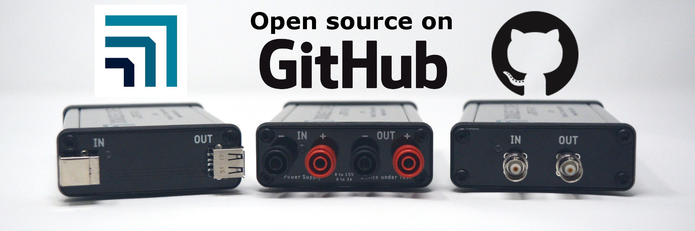

(js110-how-to-swap-the-front-panel)=

# How to swap the front panel

Joulescope comes standard with a banana jack front panel. However, Joulescope
is designed to be flexible and can support other connector types.

The front panel design is open source, and available on GitHub:

<https://github.com/jetperch/joulescope_front_panels>

To swap the front panel, you will need:

- T15 Torx screwdriver

- The new front panel

Swapping the panel is easy, but you do need to take proper precautions to
avoid damaging your Joulescope. Joulescope can be damaged by static
electricity that you don’t even notice. When you expose the Joulescope main
board, be sure only to handle it by the board edges. Follow these steps
carefully:

- Completely disconnect the Joulescope, including **IN**, **OUT,** and **USB**
  ports.

- Use the Torx screwdriver to remove the four screws at the corners of the
  existing front panel.

- Gently push the Joulescope’s USB connector into the Joulescope body. This
  action will push the front panel out. Expose about ½” or 1 cm.

- Grab the sides of the main board in one hand, being careful not to touch any
  other part of the board.

- Grab the existing front panel by the sides and carefully pull it directly
  out.

- Grab the new front panel by the sides, align the pins, and carefully push it
  in.

- Fully seat the front panel in the black plastic bezel. You may need to
  gently guide the board to ensure that the USB connector fits in the back
  panel.

- Use the Torx screwdriver to install the four screws at the corners of the
  existing front panel.
