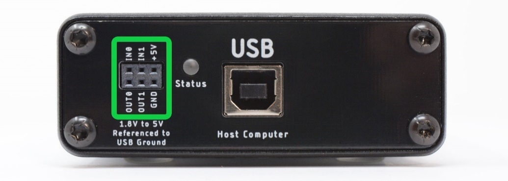
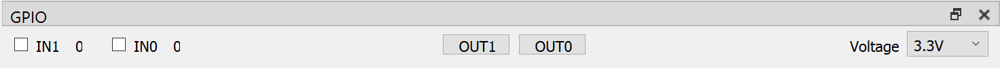
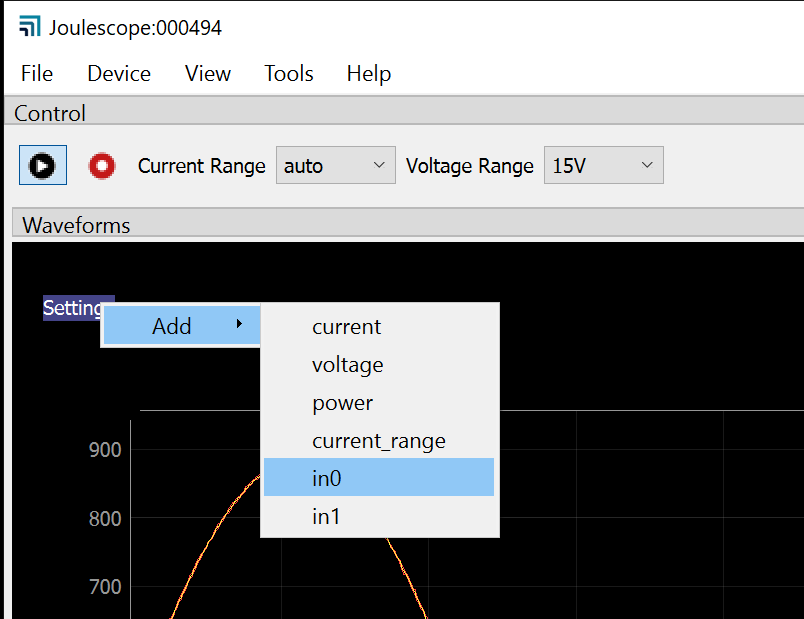

(js110-gpi-gpo)=

# GPI & GPO

The Joulescope contains two (2) general-purpose inputs (GPI) and two (2)
general-purpose outputs (GPO), located near the host USB connector.

These signals enable time-synchronization with the device under test and other
external equipment. The user interface can display GPIs time-synchronized with
current, voltage, and power in the oscilloscope view.

One intended application for the GPIs is to allow the target microcontroller
firmware to identify areas of interest. The microcontroller can toggle bits so
that you can easily see the energy consumption in the marked time windows.

When the GPI feature is activated, the voltage and current samples will only
be 13 bits (the GPI will be in the LSB), not the full 14-bits.

Both GPI and GPO are referenced to USB ground. Many applications using
Joulescope will want isolated GPI/GPO for improved performance. When selecting
an isolation solution, consider:

- Electrical isolation

- Self-powered target interface with very low power from target device –
  leakage currents only

- Variable voltage technology levels with an external reference voltage

- ESD protection

- Overvoltage protection (GPO)

- Short circuit protection (GPO)

- Very high (GΩ) input impedance (GPI)

To control the GPIO, add the GPIO Widget by selecting **View → GPIO**.

Select the reference voltage for your GPIO, which is configurable from 1.8V to
5.0V. This voltage determines the OUT0 and OUT1 output voltages. The input
threshold voltage is one half of this voltage.

Inputs are optional. Check **IN0** to enable the GPI0 input. Check **IN1** to
enable the GPI1 input. To display either IN0 or IN1, select **Settings →
Add**, then select either in0 or in1.

Manually toggle **OUT0** by pressing the OUT0 button. Manually toggle **OUT1**
by pressing the OUT1 button.
