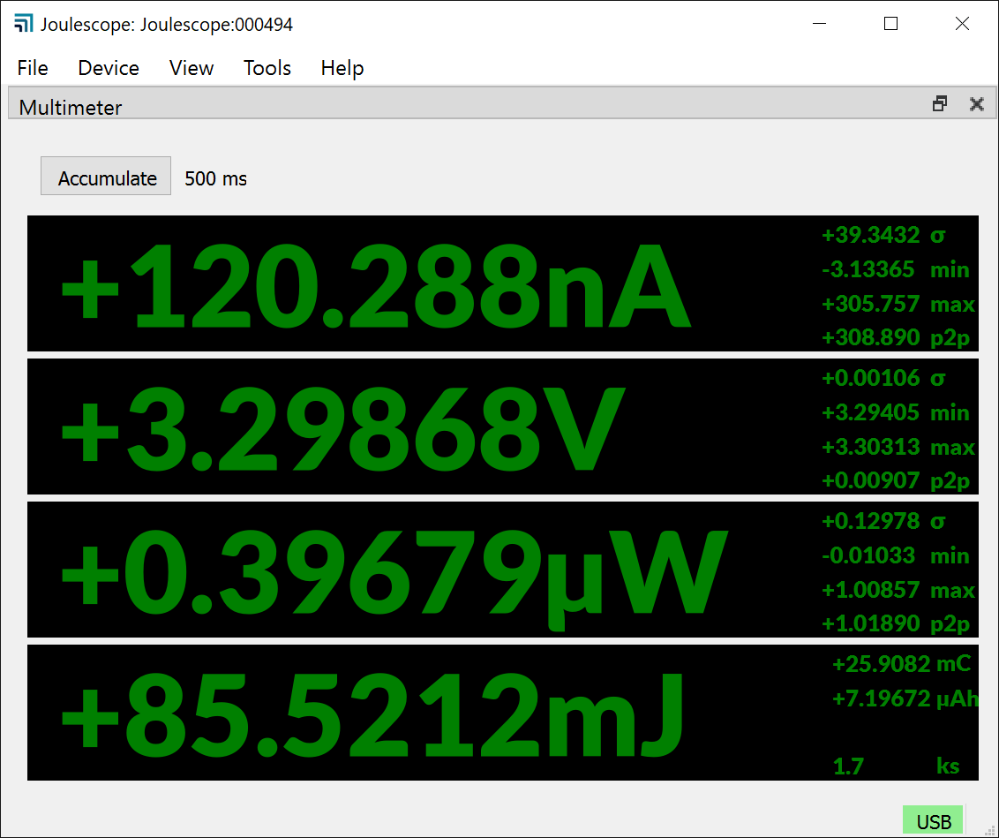
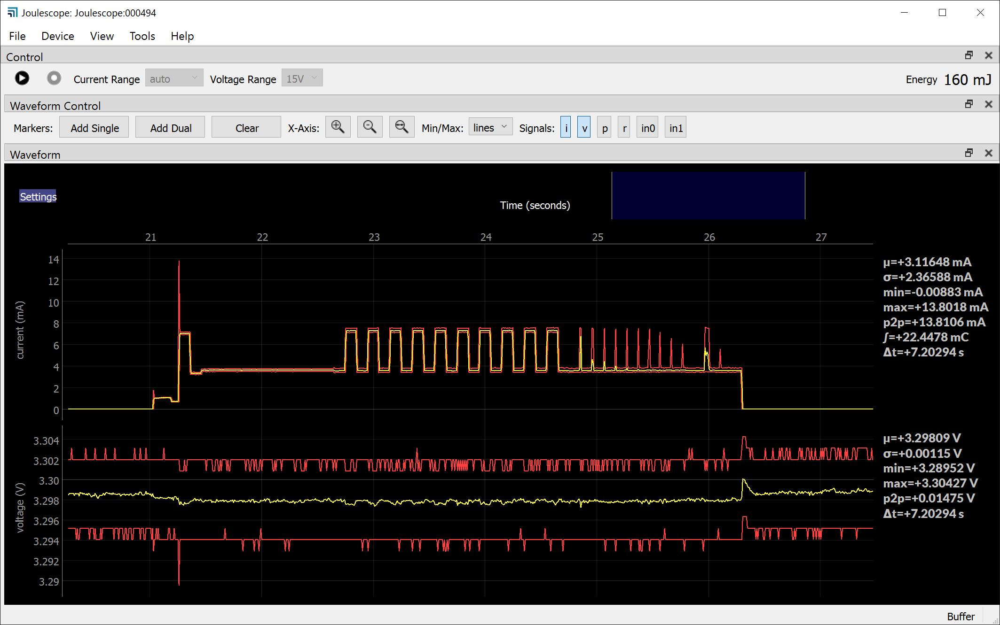
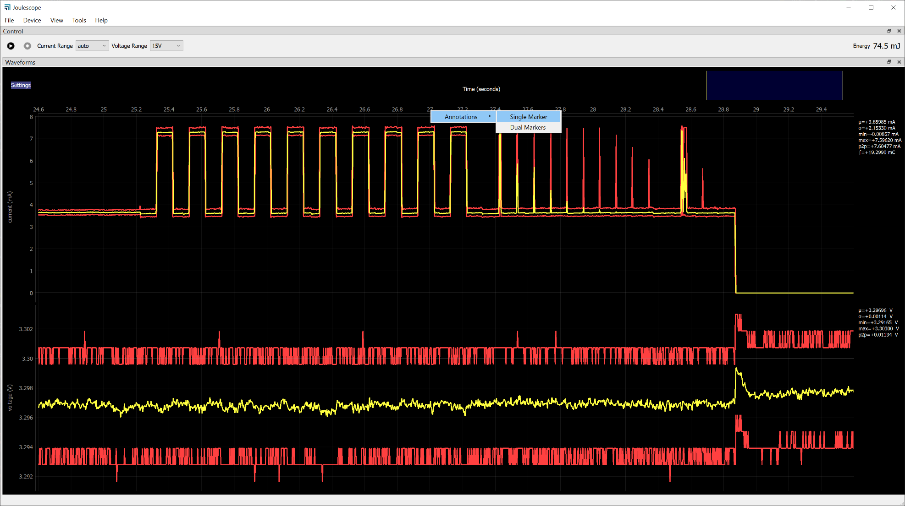
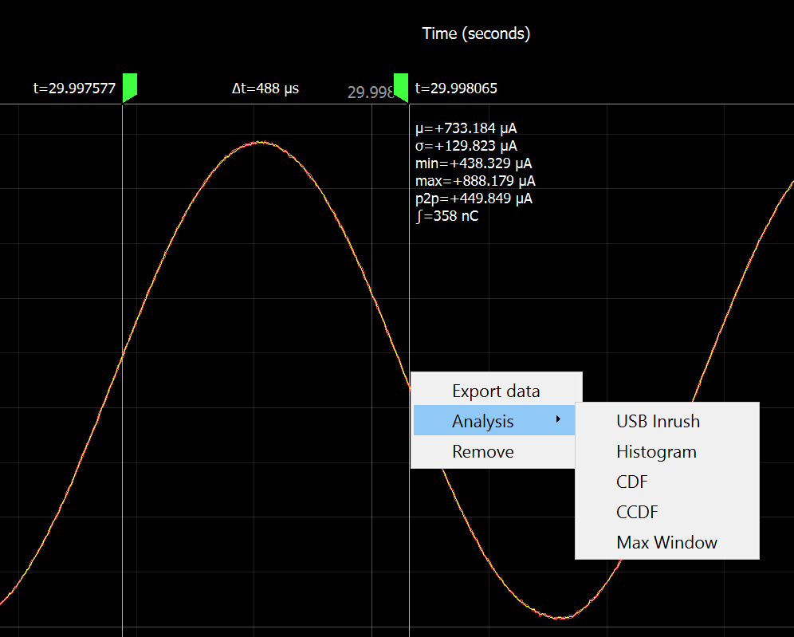
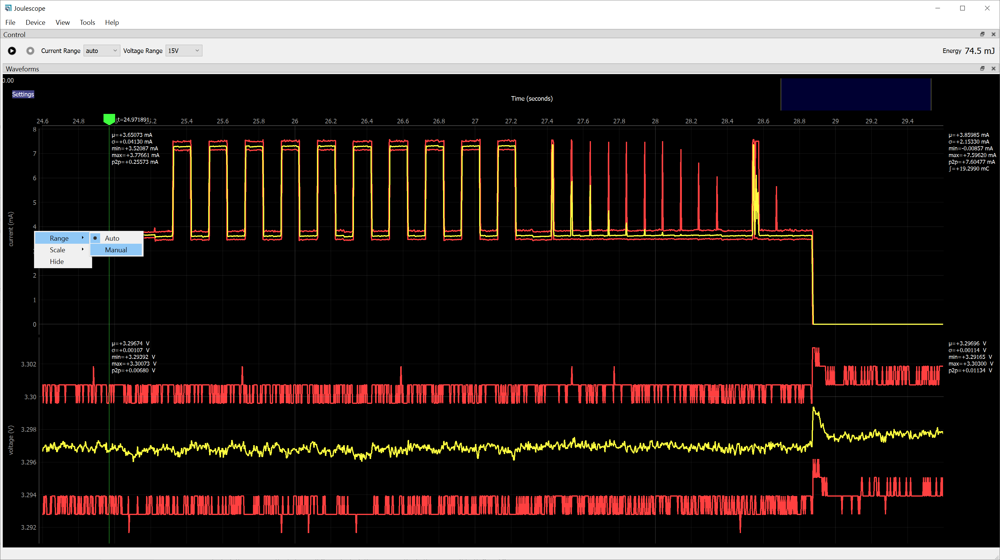

(js110-host-software)=

# Host software

The Joulescope host software runs on a host computer and communicates with the
Joulescope instrument over USB 2.0 high-speed.

The software works with Microsoft® Windows®, Apple® macOS®, and Linux®.  See
the {ref}`supported platforms <supported-platforms>`.

(js110-installation)=

## Installation

Follow {ref}`Installing the Joulescope UI <getting-started-install-ui>`.

## Multimeter view

Upon launching the host software, you see the multimeter view:

You can return to this view at any time using **View** → **Multimeter**.

The multimeter view provides the present operating state at a glance. The
multimeter view displays several quantities:

- Electrical current in amperes (A)

- Electrical voltage in volts (V)

- Power in watts (W)

- Energy in joules (J)

- Charge in either coulombs (C) or amp-hours (Ah).

This display, along with all other value displays in the Joulescope software,
the SI standard prefixes for orders of magnitude:

| **Prefix** | **Power** | **Name** |
|------------|-----------|----------|
| G          | 10⁹       | giga-    |
| M          | 10⁶       | mega-    |
| k          | 10³       | kilo-    |
| m          | 10⁻³      | milli-   |
| µ          | 10⁻⁶      | micro-   |
| n          | 10⁻⁹      | nano-    |
| p          | 10⁻¹²     | pico-    |

The multimeter view updates every half second (0.5 seconds) by default. The
software computes and displays the statistics over each half-second time
window. The large numbers are the mean (also called average) value of that
quantity over the window. The software also displays:

- σ: The standard deviation

- min: The minimum value

- max: The maximum value

- p2p: The peak-to-peak value, which is equal to (max – min)

Note that energy does not display these additional statistics since they are
not meaningful.

Every update represents only the data recorded over the last half-second. If
you click on the “Accumulate” button to activate it, then the software extends
the statistics to combine each new half-second window without discarding
results from previous windows.

## Oscilloscope view

The software includes an oscilloscope view. Click **View** → **Oscilloscope**.

The first view allows you to control the connected Joulescope. Press
 to pause or resume capturing live data. Press
 to start and stop recording data to a file. This
feature is only available when the device is capturing live data.

**Current Range** allows you to select Joulescope’s active shunt resistor.
Most applications use **auto**, where Joulescope automatically selects the
best range. However, you can manually force the range. Select **off** to
disconnect power to the target device.

**Voltage Range** allows you to select the voltage range. Joulescope includes
a **15V** range and a more sensitive **5V** range.

The Control widget in the Oscilloscope view also displays the energy or
current consumed. Left-click or select **Tools** → **Clear Accumulators** to
reset the accumulators to zero. Right-click or use **File** →
**Preferences** → **Units** → **Accumulator** to set the displayed field to
either energy or current.

The software displays two different waveforms by default. The top waveform is
electrical current, and the bottom waveform is electrical voltage. The x-axis
is time. If you have a Joulescope connected, it will automatically add the
most recent data to the right of the waveform and shift existing data to the
left. The y-axis data is the value measured at the corresponding point in
time. Joulescope captures data 2 million times per second. When zoomed out,
each x-axis pixel may represent many, many samples, which are that pixel’s
sample window. The plot displays the statistics over each pixel. The yellow
line is the mean (average). The red lines are the minimum and maximum. Power
glitches, such as interrupt service routines, are very interesting for energy
optimization. The minimum and maximum ensure that you do not miss these
events, even when zoomed out. When you eventually zoom in far enough, the red
lines disappear because 1 pixel becomes 1 sample, and the minimum and the
maximum are the same as the average. You can use **File → Preferences →
Waveform → show_min_max** to disable these lines or display the minimum to
maximum region as a fill instead.

The software computes statistics quantities over the full-time window shown in
the present view for each waveform. The software displays the statistics on
the right edge of the window. The statistical quantities are:

- µ: The mean (also called average) value

- σ: The standard deviation

- p2p: The peak-to-peak value (max - min)

- min: The minimum value

- max: The maximum value

- ∫: The integral over the time window

The waveform view supports **Annotations** to present additional information,
which includes:

- A **Single Marker** that displays information at a single point. Names used
  by other equipment for this feature include marker and cursor.

- **Dual Markers** that display information over a time window. Names used by
  other equipment for this feature include cursors, timing markers, window,
  and range selection.

To display statistics at a single point, move the mouse to the x-axis time
labels near the top. Then right-click (control-click on Mac OS) to bring up
the context menu. Select **Annotations → Single Marker**.

Left-click the marker to move it with the mouse. As you move the mouse over
the waveforms, the vertical marker follows along. The line displays statistics
about that location:

- t: The sample time for the displayed sample or window

- µ: The mean (also called average) value

When the location contains more than one sample per displayed pixel, the line
displays statistics over that single pixel’s sample window:

- σ: The standard deviation

- p2p: The peak-to-peak value (max - min)

- min: The minimum value

- max: The maximum value

Left-click again to keep the marker in position.

To display statistics over a selectable range, right-click on the x-axis time
labels and select **Annotations → Dual Markers**. Left-click a marker to
move it with the mouse, then left-click again to stop moving the marker. Hold
the **Ctrl** key while left-clicking to move both markers together.
Right-click (control-click on Mac OS) on one of the dual markers to export
data or perform analysis over the selected range.

Use the scroll wheel to zoom in and zoom out. The zoom operation keeps the
point under the mouse cursor at the same location after the zoom operation.
However, when you reach the maximum extents while zooming out, that point may
move. When viewing live data, the zoom operation always keeps the most recent
data in view at the right.

Press the left mouse button and drag the cursor left or right to pan in time.
Pan is not supported when viewing live data from a Joulescope.

The software displays the waveform on a linear scale with automatic y-axis
ranging by default. The y-axis context menu has additional options.
Right-click (control-click on Mac OS) on the y-axis to display the menu.

When manual ranging is activated, hover over the y-axis and use the scroll
wheel to zoom in and out. Left-click and drag up and down to pan the y-axis.

Use the y-axis context menu to change the y-axis scale mode. The y-axis
displays in linear coordinates by default but also supports a logarithmic
scale. A logarithmic scale is handy to view wide dynamic ranges for current
and power.

Use the y-axis context menu to hide the signal. Click **Settings** at the top
left to display the settings menu. Select **Add → \[Signal Name\]** to display
a signal not already shown.

## Energy and Charge

The Joulescope measures current and voltage two million times per second. It
then multiplies current by voltage to compute power. Joulescope then
integrates power over time to compute energy. It also integrates current to
compute charge. Joulescope displays energy in both the Multimeter view and
Oscilloscope view. This value starts accumulating when the software starts.
Use **Tools** → **Clear Energy** to reset it to zero at any time.

The energy value and charge value provide a simple measurement to observe
changes, especially for software. You can baseline the performance of an
operation by recording the measured energy or charge value. You can then make
changes, repeat the test, and observe the new energy or charge value. The
oscilloscope view enables you to investigate in further detail.

## Open-source

The host software is open source and written in Python ({ref}`supported
platforms <supported-platforms>`). The host software consists of two layers:

| **Repo name** | **Python package name** | **Description** |
|----|----|----|
| pyjoulescope_ui | joulescope_ui | The Joulescope User Interface written in QT/PySide2 |
| pyjoulescope | joulescope | The Joulescope “driver” which enables scripting |

The joulescope package was designed so that you can script custom Joulescope
actions and integrate Joulescope into your applications.

See the GitHub repositories for the latest details.

> <https://github.com/jetperch/pyjoulescope_ui>
>
> <https://github.com/jetperch/pyjoulescope>

You can find examples for how to use Joulescope in your Python application at:

<https://github.com/jetperch/pyjoulescope_examples>

Also see the {doc}`pyjoulescope documentation </software/pyjoulescope/index>`.

The Joulescope software depends upon other software and libraries. See
CREDITS.html for
[pyjoulescope_ui](http://htmlpreview.github.io/?https://github.com/jetperch/pyjoulescope_ui/blob/master/CREDITS.html)
and
[pyjoulescope](http://htmlpreview.github.io/?https://github.com/jetperch/pyjoulescope/blob/master/CREDITS.html).
