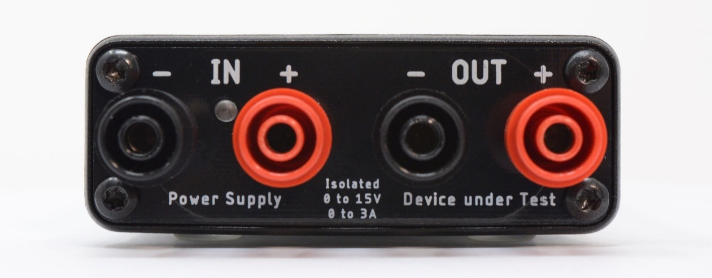
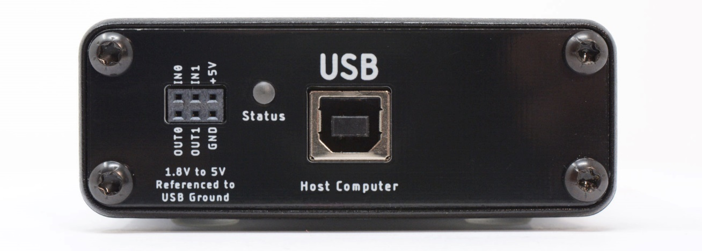

(js110-meet-your-joulescope)=

# Meet Your Joulescope

The front side of Joulescope has the connectors that connected to your target
device and its regular power supply. Connect your power supply positive output
to IN+, and connect OUT+ to your target device’s positive voltage input.
Connect the target device’s ground or negative voltage input to OUT-. Connect
IN- to your power supply ground or negative output.

The LED indicates when your Joulescope is ready to collect measurements.

The backside of Joulescope has the host USB connector, status LED, and GPIO
connector:

Use the provided USB cable to connect the USB host computer connector to your
host computer. The status LED indicates when the Joulescope successfully
communicates with the host computer. For Windows hosts, the Status LED
illuminates shortly after connecting the Joulescope to the computer. For Linux
and macOS hosts, the Status LED will not illuminate until the Joulescope
software attempts to connect.

The GPIO connector provides two general-purpose inputs and two general-purpose
outputs. See {numref}`js110-gpi-gpo` for details.
