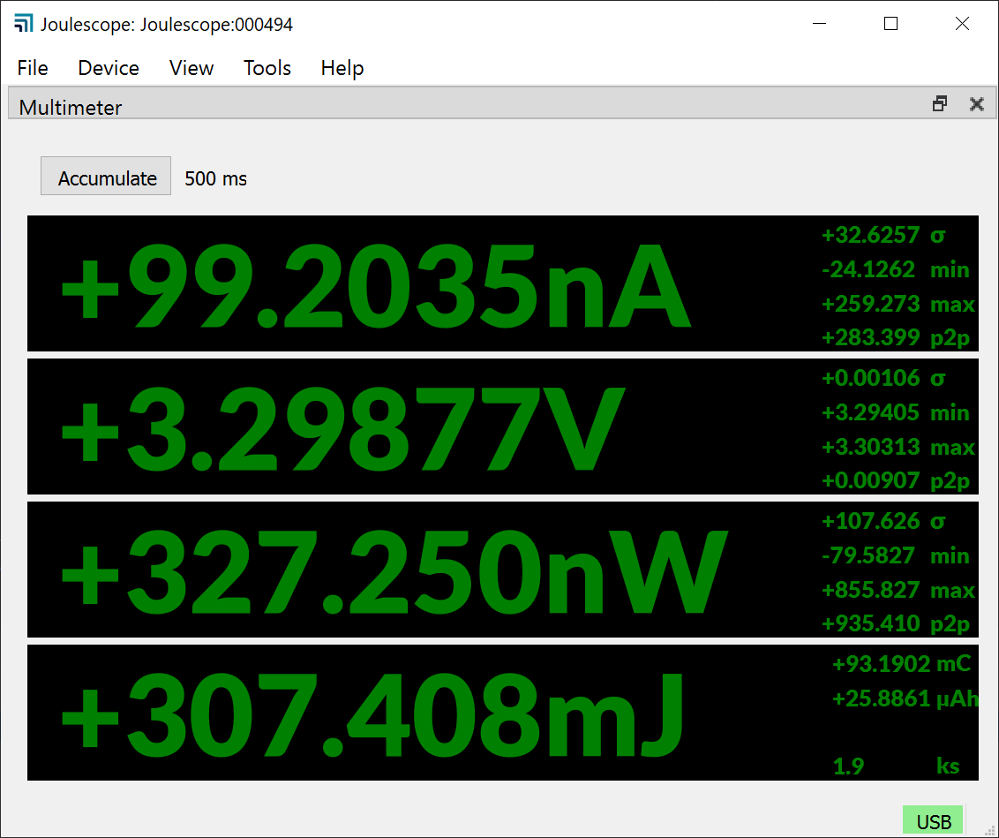
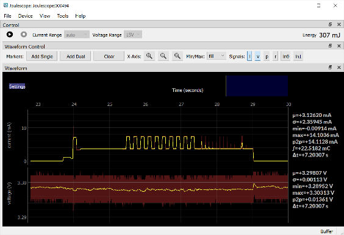

(js110-overview)=

# Overview

## Affordable, easy-to-use, accurate and precise

|  |  |
|:--:|:--:|
| *Multimeter view* | *Oscilloscope view* |

Applications include:

- Microprocessor and microcontroller power profiling and optimization

- Hardware power optimization

- Sleep current optimization

- Hardware and software troubleshooting

- Software characterization and interrupt service routine profiling

- USB 2.0 inrush and suspend current pre-compliance testing

- General-purpose current, voltage, power, charge, and energy measurement

The Joulescope™ JS110 is the most affordable and easy-to-use precision DC
energy analyzer. It measures current and voltage, then computes power and
energy. Many modern battery-powered devices and IoT devices have a high
dynamic current range, which makes accurate measurement difficult. When
“sleeping” the devices consume nanoamps (nA) or microamps (µA), but when
active, they consume milliamps (mA) or amps (A). Joulescope combines
high-speed sampling and rapid dynamic current range switching to provide
accurate and seamless current and energy measurements, even for devices with
rapidly varying current consumption. The unprecedented accuracy and low-cost
of Joulescope allows every engineer on the team to measure the energy consumed
by the target device during development. Joulescope provides rapid feedback on
how changes affect the overall product battery life.

Joulescope displays instantaneous voltage, current, power, and energy, like a
multimeter. The multimeter provides a quick and easy summary of the present
state of your device.

Joulescope displays waveforms of voltage and current over time, like an
oscilloscope. This oscilloscope view allows you to identify and to
troubleshoot dynamic behavior and short events, including inrush current,
event handlers, and tasks.

## Key benefits

- **Dynamic range**: Joulescope accurately measures electrical current over
  nine orders of magnitude from amps down to nanoamps. This wide range allows
  accurate and precise current measurements for modern devices. Sleep modes
  are often just nanoamps (nA) or microamps (µA). Active modes are often
  milliamps (mA) or amps (A).

- **Low voltage drop**: Most multimeters and current meters have a significant
  voltage drop (sometimes called burden voltage or insertion loss), which
  affects the actual voltage delivered to the device under test. Joulescope
  has a total voltage drop of 25 mV at 1 A, which keeps your target device
  running correctly. Joulescope’s extremely fast current range switching
  maintains low voltage drop even under rapidly varying current demands.

- **Makes the invisible visible**: Joulescopes measure current and voltage 2
  million times per second with 250 kHz bandwidth. This high sampling rate
  makes the power consumption of interrupt service routines, inrush currents,
  and other short events visible.

- **Easy to use:** Joulescope reports cumulative energy consumption along with
  real-time current, voltage, and power. The multimeter view clearly shows the
  most recent value, while the oscilloscope view allows you to explore changes
  over time. Much simpler and more accurate than anything in its class!

- **Customizable:** The Joulescope host software is open source on GitHub. You
  can also swap the banana jack front panel with front panels that have other
  connector types. The front panels are open source on GitHub.

- **Portable:** Joulescope fits in your backpack and only needs a small part
  of your desk. Take Joulescope wherever you want to use it!

- **Affordable:** Joulescope is affordable and priced so that every developer
  on the team can have one at their desk. With such convenient access,
  Joulescope allows developers to see the impact of their changes on energy
  consumption immediately. Developers can make informed choices to account for
  battery life during design. Eliminate power consumption surprises during
  final product testing!

(js110-key-features)=

## Key features

```{include} _key_features.md
```

See {numref}`js110-specifications` for the full specifications.

(js110-what-comes-in-the-box)=

## What comes in the box

```{include} _in_the_box.md
```
