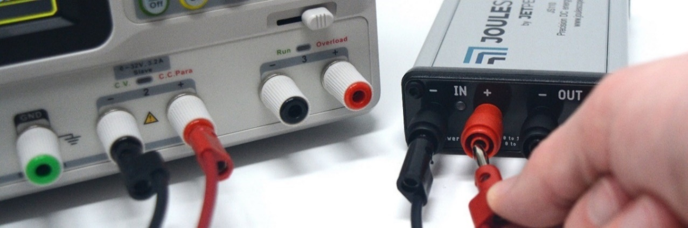
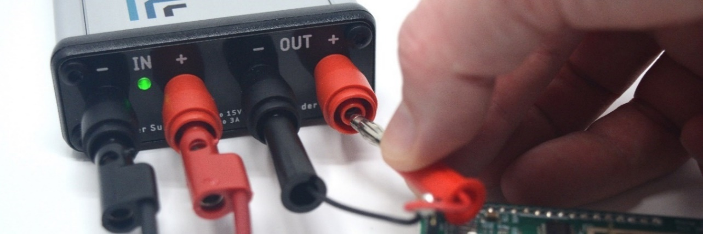

(js110-quick-start)=

# Quick start

Install and start the Joulescope UI, then connect the JS110 USB port to your
computer, as described in
{ref}`First steps <getting-started-first-steps>`.

The JS110 has **IN** and **OUT** ports.  Connect the **IN** port to your
power source.  If using a configurable power supply, set the voltage and
current suitable for your device under test.  The maximum voltage between
**IN+** and **IN-** should never exceed ±15V.  **IN** and **OUT** are
electrically isolated from USB, but the voltage between any port and USB
ground should never exceed ±48V.

Connect the Joulescope **OUT** port to the power input for your device under
test.

Operate your device under test.  The Joulescope UI starts in the
**Multimeter** view, which shows current, voltage, power, charge, and energy.
For waveforms over time, select **View** → **Oscilloscope**.
