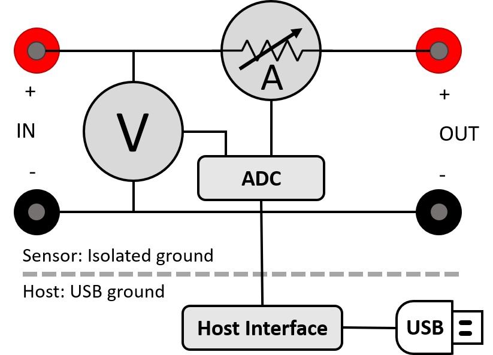

(js110-theory-of-operation)=

# Theory of operation

Joulescope simultaneously measures current and voltage, and then computes
power and energy. Joulescope combines a voltmeter and a fast auto-range
current shunt ammeter.



## Ammeter

The shunt ammeter consists of seven (7) current ranges with six (6) different
shunt resistor values ranging from 0.01 Ω to 1111 Ω. Joulescope actively
selects the best shunt resistor to keep the maximum voltage across the shunt
resistor to 20 mV. This low voltage drop minimizes the impact on the device
under test. Other equipment, including standard multimeters, have a much
larger burden voltage that can cause the target device to behave unusually.

The Joulescope amplifies the voltage across the shunt resistor and then uses
an analog-to-digital converter (ADC) to digitize the value. The ADC digitizes
the value 2 million times per second to create 2 million samples per second
(SPS). The Joulescope instrument sends these ADC values to the host software
over USB. Given a known resistor value and the measured voltage, the
Joulescope uses Ohm’s Law to compute current. Each Joulescope contains a
calibration. The software applies the calibration to convert the ADCs into
measured current values. Joulescopes are individually calibrated and tested in
the factory to ensure that every Joulescope performs to specification.

As the current changes, the ammeter selects the optimal shunt resistor value.
Joulescope uses dedicated hardware to quickly select the appropriate shunt
resistor to avoid impacting the device under test. The shunt value selection
uses the ADC output, dedicated over-range analog hardware, and a unique
algorithm that runs in an FPGA. The FPGA selects the active shunt resistors
using MOSFETs, which were carefully qualified to meet Joulescope’s demanding
performance characteristics.

The shunt resistor selection does take some time. How fast does the shunt
resistor need to change to have a minimal impact? The linearized equation is:

t = C \* ΔV / ΔI

Let’s take a typical example. The target device takes 3.3V and can tolerate a
temporary 3% (0.03) voltage glitch on a 1 amp change. If the target device has
10 µF of capacitance, the required shunt resistor switching time is
approximately:

10 µF \* 3.3 V \* 0.03 / 1 A = 1 µs

Joulescope was designed to achieve 1 µs switching speed to meet this demanding
case. Most target systems have larger capacitance and less dramatic step
current changes. In all cases, the shunt resistor selection is always
make-before-break to ensure uninterrupted connectivity to the target device.

## Voltmeter

The voltmeter measures the voltage between IN+ and IN-. The voltmeter scales
the input voltage, and uses an analog-to-digital converter (ADC) to digitize
the value. The Joulescope instrument sends the voltage samples, along with the
current samples, to the host computer. The software applies the calibration to
convert from ADC values to actual voltage.

The voltmeter has two different ranges, and you can manually select the best
range for your application. The 5V range provides higher resolution for
smaller voltages, while the 15V range allows for larger voltage measurements.

## Host Computer

The Joulescope instrument requires a host computer to operate. The Joulescope
instrument sends 2 million current and voltage samples per second immediately
to the host computer over USB. Unlike traditional oscilloscopes, a Joulescope
is always capturing data. The terms “trigger” and “sample buffer” do not fully
apply to the Joulescope device, since all sample data arrives at the host
computer. The Joulescope User Interface (UI) temporarily stores capture data
in a circular buffer. The UI allows you to adjust the buffer size to use your
host computer’s RAM. Joulescope can also record to a file, and the capture
size is only limited by your computer’s available storage on your hard disk
drive or solid-state drive.

The Joulescope host software is open-source. The pyjoulescope “driver”
communicates with the appropriate operating system USB driver. Joulescopes use
Microsoft’s WinUSB on Windows, which is included by default with the Windows
operating system. On Linux and macOS, Joulescope uses the popular, open-source
libusb driver. The pyjoulescope driver provides an easy-to-use scripting
environment. You can also use the driver to build integrated applications,
such as the Joulescope UI, that use the Joulescope instrument data.

## Power, Energy, Charge, and Statistics

Joulescopes only measure current and voltage. The Joulescope software uses
math to compute the power, energy, and charge. Power is the current multiplied
by the voltage:

**P = V \* I = V² / R = I² \* R**

Energy is the integral of power over time.

```{math}
E\ \  = \int_{}^{}{P\ dt}
```

When we talk about energy, we often mean the energy consumed over a specific
time interval, which is the definite integral:

```{math}
E\ \  = \ \int_{t = 0}^{T}{P\ dt}\ \ \  \approx \ \ \ \ \sum_{n = 0}^{N}{P_{n}\ \Delta t}
```

The Joulescope host software performs the discrete-time Euler integration
shown to the right. The Joulescope software carefully manages the numerical
precision to ensure that it computes energy correctly. IEEE double-precision
floating-point numbers do not provide sufficient precision.

Charge is the integral of current over time.

```{math}
C\ \  = \ \int_{t = 0}^{T}{I\ dt}\ \ \  \approx \ \ \ \ \sum_{n = 0}^{N}{I_{n}\ \Delta t}
```

Charge and energy are mathematically similar. Both voltage and current
contribute to energy, but only current contributes to charge.

## High impedance / low leakage

Joulescope measures currents at nanoamp resolutions and accuracies. Many
contemporary devices have input impedances of 1 MΩ to 10 MΩ, which is not good
enough. At 3.3V, a 10 MΩ load draws:

3.3V / 10 MΩ = 330 nA

Joulescope features a combined input impedance and leakage current of
approximately 1 GΩ. This high input impedance allows Joulescope to make
accurate and precise low current measurements.

## Electrical isolation

The sensor side of Joulescope is electrically isolated from the host computer.
This isolation allows you to insert Joulescope into your test system without
worrying about ground issues, including ground loops and ground noise.
