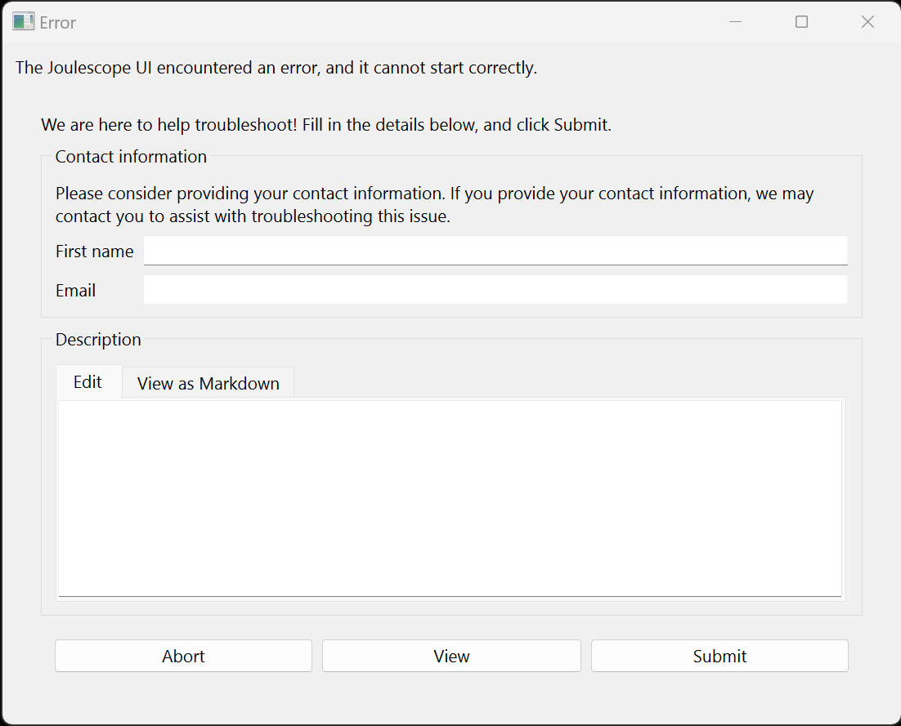
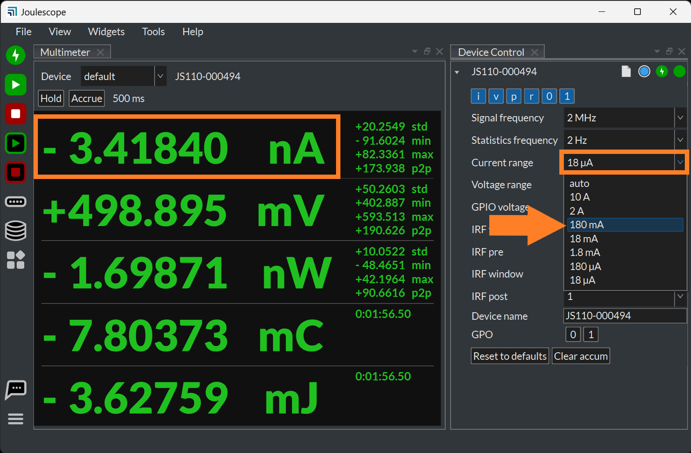

(js110-troubleshooting)=

# Troubleshooting

This section contains common troubleshooting tips.

## The Joulescope UI is not working as expected

If you are using Joulescope UI 1.0 or newer and the UI is still running,
select **Help** → **Report Issue**. Fill in your name and email so that we can
reply to you, then enter a description. Click **Submit**.

In many cases, you can resolve the issue by clearing the Joulescope UI
configuration to revert to default settings. Select **File** → **Clear config
and exit**, and then restart the Joulescope UI.

If the Joulescope UI 1.0 or newer does not start correctly, you should see an
error window:

Fill in your name and email so that we can reply to you, then enter a
description. Click **Submit**.

Select either **Revert to previous configuration** or **Revert to defaults**
for the recovery option on the next page.

## JS110 is not recognized by the host computer

Ensure that the instrument is connected by USB to the host computer. Ensure
that the USB connection is directly to a USB port on the host computer. Avoid
any USB hubs, docks, or adapters. For desktop PCs, use a motherboard port on
the back as some front USB ports use a USB hub internally.

For Linux machines, ensure that you have appropriate permissions. You will
usually need to add the [udev
rules](https://raw.githubusercontent.com/jetperch/pyjoulescope/master/99-joulescope.rules).

## Offset error

The JS110 is designed to never need recalibration, but it can become damaged.
The most common indicator of damage is an offset error in one or more current
ranges.

To diagnose this issue, disconnect all cables from the sensor-side IN and OUT.
Using the Joulescope UI, manually select each current range and note the
offset. Using the Joulescope UI 1.0, select **View** → **Multimeter**, then
select **Widgets** → **Device Control**. Rearrange the widgets. Manually
select each Current range in turn, and note the measured current offset at the
top left of the **Multimeter** widget.

The current ranges should be within the offset accuracy specifications shown
in the current measurement specifications in {numref}`js110-specifications`.
If you find that a current range or two is out of specification, the most
likely cause is damage to one of the shunt resistor selection MOSFETs. Known
ways to damage these
MOSFETs include overvoltage, excessive electrostatic discharge, overcurrent,
and reverse current while the JS110 is unpowered.

You can attempt repair of the MOSFET corresponding to the damaged range:

| **Current Range** | **Reference Designator** | **Part Number**  |
|-------------------|--------------------------|------------------|
| 18 µA             | Q1                       | ZXMP10A13FTA     |
| 180 µA            | Q2                       | ZXMP10A13FTA     |
| 1.8 mA            | Q3                       | IRLML2244TRPbF   |
| 18 mA             | Q4                       | IRLML2244TRPbF   |
| 180 mA            | Q5                       | SI7615ADN-T1-GE3 |
| 2 A               | Q6                       | SI7615ADN-T1-GE3 |
| 10 A              | Q6                       | SI7615ADN-T1-GE3 |

After repair, ensure that you remove all solder flux, thoroughly dry the
printed circuit board, and allow the printed circuit board to return to room
temperature.

(js110-unable-to-measure-the-full-voltage-range)=

## Unable to measure the full voltage range

You apply a known voltage across IN+ and IN-, but the JS110 measures a smaller
voltage. First ensure that you have the Voltage range set to **15 V**. If you
are using the Joulescope UI 1.0, you can find this setting in the **Device
Control** widget.

If the JS110 is set to the 15 V current range, then the JS110’s Ćuk converter
may not be generating a sufficient voltage. The most likely cause is that one
of the capacitors failed. Open the JS110 and measure the voltage across C116
or C120, which are the two capacitors in the Ćuk converter that seem to fail
more than they should. You should see -16V.

When the JS110 is powered off, you can use a multimeter to measure their
resistance across these capacitors. You should measure 10 kΩ or more in
circuit. Note that you may need to wait for the multimeter to charge up the
capacitors to make this measurement.

If the voltage is not close to -16 V, or the resistance measured too low, then
you can attempt repair by replacing them. They are 4.7 µF 1206 (imperial) 50V
20% X5R. One suitable part is UMK316BJ475KL-T.

## Unable to open in Joulescope UI

In Windows, the device appears in Device Manager. However, when opening the
Joulescope UI, the device does not connect. In the Device Control widget, the
“Open and close device” circle is not available and grayed out.

The most likely cause is a fault on the sensor-side of the JS110. When the UI
attempts to open the device, it powers on the sensor-side. If the sensor-side
consumes too much power due to a hardware failure, then the host software will
time out while trying to initialize the JS110’s sensor-side.

The normal failure is that U33 becomes hot. U33 is a TI TPS2552 current
limiter which drops the voltage and dissipates power on overcurrent
conditions.

The most common failure that causes overcurrent are the Ćuk converter
capacitors C116 and C120. See
{numref}`js110-unable-to-measure-the-full-voltage-range` for troubleshooting
and repair.

## Inaccurate measurements in the presence of strong RF

The JS110 is susceptible to strong RF. The JS110 is a shunt ammeter that
maintains a maximum of 20 mV across the shunt resistor. Nearby transmitters
can easily induce much larger voltages. For example, 30 dBm = 1 W = 20 V
peak-to-peak in a 50 Ohm transmission line. Even 20 dBm = 0.1 W = 6.324 V
peak-to-peak. While the JS110 does have some input filtering, the filtering is
very limited and the front-end opamp has no internal EMI attenuation.

The JS110 is also an unbalanced instrument, meaning that its measurement range
is biased towards positive measurements. For the same current range, the
positive measurement limit is about five times the negative limit. High
frequency signals will saturate the JS110’s range, which clips at the
measurement extremes rectifying the RF signal. When this situation occurs, the
JS110 will always measure higher current than actual.

The JS110 is often used with target devices that are RF transmitters. To
minimize RF pickup, we recommend the following:

- Twist together the wires going to IN+ and OUT+ to minimize the loop area.
  This minimizes coupling from the antenna to the JS110 current sense wires.

- Keep the JS110 at least 1 wavelength away from the antenna to minimize
  near-field coupling directly to the JS110 enclosure.

- Keep the host-side USB connection away from the antenna, too.

- For more accurate current measurement, connect IN+ and OUT+ as a twisted
  pair directly from your target device. Consider placing a ferrite bead at
  each end of the twisted wire.

- Consider upgrading to the Joulescope JS220 which is a balanced instrument
  (equal + and - limits) and has further filtering improvements to minimize RF
  interference.
