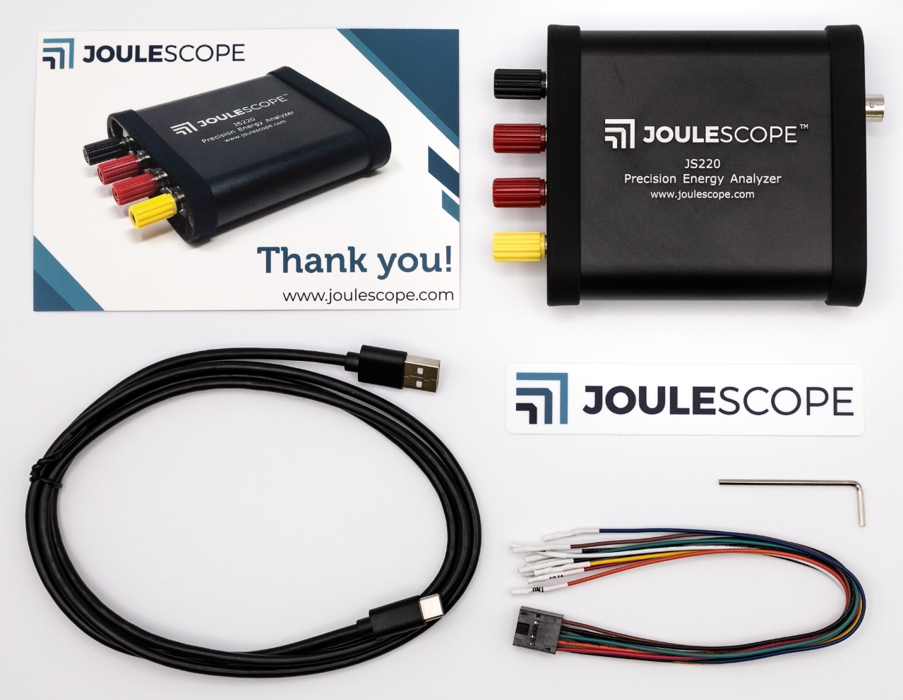

The JS220 arrives in a carry case:

Unzip the carry case to find the JS220 instrument and accessories:

Your Joulescope JS220 purchase includes:

- Joulescope JS220 instrument with factory calibration

- Binding Post Front Panel, already installed

- 5’ USB 2.0 A to C cable

- GPIO cable assembly

- 2 mm Allen wrench, for optionally swapping the front panel

- Quick Start Guide

- Joulescope sticker

- Carry case

You will need to provide:

- A host computer running one of the {ref}`supported platforms
  <supported-platforms>`. Most computers manufactured within the last five
  years should work. The computer requires an available USB 2.0 port, at least
  500 MB of hard drive / solid state drive storage space, and 1 GB of
  available RAM.

- Suitable cable(s) to connect the Joulescope JS220’s binding posts to your
  system, often the power source and device under test.

- For computers without USB A ports, a suitable USB cable or USB adapter.

- Optional BNC cable for connecting trigger to other equipment.

You need an internet connection to download the free software.
