(js220-how-to-connect-your-joulescope)=

# How to Connect Your Joulescope

The Joulescope JS220 has flexible connections that allow for a wide variety of
measurements. This section describes some common test scenarios.

1.  {ref}`Measure only current (ammeter) <js220-measure-only-current-ammeter>`

2.  {ref}`Measure only voltage (voltmeter) <js220-measure-only-voltage-voltmeter>`

3.  {ref}`Measure power supply provided <js220-measure-power-supply-provided>`

4.  {ref}`Measure target device consumption <js220-measure-target-device-consumption>`

5.  {ref}`Measure subsystem consumption <js220-measure-subsystem-consumption>`

The Joulescope JS220 sensor provides four connections: **Voltage +**,
**Voltage -**, **Current +** and **Current -**. Many test setups also include
a power source that provides power and a target device under test that
consumes power. We will use the following conventions for this section:

| Label   | Description                                   |
|---------|-----------------------------------------------|
| **V+**  | JS220 voltage + connection                    |
| **V-**  | JS220 voltage – connection                    |
| **I+**  | JS220 current + connection                    |
| **I-**  | JS220 current – connection                    |
| **PS+** | Power source voltage + connection             |
| **PS-** | Power source voltage – connection             |
| **T+**  | Target device under test voltage + connection |
| **T-**  | Target device under test voltage – connection |

The previous-generation Joulescope JS110 had connections **IN+**, **IN-**,
**OUT+**, and **OUT-**. The following table maps JS110 connections to JS220
connections:

|  JS110   |       JS220       |
|:--------:|:-----------------:|
| **IN+**  | **V+** and **I+** |
| **IN-**  |      **V-**       |
| **OUT+** |      **I-**       |
| **OUT-** |      **V-**       |

Note that the JS220 provides more flexibility by separating **V+** and **I+**.

(js220-measure-only-current-ammeter)=

## Measure only current (ammeter)

The Joulescope JS220 features independent current and voltage channels. You
can use your Joulescope JS220 to measure the current through any wire. The
JS220 will also compute total charge, the integral of current.

The following figure shows a simple current source with a wire. The current
source polarity and arrow are for convention only, and current can flow in
both directions.

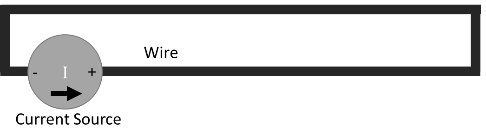

Simply insert the JS220 inline:

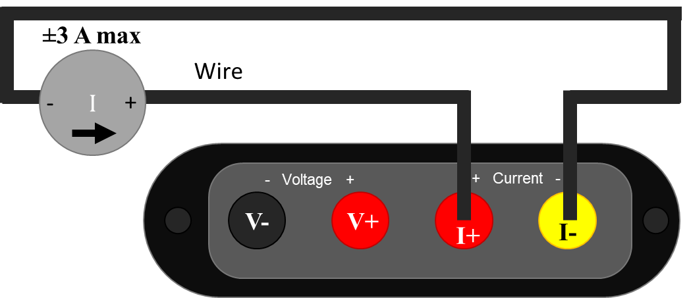

Since your JS220 can measure current flowing in either positive or negative
direction, the current flow direction indicator is for convention only. If
connected in the opposite direction, the measurement polarity (sign) is
reversed. When connecting your JS220 like this, ensure that the current source
does not exceed the Joulescope JS220 limit of ±3 A.

During normal operation, the JS220 is designed to keep the voltage at **I+**
almost equal to the voltage **I-**. The JS220 uses a resistor to sense the
current flowing between **I+** and **I-**, but it limits the shunt resistor
voltage to 20 mV maximum, at least for all current under 2 A.

When not connected, you will observe random voltage measurement values that
may change over time. The JS220 has extremely high input impedance on **V+**
and **V-**. Most test instruments add a known resistance, often 1 MΩ or 10 MΩ,
that pulls **V+** to **V-**. The JS220 focuses on low-power measurement, and
such a resistor would consume meaningful current. The drawback is that
unconnected voltage measurements are affected by nearby electromagnetic fields
and the input bias currents of the JS220’s input stage opamps. To eliminate
fluctuating voltage readings while using the JS220 as an ammeter, connect
**I+** to both **V+** and **V-**.

(js220-measure-only-voltage-voltmeter)=

## Measure only voltage (voltmeter)

The Joulescope JS220 features independent current and voltage channels. You
can use your Joulescope JS220 as a one channel, high-impedance, isolated
oscilloscope.

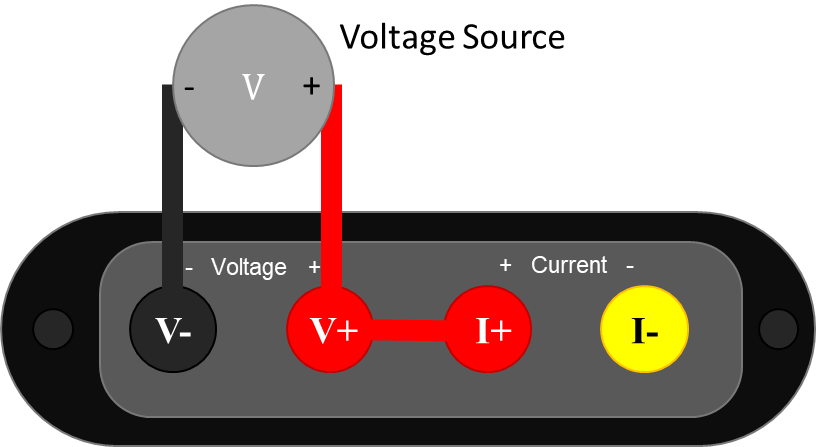

Note the extra connection between **V+** and **I+**. With the standard binding
post front panel, you can insert a short length of wire to make this
connection. The **V-** and **V+** signals must remain within ±15 V of **I+**
to measure correctly. The easiest way to ensure this condition is to connect
**I+** and **V+** as shown. Also ensure that the JS220 **Current Range** is
set to anything other than **off**. Unlike most test equipment, the voltage
inputs are completely floating and isolated, so you need to make this
connection.

(js220-measure-power-supply-provided)=

## Measure power supply provided

The JS220 can measure the current, voltage, power, charge, and energy provided
to a target device under test by a power source. A typical system consists of
a power source and a target device under test.

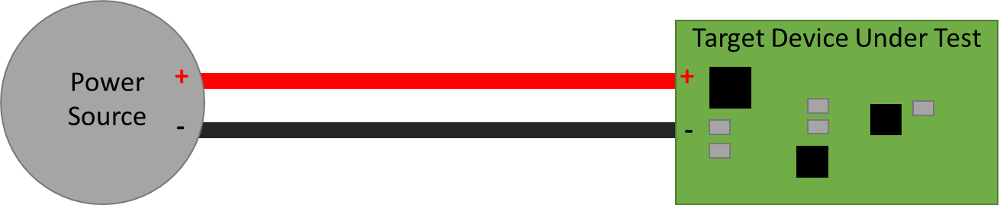

The power source can be anything that provides electricity including a
battery, battery pack, rechargeable battery, bench power supply, mains wall
adapter, USB, and power regulators.

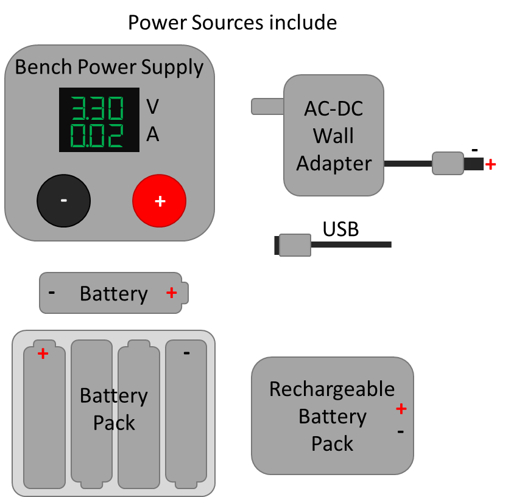

The target device under test can include product prototypes, custom hardware
under development, development boards, systems, and subsystems.

The easiest way to connect your JS220 is as an ammeter measuring current in
the + wire and as a voltmeter across the power source **PS+** and **PS-**,
like this:

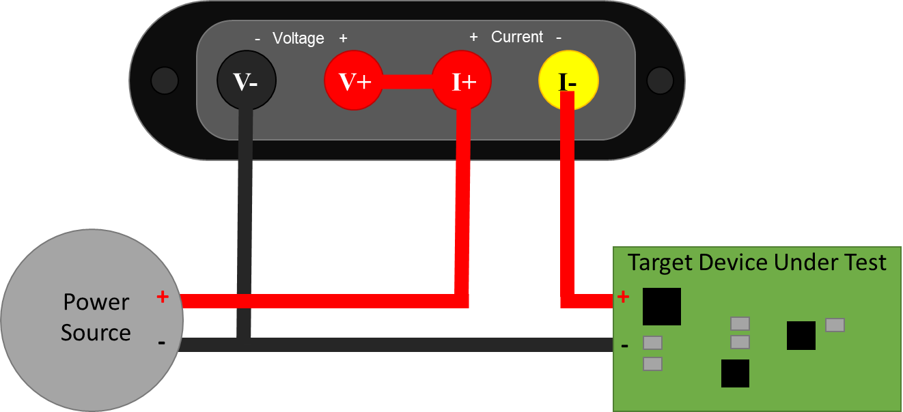

Note that the **V-** wire is connected to **PS-** and **T-**. It does not
connect to **PS+**. This setup configures the Joulescope JS220 in high-side
current sense configuration.

If you are familiar with the previous-generation Joulescope JS110, this
configuration is the exact same as connecting **IN+** to **PS+**, **IN-** to
**PS-**, **OUT+** to **T+**, and **OUT-** to **T-**. The FP02-BNA front panel
provides the JS220 with the exact same connections as the JS110.

The JS220 can alternatively be used to measure current on the low-side wire
connected to **PS-**.

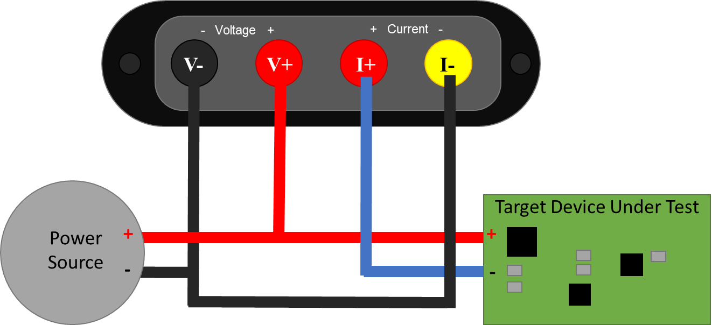

(js220-measure-target-device-consumption)=

## Measure target device consumption

The JS220 can measure the current, voltage, power, charge, and energy consumed
by a target device. The JS220 and wires all have resistance (impedance). When
current flows, this resistance causes a voltage drop according to Ohm’s Law: V
= I \* R. While this energy is provided by the power source, it is consumed by
the connections between the power source and the target device under test.
This loss should not be included in the measurement for target consumption.
The JS220 is specifically designed to enable more accurate, 4-wire
Kelvin-connection measurements:

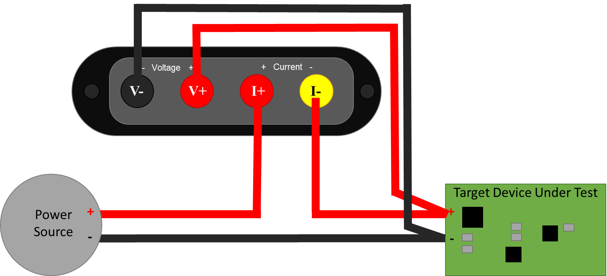

To minimize noise pickup, you want to minimize the loop area. The easiest way
to do this is twist the insulated + and – wires together from **PS+** and
**PS-** all the way to **T+** and **T-**, like this

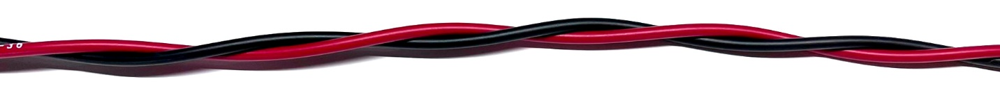

Just before connecting to the **T+**, connect the JS220, connecting the
additional wires to the JS220 **I+** and **I-** together. Finally, twist the
insulated **V+** and **V-** wires together.

Shorter wires result in both lower resistive voltage losses and lower noise
pickup. However, for applications where the target device contains an RF
transmitter, you do not want the cables too short. You want to ensure that the
JS220 does not become part of the antenna. A good rule of thumb is that you
should locate all test equipment one wavelength away from the RF transmitter.
One wavelength is approximately 33 cm at 915 MHz and 12 cm at 2.4 GHz.

(js220-measure-subsystem-consumption)=

## Measure subsystem consumption

The JS220 can measure the current, voltage, power, charge, and energy consumed
by subsystem on the target device under test. Many devices and prototype
boards have jumpers to simplify current measurement in system. However, some
hardware devices require the user to remove a resistor or cut a printed
circuit board trace to measure the subsystem current consumption. In either
case, you want to connect the JS220 as an ammeter inline with the power source
to the subsystem to measure current. The JS220 will also compute charge, the
integral of current.

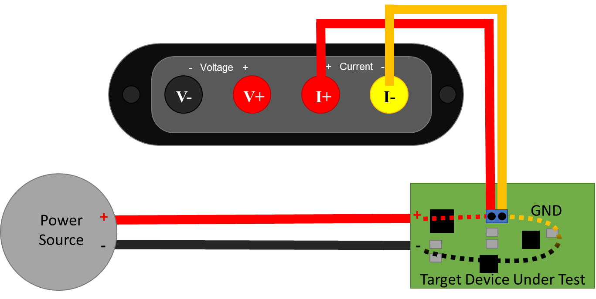

For voltage, power, and energy, also connect the JS220 voltmeter:

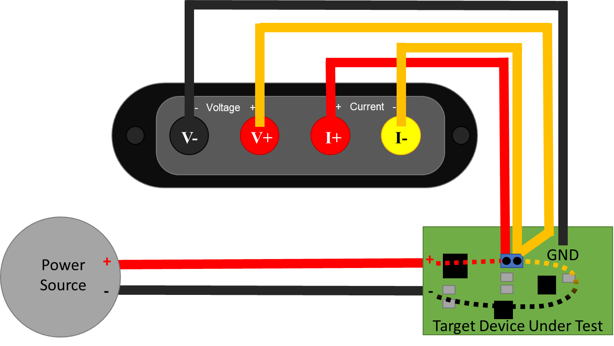

This connection recommendation shows a Kelvin-style 4-wire connection, which
helps improve accuracy and minimize noise pickup. Connect the JS220 using two
wire pairs, one to measure current and one to measure voltage. Twist the
insulated **V+** and **V-** wires together and the **I+** and **I-** wires
together to further reduce noise pickup. For less accuracy and perhaps a
quicker setup time, connect **V+** to **I+** and **V-** to **PS-**.

(js220-measure-higher-voltages)=

## Measure higher voltages

If your system can tolerate additional leakage current on the supply side,
then you can use a simple resistive divider to measure higher voltages.

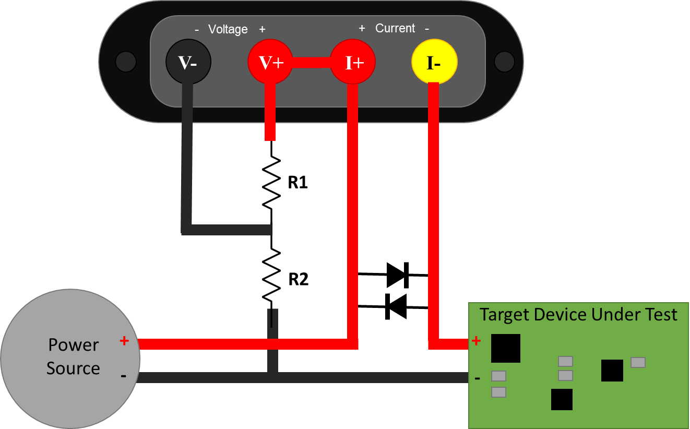

:::{warning}
The voltage from I+ to I- must never exceed ±20 V. While the Joulescope is
operating, this voltage is very small. However, when the JS220 is unpowered, a
fuse engages, or you use the disconnect target power feature, then the voltage
across I+ to I- will be the full power supply voltage. We recommend adding the
diodes as shown to prevent damaging your Joulescope in these conditions.
Ensure that the diodes are rated for the full current consumed by the target
device under test.
:::

The actual voltage as a function of the measured voltage is:

```{math}
V_{ACTUAL} = \frac{R_{1} + R_{2}}{R_{1}}\ V_{MEASURED}
```

You need to select values for R₁ and R₂ that keep V{sub}`MEASURED` within ±14.5 V,
keep leakage current low enough, and preserve measurement bandwidth. The RC
filter combination limits the measurement bandwidth:

```{math}
f = \frac{1}{2\pi R_{2}C}
```

Leakage current is:

```{math}
i = \frac{V_{ACTUAL}}{R_{1} + R_{2}}
```

Typical V- input capacitance is on the order of 10 pF, so R₁ = R₂ = 1 MΩ gives
approximately 16 kHz of measurement bandwidth and ±29 V of range. At 29 V, the
leakage current is 14.5 µA. This additional leakage current comes from the
power source, but it is not measured by the JS220.

In the Joulescope UI, you can set the **Voltage scale** in the **Device
control** widget to adjust the displayed values to account for the voltage
divider.

Ensure that V-, V+, I+, and I- are always within ±48 V of USB ground.

You can consider an active buffer solution if your system cannot tolerate the
leakage current to give the desired measurement bandwidth.
