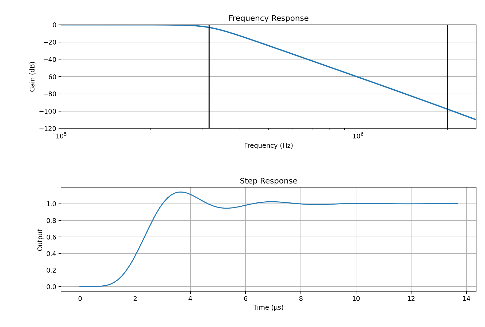
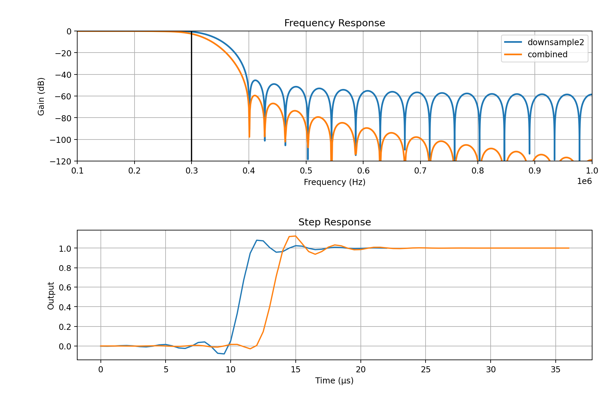
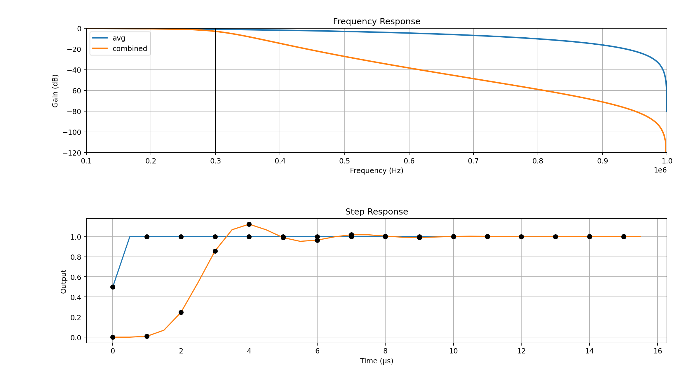
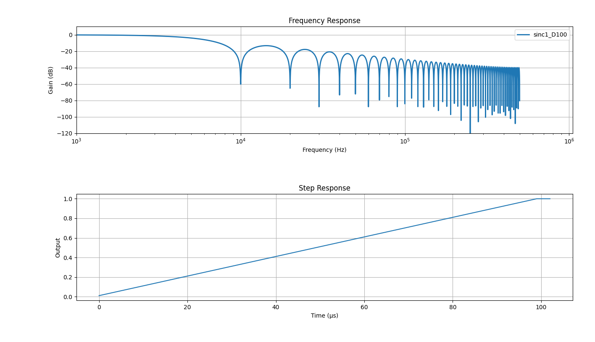

(js220-filters-and-frequency-response)=

# Filters and Frequency Response

The Joulescope JS220 measures current and voltage each at 2,000,000 times per
second.

## Analog Filter

The JS220 includes a 6^(th) order analog Butterworth low-pass filter with a
nominal 315 kHz bandwidth. The gain at the bandwidth is - 3 dB gain. The
analog front end includes several additional RC poles at much higher
frequencies. The combined response is shown in the figure below.

This filter prevents aliasing to 15-bit accuracy at 2 MHz.

## Downsample by 2

The JS220 requires the 2 Msps rate to accurately measure at its rated
bandwidth. However, 2 Msps produces enough data to saturate a high-speed USB
data link. After initially processing the incoming samples, the JS220 performs
a digital downsample by two to convert to 1 Msps without affecting the
measurement bandwidth.

By default, the JS220 uses a flat-in-frequency wideband FIR filter:

The default filter provides an excellent frequency response. The tradeoff is
that the time domain will contain oscillations near fast transitions which may
not be desirable for all measurements.

Starting with FPGA version 1.3.0, the JS220 includes a simple averaging filter
that averages two samples together. This filter is equivalent to a length 2
moving average, also called a boxcar filter or sinc1 filter.

(js220-downsampling)=

## Downsampling

You may configure the JS220 for downsampling, which reduces the sample rate
for measurements that do not need the full 300 kHz bandwidth. For example, 1
kHz is often suitable for long-term captures that only need to observe target
activity. Downsampling reduces storage requirements and may reduce the USB
communication demands.

Starting with FPGA 1.3.0, the JS220 supports on-instrument downsampling. This
feature allows you to reduce the USB data rate to support more simultaneous
Joulescopes on a single USB root hub. The downsampling filter is a sinc1
filter, also called a boxcar or simple average filter. This filter
implementation is straightforward. An output is computed once every N input
samples, and each output is the average of the previous N input samples. The
output rate is 1/N of the input rate. The minimum output rate supported by the
on-instrument downsampling is 1 kHz.

The sinc1 filter is maximally smooth in time. It guarantees no overshoot, even
on square waves. For applications where you are attempting to size the power
supply current capacity, this filter is ideal.

While the sinc1 filter is guaranteed to preserve DC accuracy, the sinc1
filter’s frequency response rolls off gently. You can easily encounter
aliasing where higher frequency components are represented as lower frequency
components. The following plot shows an example decimation by 100 for the 10
kHz output rate:

While sinc1 filters provide an intuitive time response, their frequency
response cutoff is gentle. As a result, higher frequency content aliases into
the resulting signal. However, sinc1 filters have zeros at all multiples of
the sampling frequency, which perfectly preserves the DC value.

The system continues to offer wideband FIR filtering, which is implemented on
the host, for a more accurate wideband frequency response. However, the sharp
cutoff in frequency results in ringing in the time domain. This behavior is
known as the Gibbs phenomenon.
