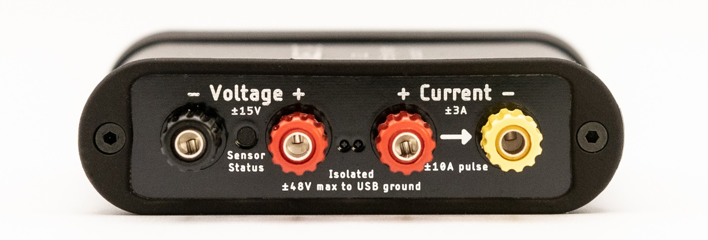
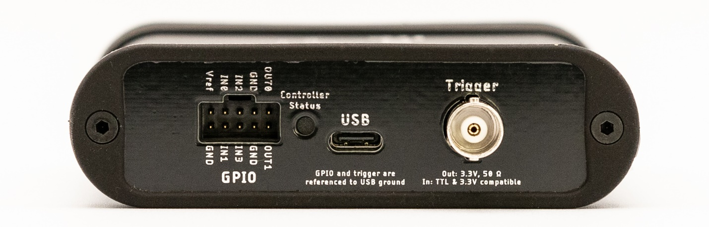

(js220-meet-your-joulescope-js220)=

# Meet Your Joulescope JS220

```{include} _in_the_box.md
```

The front side of the JS220 has the connectors that connect to your system:



Your JS220 measures the voltage across the Voltage + and Voltage – binding
posts. Your JS220 measures the current flowing through the Current + to the
Current – binding posts. If you have a power source and target device, connect
the positive side through the current binding posts. You can then connect the
voltage signals across either your power source or your target device. For
more connection examples, see {numref}`js220-how-to-connect-your-joulescope`.

The Sensor Status indicator is off when your JS220 is powered off or inactive.
Flashing red indicates that the instrument is ready but the current flow is
not yet enabled. Solid green indicates that current measurement is enabled.

The backside of Joulescope has the host USB connector, status LED, GPIO
connector, and trigger connector:



Use the provided USB C to USB A cable to connect the USB host computer
connector to your host computer. If your computer only has USB C ports, use an
adapter (not provided) or a USB C to USB C cable (not provided).

The Controller Status indicator is off when the JS220 is not connected to the
host computer, or the host computer has not yet activated the JS220 over USB.
Microsoft Windows computers activate devices immediately when connected while
macOS and Linux do not activate the device until the Joulescope software
attempts to use the device. Solid blue indicates that the JS220 is activated.
Solid green indicates that the JS220 device is running normally.

The GPIO connector provides four general-purpose inputs and two
general-purpose outputs. See {numref}`js220-gpi-gpo` for details.

The BNC Trigger connector provides either a Trigger Out or a Trigger In. This
Trigger allows the JS220 to synchronize data collection with other equipment.
