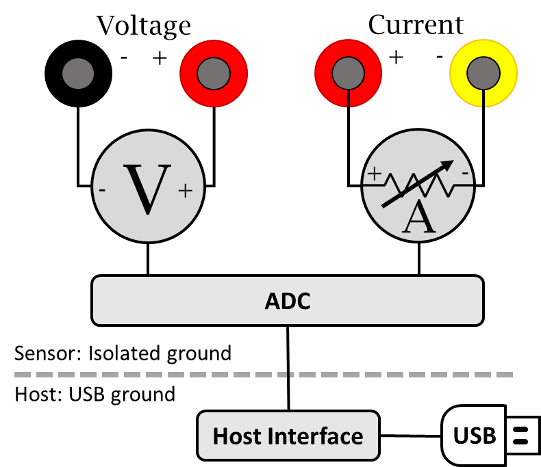
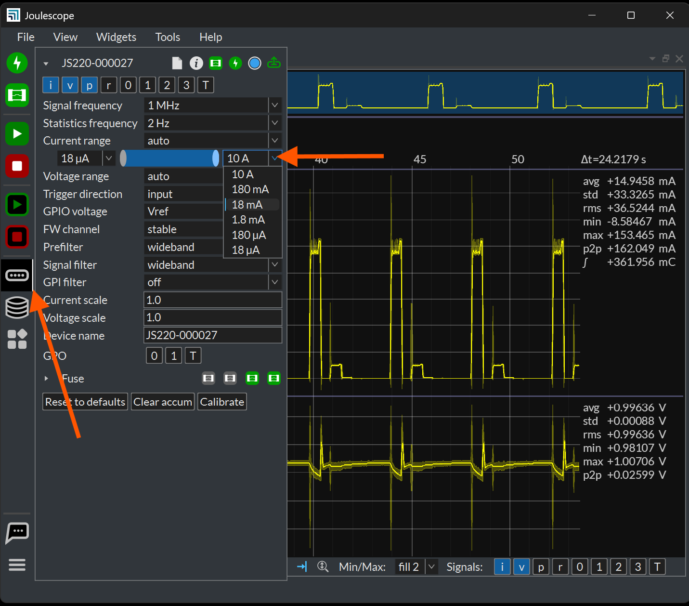

(js220-theory-of-operation)=

# Theory of operation

Joulescope simultaneously measures current and voltage, and then computes
power and energy. Joulescope combines a voltmeter and a fast auto-range
current shunt ammeter.



## Ammeter

The shunt ammeter consists of six (6) current ranges with six (6) different
shunt resistor values ranging from 0.01 Ω to 1111 Ω. Joulescope actively
selects the best shunt resistor to keep the maximum voltage across the shunt
resistor to 20 mV. This low voltage drop minimizes the impact on the device
under test. Other equipment, including standard multimeters, have a much
larger burden voltage that can cause the target device to behave unusually.

The Joulescope amplifies the voltage across the shunt resistor and then uses
an analog-to-digital converter (ADC) to digitize the value. The ADC digitizes
the value 2 million times per second to create 2 million samples per second
(SPS). The Joulescope instrument processes these ADC values on the instrument
using a sensor-side FPGA.

Given a known resistor value and the measured voltage, the Joulescope uses
Ohm’s Law to compute current. The FPGA applies calibration coefficients to
convert the measured voltage into the measured current. Joulescopes are
individually calibrated and tested in the factory to ensure that every
Joulescope performs to specification.

The instrument then downsamples by 2 from 2 Msps to 1 Msps. This downsampling
saves USB bandwidth without affecting the 300 kHz measurement bandwidth.

### Autoranging

As the current changes, the ammeter selects the optimal shunt resistor value.
Joulescope uses dedicated hardware to quickly select the appropriate shunt
resistor to avoid impacting the device under test. The shunt value selection
uses the ADC output, dedicated over-range analog hardware, and a unique
algorithm that runs in an FPGA. The FPGA selects the active shunt resistors
using MOSFETs, which were carefully qualified to meet Joulescope’s demanding
performance characteristics.

The shunt resistor selection does take some time. How fast does the shunt
resistor need to change to have a minimal impact? The linearized equation is:

t = C \* ΔV / ΔI

Let’s take a typical example. The target device takes 3.3V and can tolerate a
temporary 3% (0.03) voltage glitch on a 1 amp change. If the target device has
10 µF of capacitance, the required shunt resistor switching time is
approximately:

10 µF \* 3.3 V \* 0.03 / 1 A = 1 µs

Joulescope was designed to achieve 1 µs switching speed to meet this demanding
case. Most target systems have larger capacitance and less dramatic step
current changes. In all cases, the shunt resistor selection is always
make-before-break to ensure uninterrupted connectivity to the target device.

### Optimizing for Accuracy

For many applications, the JS220 performs sufficiently without any additional
configuration. However, additional configuration can improve accuracy for
measuring lower-current systems, such as Bluetooth devices. Any system that
never consumes more than 180 mA can benefit from additional configuration.

When the JS220 switches current ranges, the JS220 activates a MOSFET to select
the new shunt resistor and deactivates the MOSFET for the previous shunt
resistor. All MOSFETs are effectively capacitors between their gate and the
source/drain. Activating and deactivating a MOSFET results in charge
injection. While we have carefully selected these MOSFETs to minimize charge
injection, it is not zero. You may observe a brief spike on the order of 300
ns. The JS220 may also measure this spike, but it will be spread in time due
to the JS220’s 300 kHz measurement bandwidth.

The second effect is that the impedance from **Current +** to **Current -**
changes very quickly. Many targets have large bypass capacitors. Since
capacitors resist instantaneous voltage changes, the result is that a real
current may flow over the shunt resistor to charge or discharge the capacitor
to account for the new JS220 impedance. This current is real, and it cancels
out over time. However, it’s often not what we want to measure, so it can be
distracting for some systems.

When the JS220 autoranges on over-current, it always autoranges up to the
maximum configured range, which is 10 A by default. It will then downrange as
needed to the optimal range. While this behavior guarantees the 1 µs
transition time for all support loads, it may result in increased error due to
the 10 A current range error rating. You can limit this maximum range for
lower current targets to improve performance:



When setting the current limit, ensure that the waveform never exceeds the
current range value when viewed at the full 1 MHz sample rate. Otherwise, the
JS220’s measurement will saturate, causing significantly increased
inaccuracies. The JS220 does contain a soft-fuse feature for each current
range to help prevent damage to the instrument if you select too low of a
maximum current range.

You can also increase the minimum current range that may be affected by the
higher input impedance. The most common reason to use this feature is when
connected to a DC-DC switching converter with inadequate upstream bulk
capacitance.

## Voltmeter

The voltmeter measures the voltage between **Voltage +** and **Voltage -**.
The voltmeter scales the input voltage, and uses an analog-to-digital
converter (ADC) to digitize the value. The Joulescope instrument sends the
voltage samples, along with the current samples, to the host computer. The
software applies the calibration to convert from ADC values to actual voltage.

The voltmeter has two different ranges, and you can manually select the best
range for your application. The 2V range provides higher resolution for
smaller voltages, while the 15V range allows for larger voltage measurements.

The voltmeter intentionally omits the pull resistors to ground, typically 1 MΩ
to 10 MΩ for most multimeters and oscilloscopes. However, **Voltage +** and
**Voltage -** will float when unconnected. The voltmeter measurement is only
valid once **Voltage +** and **Voltage -** are both connected to within ±15V
of the **Current +** terminal. See {numref}`js220-high-impedance-low-leakage`
for more detail.

## Host Computer

The Joulescope instrument requires a host computer to operate. The Joulescope
instrument sends 2 million current and voltage samples per second immediately
to the host computer over USB. Unlike traditional oscilloscopes, a Joulescope
is always capturing data. The terms “trigger” and “sample buffer” do not fully
apply to the Joulescope device, since all sample data arrives at the host
computer. The Joulescope User Interface (UI) temporarily stores capture data
in a circular buffer. The UI allows you to adjust the buffer size to use your
host computer’s RAM. Joulescope can also record to a file, and the capture
size is only limited by your computer’s available storage on your hard disk
drive or solid-state drive.

The Joulescope host software Is open-source. The pyjoulescope “driver”
communicates with the appropriate operating system USB driver. Joulescopes use
Microsoft’s WinUSB on Windows, which is included by default with the Windows
operating system. On Linux and macOS, Joulescope uses the popular, open-source
libusb driver. The pyjoulescope driver provides an easy-to-use scripting
environment. You can also use the driver to build integrated applications,
such as the Joulescope UI, that use the Joulescope instrument data.

## Power, Energy, Charge, and Statistics

Joulescopes only measure current and voltage. The Joulescope software uses
math to compute the power, energy, and charge. Power is the current multiplied
by the voltage:

**P = V \* I = V² / R = I² \* R**

Energy is the integral of power over time.

```{math}
E\ \  = \int_{}^{}{P\ dt}
```

When we talk about energy, we often mean the energy consumed over a specific
time interval, which is the definite integral:

```{math}
E\ \  = \ \int_{t = 0}^{T}{P\ dt}\ \ \  \approx \ \ \ \ \sum_{n = 0}^{N}{P_{n}\ \Delta t}
```

The Joulescope host software performs the discrete-time Euler integration
shown to the right. The Joulescope software carefully manages the numerical
precision to ensure that it computes energy correctly. IEEE double-precision
floating-point numbers do not provide sufficient precision.

Charge is the integral of current over time.

```{math}
C\ \  = \ \int_{t = 0}^{T}{I\ dt}\ \ \  \approx \ \ \ \ \sum_{n = 0}^{N}{I_{n}\ \Delta t}
```

Charge and energy are mathematically similar. Both voltage and current
contribute to energy, but only current contributes to charge.

(js220-high-impedance-low-leakage)=

## High impedance / low leakage

Joulescope measures currents at nanoamp resolutions and accuracies. Many
contemporary devices have input impedances of 1 MΩ to 10 MΩ, which is not good
enough. At 3.3V, a 10 MΩ load draws:

3.3V / 10 MΩ = 330 nA

Joulescope features a combined input impedance and leakage current of
approximately 1 GΩ. This high input impedance allows Joulescope to make
accurate and precise low current measurements.

## Electrical isolation

The sensor side of Joulescope is electrically isolated from the host computer.
This isolation allows you to insert Joulescope into your test system without
worrying about ground issues, including ground loops and ground noise. The
JS220 sensor-side isolated ground is referenced to **Current +**.
