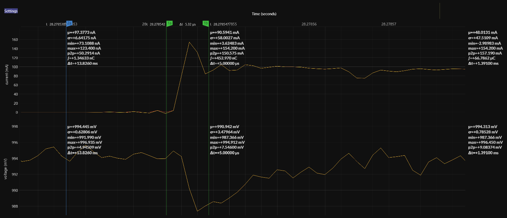

(js220-typical-behavior)=

# Typical Behavior

This section contains information regarding typical Joulescope JS220 behavior.

## Step Response

Joulescope is a shunt ammeter with incredibly fast autoranging. This section
contains typical autoranging measurements.

The test setup includes a Joulescope JS220 with the JS220 Evaluation Kit 1
(EVK). For this test, an additional 2200 µF electrolytic capacitor was placed
across **Voltage +** and **Voltage –** to assist the transient response of the
EVK’s low dropout regulator.

This test shows the current consumption going from 97 nA to 100 mA. The JS220
responds immediately to the change in current. The very slight ripple before
the edge is caused by the low-pass FIR filter on the JS220.
