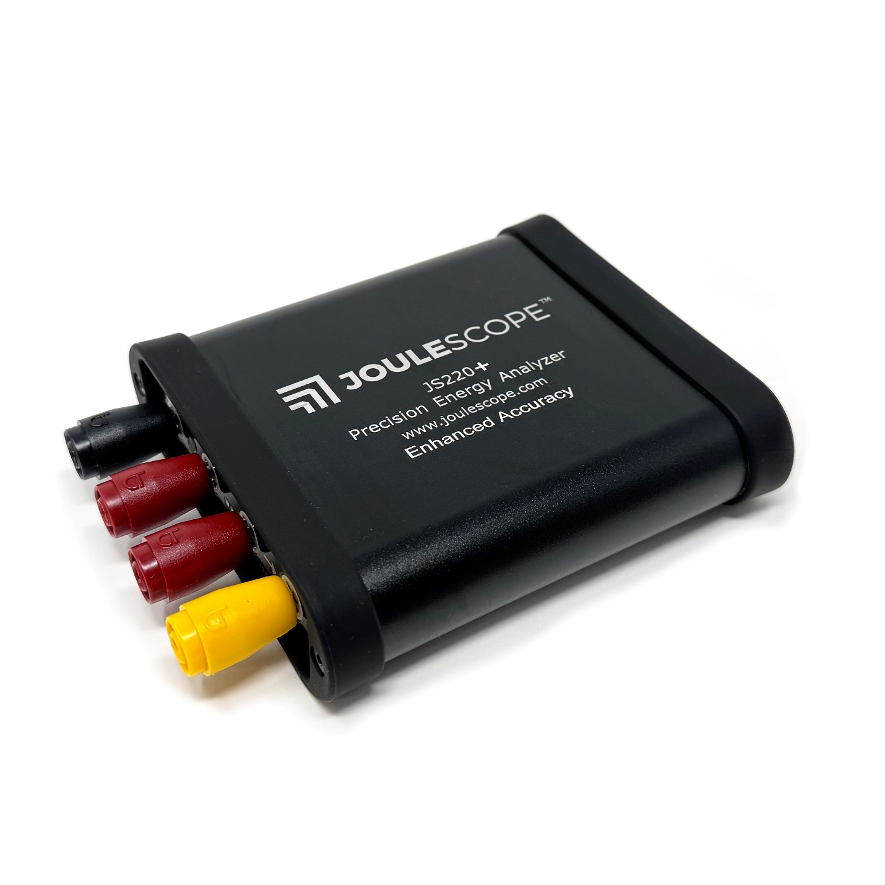

(js220plus)=

# Joulescope JS220+ User's Guide


**Precision Energy Analyzer with Enhanced Accuracy**

Revision 2.0, last revised 2026 Oct 26.



```{toctree}
:numbered:
:maxdepth: 2

introduction
specifications
trim_calibration
technology
ordering
changelog
```
