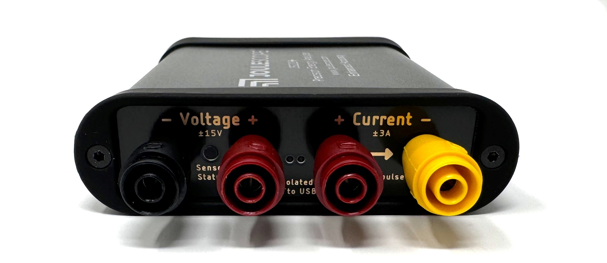
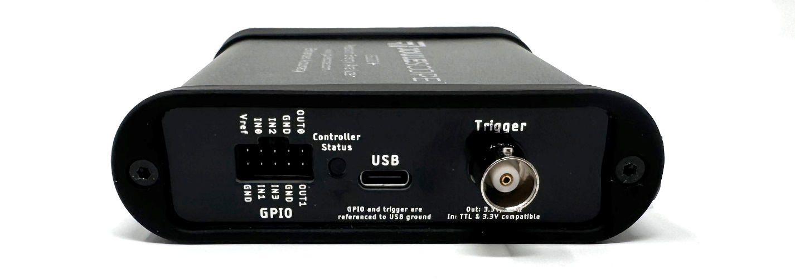

(js220plus-technology)=

# Technology

The JS220+ leverages new components and techniques to achieve nanoamp
accuracy. The improvements include:

- Improved guard traces for reduced leakage.

- Replaced the 18 µA current range selection MOSFET for one with lower
  gate-source leakage.

- Redesigned analog front-end for lower input bias current and better
  temperature stability.

- Redesigned anti-aliasing filter for improved temperature stability.

- Redesigned ADC reference and level shift for improved temperature stability.

- Redesigned voltage ESD solution, dramatically reducing leakage currents.

- Migrated to Rogers 4003C PCB material for both the main PCB and front panel
  PCB. Rogers 4003C has 1000x higher resistivity than FR4 for significantly
  reduced current leakage.

