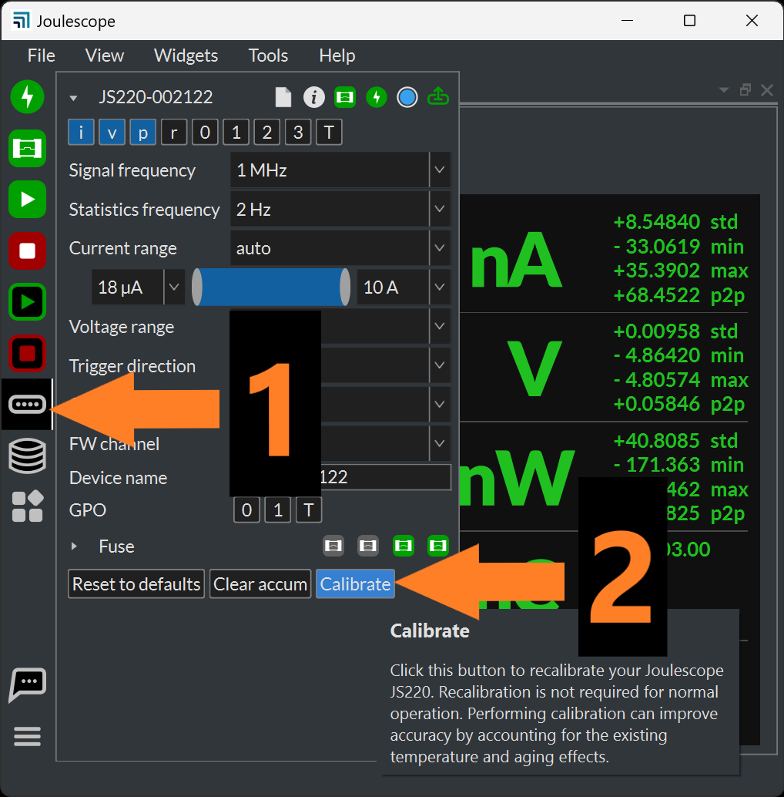

(js220plus-trim-calibration)=

# Trim Calibration

While the JS220+ offers significant offset performance improvements relative
to the JS220, it may require trim calibration to achieve the full offset
accuracy performance.

The Joulescope UI 1.0.40 and later includes offset trim calibration. Before
starting a trim calibration, please run your JS220+ for at least 5 minutes to
allow the temperature to stabilize. To start a current offset trim
calibration, select the **Device Control** widget in the sidebar, then press
**Calibrate**:

Press **Start** for **Current offset**, and follow the onscreen instructions.

The JS220+ uses an internal fixed-point representation of 5Q31 for current
samples. 2⁻³¹ represents an accuracy of ±0.5 nA. After performing trim
calibration, the instrument offset may be off by up ±0.25 nA. However, the
trim offset calibration specification accounts for this initial error.
