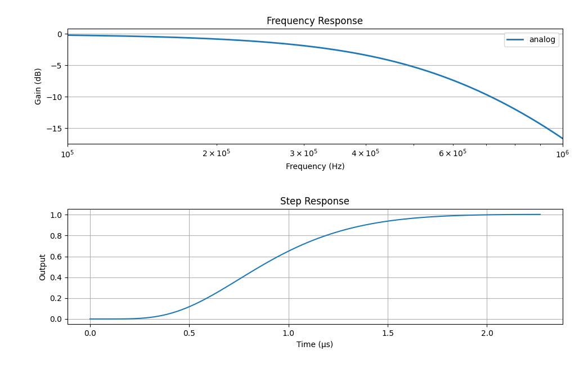

(js320-filters-and-frequency-response)=

# Filters and Frequency Response

The Joulescope JS320 measures current and voltage each at 1,000,000 times per
second.

## Analog Filter

The JS320 includes a 2^(th) order analog linear phase Bessel filter with
constant group delay for exceptional time domain clarity. The filters has a
446 kHz bandwidth. The signal chain has additional RC poles that bring the
total analog bandwidth down to 377 kHz:

## Downsampling

You may configure the JS320 for downsampling, which reduces the sample rate
for measurements that do not need the full bandwidth. For example, 1 kHz is
often suitable for long-term captures that only need to observe target
activity. Downsampling reduces storage requirements and may reduce the USB
communication demands.

The JS320 performs downsampling on the instrument. This feature allows you to
reduce the USB data rate to support more simultaneous Joulescopes on a single
USB root hub. The downsampling filter is a sinc1 filter, also called a boxcar
or simple average filter. This filter implementation is straightforward. An
output is computed once every N input samples, and each output is the average
of the previous N input samples. The output rate is 1/N of the input rate. The
minimum output rate supported by the on-instrument downsampling is 1 kHz.

The sinc1 filter is maximally smooth in time. It guarantees no overshoot, even
on square waves. For applications where you are attempting to size the power
supply current capacity, this filter is ideal.

While the sinc1 filter is guaranteed to preserve DC accuracy, the sinc1
filter’s frequency response rolls off gently. You can encounter aliasing where
higher frequency components are represented as lower frequency components. The
following plot shows an example decimation by 100 for the 10 kHz output rate:

While sinc1 filters provide an intuitive time response, their frequency
response cutoff is gentle. As a result, higher frequency content aliases into
the resulting signal. However, sinc1 filters have zeros at all multiples of
the sampling frequency, which perfectly preserves the DC value.
