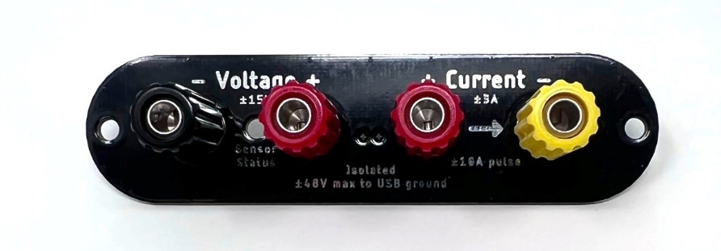

(js320-how-to-swap-the-front-panel)=

# How to swap the front panel

Joulescope comes standard with a banana jack front panel. However, Joulescope
is designed to be flexible and can support other connector types.

The front panel design is open source, and available on GitHub:

<https://github.com/jetperch/js220_end_panels>

The JS320 is fully compatible with all JS220 end panels and accessories.

To swap the front panel, you will need:

- 2 mm Allen wrench (included)

- The new front panel

Swapping the panel is easy, but you do need to take proper precautions to
avoid damaging your Joulescope. The JS320 can be damaged by static electricity
that you don’t even notice. When you expose the Joulescope main board, be sure
only to handle it by the board edges. Follow these steps carefully:

- Completely disconnect the Joulescope, including **Current**, **Voltage**,
  **GPIO**, **Trigger**, and **USB** ports.

- Use the Allen wrench to remove the two screws at the sides of the existing
  front panel.

- Gently push the Joulescope JS320’s trigger connector into the Joulescope
  body. This action will push the front panel out. Expose about ½” or 1 cm.

- Grab the sides of the main board in one hand, being careful not to touch any
  other part of the board.

- Grab the existing front panel by the sides and carefully pull it directly
  out.

- Grab the new front panel by the sides, align the pins, and carefully push it
  in. Be careful to ensure that the light pipe fits into the front panel.

- Fully seat the front panel in the black plastic bezel. You may need to
  gently guide the board to ensure that the USB connector, trigger connector,
  and light pipe fit in the back panel.

- Use the Allen wrench to install the two screws at the sides of the existing
  front panel.
