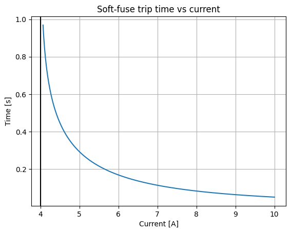
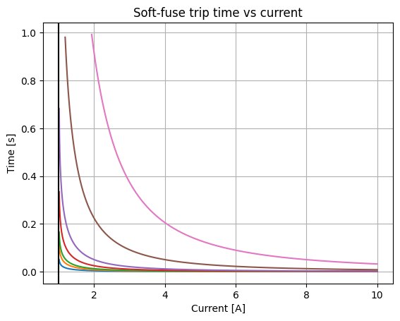
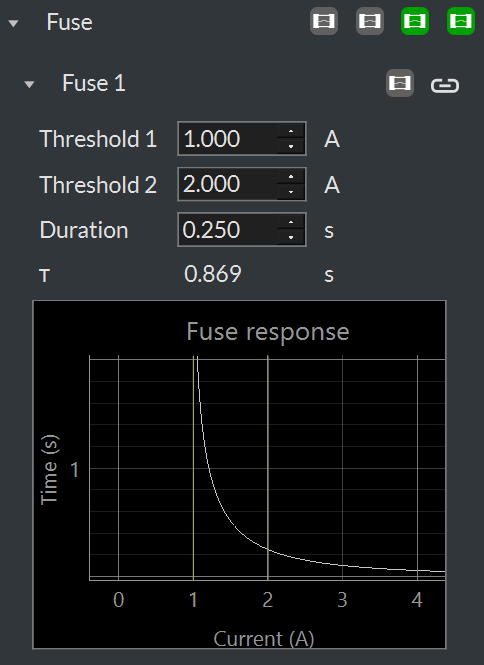
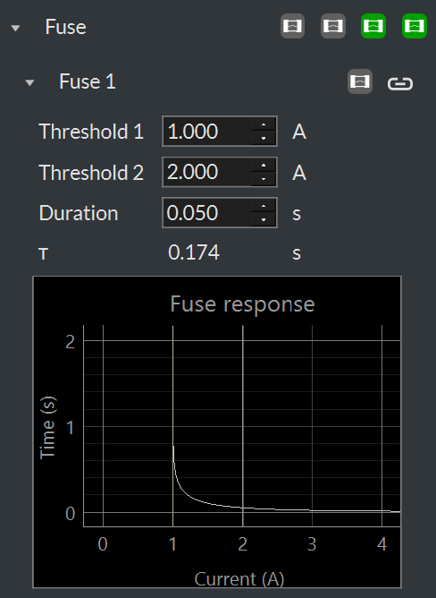

(js320-fuse)=

# Fuse

The Joulescope JS320 includes a fuse feature. The fuse is software-controlled
and operates using the measured current and existing shunt selection MOSFETs.
The fuse implements four different channels:

1.  User 1 Fuse

2.  User 2 Fuse

3.  Range Fuse

4.  Max Fuse

The Range Fuse and Max Fuse are configured to protect your Joulescope JS320
from damage. You can configure the two User Fuses to protect your connected
target equipment and power source.

The JS320 uses an algorithm that emulates traditional fuses. The algorithm
contains coefficients that allow the fuse to “heat up” and “cool off”. Like a
traditional fuse, the algorithm operates on power (current squared). For each
time step, the algorithm is:

```{math}
a_{n} = a_{n - 1} + i^{2}\Delta t + a_{n - 1}K\Delta t
```

If a{sub}`n` \> T, then the fuse engages and breaks the circuit from **Current +**
to **Current -**.

If a fuse engages, first investigate what caused the overcurrent condition.
Modify your test setup to prevent the overcurrent condition from occurring. If
you are using the Joulescope UI, press the  icon
on the sidebar to clear all engaged fuses. You can also clear individual fuses
for each instrument using the **Device Control** widget.

The fuse feature was added on 2023-10-26 with FPGA 1.1.0 and FW 1.1.0. The
latest version of the Joulescope UI will automatically update your JS320 to
include this fuse feature.

## Max Fuse

The Max Fuse protects your JS320 from over-specification current events. The
engage time versus a fixed input current is:



## Range Fuse

The Range Fuse protects your JS320 for each current range. This fuse is only
meaningful when you manually select a fixed current range. While in the
default “auto” current range mode, the JS320 will always autorange before this
fuse engages.

The response for each current range is:



## User Fuses

The JS320 includes two optional, user-configurable fuses. You can use these
fuses to protect your connected equipment with a current response that is
tuned to your equipment. Note that the Max Fuse and Range Fuse are always
active. If you configure a User Fuse to be less responsive, then the fixed
fuse will engage first.

Specifying the two coefficients T and K directly is not intuitive. Instead,
the UI allows you to specify two current thresholds and a duration. The first
threshold is the minimum trip current. Any current less than this first
threshold will never cause the fuse to engage. A constant current at the
second threshold for the given duration will cause the fuse to engage.
Together, these three constants determine the fuse response. When you select
the constants, the UI will display the resulting response curve. The following
figures show the response curve with the same thresholds but different
durations:



