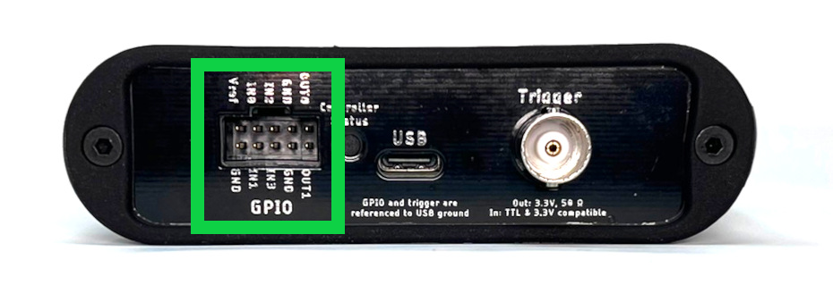
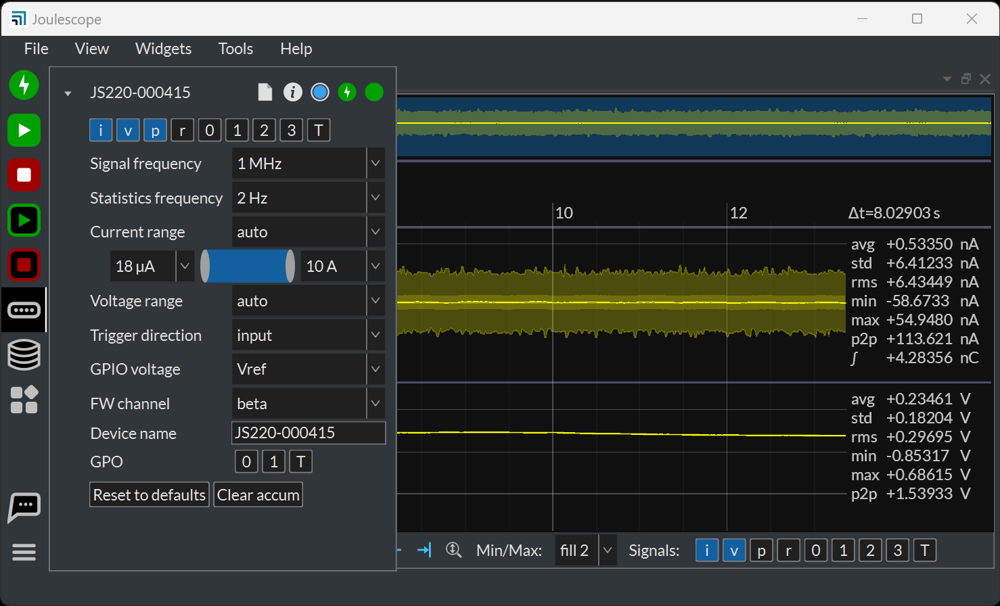

(js320-gpi-gpo)=

# GPI & GPO

The Joulescope contains four (4) general-purpose inputs (GPI) and two (2)
general-purpose outputs (GPO) located on the GPIO connector to the left of the
host USB connecter. The JS320 includes a GPIO cable harness that can simplify
connecting the GPIO to target devices and breadboards. The BNC Trigger
connector located to the right of the host USB connector can be configured as
either an additional general purpose input or output.

The JS320 software can record the input signals and control the output
signals. The input signals allow the JS320 to monitor other equipment and your
device under test. The output signals can be used to control other equipment
or the device under test. The user interface can display inputs
time-synchronized with current, voltage, and power in the oscilloscope view.

One intended application for the GPIs is to allow the target microcontroller
firmware to identify areas of interest. The microcontroller can toggle bits so
that you can easily see the energy consumption in the marked time windows.

The GPIO and Trigger are referenced to USB ground. Many applications using
Joulescope will want isolated GPI/GPO for improved performance. When selecting
an isolation solution, consider:

- Electrical isolation

- Self-powered target interface with very low power from target device –
  leakage currents only

- Variable voltage technology levels with an external reference voltage

- ESD protection

- Overvoltage protection (GPO)

- Short circuit protection (GPO)

- Very high (GΩ) input impedance (GPI)

To control the JS320’s GPIO, use the **Device Control Widget**. While you can
add this widget to the current view, the quickest way to make a change is by
clicking the **Device Control** icon on the **Sidebar**:

You can enable the GPI signals 0, 1, 2, 3, and T by enabling the signal at the
top. To also view them in the Waveform Widget, you also need to enable the
signal in the Waveform Control at the bottom (by default) of the Waveform
Widget. You can toggle the GPO signals 0, 1, and T by clicking the GPO at the
bottom.

The GPIO includes an external Vref signal. When using the GPIO with your
device under test, connect Vref to the supply voltage on the device under
test. Using Vref ensures that the input threshold and output voltage match the
target system. Using Vref also ensures that the outputs do not backpower the
device under test.

Alternatively, the JS320 can use an internal 3.3V reference voltage. In both
cases, Vref determines the output voltage high level. The input threshold
voltage is one half of this voltage.

The connector part number is [Molex
90130-3210](https://www.molex.com/en-us/products/part-detail/901303210) or
equivalent. Compatible connectors include Molex . Molex 219658-1103 is a
compatible off-the-shelf cable assembly.
