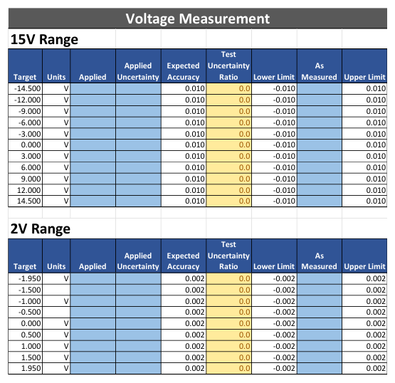
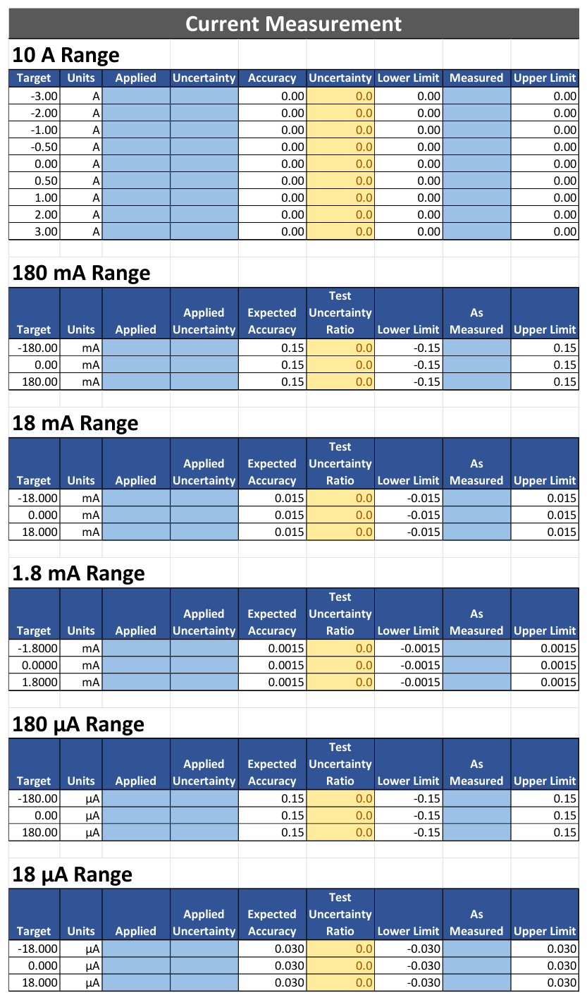
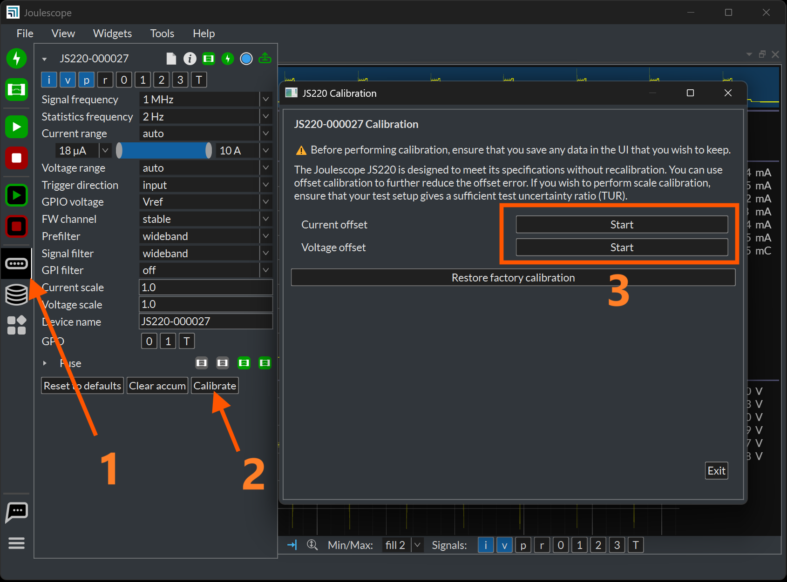

(js320-maintenance)=

# Maintenance

The Joulescope JS320 is designed for minimal maintenance. To clean your
Joulescope, disconnect all wires from the unit. You can gently wipe the unit
with a damp cloth using water only. Using rubbing alcohol or other cleaning
agents may damage your Joulescope. Do not submerge.

Joulescope is factory-calibrated and should continue to function within
specifications over its operating life. For critical or demanding
applications, you may choose to follow industry-standard practices and have
your Joulescope recalibrated annually. Tra-Cal, located in Maryland, USA,
provides authorized ISO 17025:2017 calibration and recalibration. You can
submit your request at:

<https://www.tra-cal.com/request-a-quote>

Recalibrating Joulescope requires custom equipment and trained personnel. Only
Jetperch LLC and Tra‑Cal are authorized to perform recalibration.

(js320-verification-procedure)=

## Verification Procedure

Calibration should normally find that the Joulescope instrument still operates
within specification. Although calibration can only be performed by authorized
vendors, any facility capable of performing precision multimeter calibration
can verify that a Joulescope is operating within specification. This section
describes the verification procedure.

### Preliminary operations

1.  Download the host computer software from
    <https://www.joulescope.com/pages/downloads>

2.  Install the software

3.  Download the validation spreadsheet from
    <https://download.joulescope.com/docs/validation/index.html>

4.  Connect your Joulescope to the host computer using the provided USB cable.

5.  Select **View.** If the first **Multimeter** is not already selected,
    select it.

6.  Select **View**. If **Control** is not already selected, select it.

7.  Open the validation worksheet in Excel and fill in the Device Under Test
    Information.

8.  Select File → Save As for this device calibration.

9.  Optionally configure your Test Uncertainty Ratio (TUR) to your desired
    level. We recommend following industry-standard practices and set TUR to 4
    or greater.

### Voltage Validation Process

1.  Connect calibrator OUT terminals to the Joulescope **Voltage** terminals,
    observing polarity.

2.  Connect **Voltage +** to **Current +**. Leave **Current –** open.

3.  In the Joulescope UI, select **Voltage Range** to 15V.

4.  Configure the calibrator to the target voltage.

5.  Record the actual calibrator voltage, the calibrator’s uncertainty at that
    voltage, and the Joulescope’s measured voltage as displayed by the
    Joulescope UI.

6.  Repeat 4 and 5 for each target voltage.

7.  Repeat 2 through 6 for the 2V range.

The following image shows the calibration spreadsheet:

During the test process, you should fill in all light-blue cells with
measurement data. All TUR values should be green. Yellow indicates that the
test setup lacks sufficient accuracy. All “As Measured” values should be
green. Red indicates that the Joulescope does not meet specifications.

### Current Validation Process

The current calibration process can be performed using several methods. In all
cases, the goal is to generate a current close to the target current. Strict
accuracy on the generated current is not required. However, a reference
measurement is required.

The general process is

1.  Select the **Current Range** in the Joulescope UI.

2.  Configure the target current.

3.  Record the applied current as measured by the reference, reference’s
    uncertainty at that current, and the Joulescope’s measured current as
    displayed by the Joulescope UI.

4.  Repeat 2 and 3 for each target current

5.  Repeat 1 through 4 for each current range.

Note that many of the test cases are for a 0.0 amp target current. In this
setup, you can simplify the setup and leave the Joulescope instrument
disconnected, or optionally short the Joulescope **Current** terminals with a
banana jumper wire.

Numerous valid test equipment methods exist to generate and accurately measure
the target current. You may select a method that is appropriate for your
equipment. The Joulescope JS320 has a very large current range, and you will
need to accurately measure from 18 µA to 3 A. You may need to employ more than
one method to cover the entire current range with a sufficient TUR. Possible
methods include:

**Method 1: Reference current source**

If you have a reference current source, connect the current source to the
Joulescope **Current** terminals, observing polarity.

In step (2), directly configure the reference current source to generate the
target current.

In step (3), read the applied current from the reference current source.

**Method 2: Reference ammeter with current source**

Connect an inaccurate current source + terminal to the Joulescope **Current
+** terminal. Connect the **Current –** terminal to the reference ammeter +
terminal. Connect the reference ammeter – terminal back to the current source
– terminal.

In step (2), configure the inaccurate current source to the target current.

In step (3), read the applied current from the reference ammeter.

**Method 3: Reference ammeter with voltage source and variable load resistor**

Connect an inaccurate voltage source + terminal to the Joulescope **Current
+** terminal. Connect the Joulescope **Current –** terminal to one terminal of
a variable load resistor. Connect the other variable load resistor terminal to
the reference ammeter + terminal. Connect the reference ammeter – terminal to
the Joulescope inaccurate voltage source – terminal.

In step (2), select a target voltage and resistance combination to give the
target current as computed using Ohm’s law: I = V / R. Configure the load
resistance, configure the voltage source, then enable the voltage output.
Ensure that the voltage stays between 0 and 15V. We recommend adding a step
3.5 to disable the voltage output before changing the load resistance for the
next target current.

In step (3), read the applied current from the reference ammeter.

## Offset Calibration

The JS320 is designed to remain in spec without calibration. However, you can
perform offset calibration to improve accuracy for demanding measurements.

The JS320 supports offset calibration for both current and voltage. The
Joulescope UI 1.0.40 and later includes offset trim calibration. Before
starting a trim calibration, please run your JS320 for at least 5 minutes to
allow the temperature to stabilize. To start a current offset trim
calibration, select the **Device Control** widget in the sidebar, then press
**Calibrate**:

Press **Start** for **Current offset** or **Voltage offset**, and follow the
onscreen instructions. Ensure that you leave the terminals open for **Current
offset** calibration. Short V-, V+ and I+ to perform **Voltage offset**
calibration.

The JS320 uses an internal fixed-point representation of 5Q31 for current
samples. 2⁻³¹ represents an accuracy of ±0.5 nA. After performing trim
calibration, the instrument offset may be off by up ±0.25 nA.
