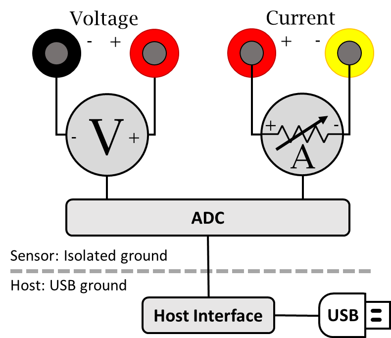
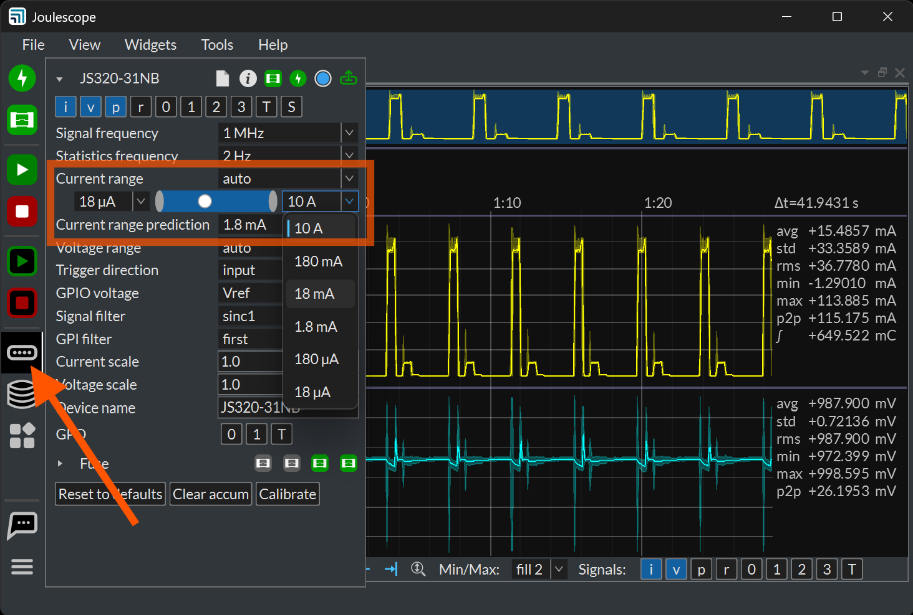

(js320-theory-of-operation)=

# Theory of operation

Joulescope simultaneously measures current and voltage, and then computes
power and energy. Joulescope combines a voltmeter and a fast auto-range
current shunt ammeter.



## Ammeter

The shunt ammeter consists of six (6) current ranges with six (6) different
shunt resistor values ranging from 0.01 Ω to 1111 Ω. Joulescope actively
selects the best shunt resistor to keep the maximum voltage across the shunt
resistor to 20 mV. This low voltage drop minimizes the impact on the device
under test. Other equipment, including standard multimeters, have a much
larger burden voltage that can cause the target device to behave unusually.

The Joulescope amplifies the voltage across the shunt resistor and then uses
an analog-to-digital converter (ADC) to digitize the value. The ADC digitizes
the value 2 million times per second to create 2 million samples per second
(SPS). The Joulescope instrument processes these ADC values on the instrument
using a sensor-side FPGA.

Given a known resistor value and the measured voltage, the Joulescope uses
Ohm’s Law to compute current. The FPGA applies calibration coefficients to
convert the measured voltage into the measured current. Joulescopes are
individually calibrated and tested in the factory to ensure that every
Joulescope performs to specification.

The instrument then downsamples by 2 from 2 Msps to 1 Msps. This downsampling
saves USB bandwidth without affecting the measurement bandwidth.

### Autoranging

As the current changes, the ammeter selects the optimal shunt resistor value.
Joulescope uses dedicated hardware to quickly select the appropriate shunt
resistor to avoid impacting the device under test. The shunt value selection
uses the ADC output, dedicated over-range analog hardware, and a unique
algorithm that runs in an FPGA. The FPGA selects the active shunt resistors
using MOSFETs, which were carefully qualified to meet Joulescope’s demanding
performance characteristics.

The shunt resistor selection does take some time. How fast does the shunt
resistor need to change to have a minimal impact? The linearized equation is:

t = C \* ΔV / ΔI

Let’s take a typical example. The target device takes 3.3V and can tolerate a
temporary 3% (0.03) voltage glitch on a 1 amp change. If the target device has
10 μF of capacitance, the required shunt resistor switching time is
approximately:

10 μF \* 3.3 V \* 0.03 / 1 A = 1 μs

Joulescope was designed to achieve 1 µs switching speed to meet this demanding
case. Most target systems have larger capacitance and less dramatic step
current changes. In all cases, the shunt resistor selection is always
make-before-break to ensure uninterrupted connectivity to the target device.

(js320-current-ranges)=

### Current ranges

Embedded devices span a very wide current range.  A wireless sensor may sleep
at tens to hundreds of nA, then wake and transmit at tens to hundreds of mA.
Other targets draw several amperes.  Joulescope covers nA to 10 A,
approximately 10 decades, which no single shunt resistor and ADC can resolve
with adequate accuracy.

The JS320 has six current ranges.  The settings below identify each range by
its index:

| Index | Range  |
|-------|--------|
| 0     | 10 A   |
| 1     | 180 mA |
| 2     | 18 mA  |
| 3     | 1.8 mA |
| 4     | 180 µA |
| 5     | 18 µA  |

Autoranging selects the most sensitive range that does not overflow.  When the
current exceeds the active range, the instrument must switch to a less
sensitive range within microseconds, or the measurement clips.

### Autoranging errors

Autoranging introduces two errors: measurement error during the transition,
and a real current disturbance.

The instrument must measure correctly while the range is changing.  When the
JS320 switches current ranges, the JS320 activates a MOSFET to select the new
shunt resistor and deactivates the MOSFET for the previous shunt resistor. All
MOSFETs are effectively capacitors between their gate and the source/drain.
Activating and deactivating a MOSFET results in charge injection. While we
have carefully selected these MOSFETs to minimize charge injection, it is not
zero. You may observe a brief spike on the order of 300 ns. The JS320 may also
measure this spike, but it will be spread in time due to the JS320’s
measurement bandwidth.

The second effect is that the impedance from **Current +** to **Current -**
changes very quickly. Many targets have large bypass capacitors. Since
capacitors resist instantaneous voltage changes, the result is that a real
current may flow over the shunt resistor to charge or discharge the capacitor
to account for the new JS320 impedance. This current is real, and it cancels
out over time. However, it’s often not what we want to measure, so it can be
distracting for some systems.  The disturbance is inherent to any
autoranging shunt ammeter.  Joulescope minimizes it, but it cannot be
eliminated.  Larger range jumps cause larger impedance changes and larger
disturbances.

### Autoranging in each Joulescope model

The JS110 (2019) has seven current ranges.  It does not measure through
current range changes.  It is blind for approximately 5 µs during each range
change, and it interpolates over the missing data.

The JS220 (2022) has six current ranges.  It measures through range changes,
but only with the accuracy of the 10 A range.  On overflow, the JS220 jumps
directly to the maximum current range, 10 A by default, then settles back
down to the appropriate range.  All samples during the transition have the
accuracy of the maximum current range, and the large range jump produces a
large impedance change with visible ringing.  For most applications, the
error is small.  Bluetooth, backscatter RF, and energy harvesting products
continue to push peak currents lower, which increases the relative error
from this brief time in the 10 A range.  For some applications, this error
is significant.

The JS320 (2026) improves accuracy across all ranges.  It measures through
range transitions with the accuracy of any range, not just 10 A.  The JS320
measures across three ranges simultaneously and synthesizes a single current
measurement.  The JS320 also adds the predicted current range.

(js320-predicted-current-range)=

### Predicted current range

On overflow, the JS320 autoranger first switches to the predicted current
range rather than to the maximum current range.  If the current fits in the
predicted range, the instrument stays there.  Otherwise, it continues to the
maximum current range.  In rare cases, such as when the instrument has not
yet settled after a previous range change, the autoranger skips the
prediction and switches directly to the maximum current range.

Prediction provides:

* Accuracy of the predicted range during the transition, not of the 10 A
  range.
* Smaller range jumps and therefore a smaller real current disturbance.
* No clipping risk, since current above the prediction still reaches the
  maximum current range.

With prediction off and the maximum current range at 10 A, the JS320 behaves
like a JS220.

(js320-optimizing-for-accuracy)=

### Optimizing for Accuracy

For many applications, the JS320 performs sufficiently without any additional
configuration. However, additional configuration can improve accuracy for
measuring lower-current systems, such as Bluetooth devices. Any system that
never consumes more than 180 mA can benefit from additional configuration.

In the Joulescope UI, configure autoranging in the Device Control widget:



* **Current range** selects `auto` for autoranging.
* The slider below sets the current range limits: the most sensitive range
  on the left and the maximum current range on the right.
* **Current range prediction** sets the predicted current range.

Scripts use these settings:

| Topic               | Meaning                                       | Default   |
|---------------------|-----------------------------------------------|-----------|
| `s/i/range/mode`    | Current range mode: `off`, `auto`, `manual`.  | `off`     |
| `s/i/range/min`     | Maximum current range (least sensitive).      | 0 (10 A)  |
| `s/i/range/predict` | Predicted current range on overflow, 0 = off. | 0 (off)   |
| `s/i/range/max`     | Minimum current range (most sensitive).       | 5 (18 µA) |

All range values use the index from {numref}`js320-current-ranges`.  Note that
`min` and `max` refer to the range index, not to current.  `s/i/range/min` is
the *least* sensitive range and therefore sets the *maximum* current.

#### Maximum current range

The maximum current range, `s/i/range/min`, limits the least sensitive range
that the autoranger may select.  Set it to the smallest range that still
covers the true peak current of the target.

* Too high: no measurement error, but overflow transitions jump further than
  needed.
* Too low: currents that exceed five times the range clip, which causes
  significantly increased inaccuracies.

When the target peak current is unknown, leave it at 10 A.

When the maximum current range is set to anything other than 10 A, the JS320
can measure currents up to five times the range.  The JS320 measures
the maximum current range with a dedicated ADC input that omits the 5×
gain stage of the other current inputs.  However, burden voltage increases
beyond the specified value.  The actual burden voltage is approximately:

```{math}
V_{burden} \approx \frac{I}{I_{range}} \times 20\ \mathrm{mV}
```

When setting the maximum current range, ensure that the waveform never
exceeds five times the range when viewed at the full 1 MHz sample rate.
The JS320 does contain a soft-fuse feature for each current range to help
prevent damage to the instrument if you select too low of a maximum current
range.  See {numref}`js320-fuse`.

#### Minimum current range

Leave the minimum current range, `s/i/range/max`, at the default 18 µA.
Change it only when the target is affected by the higher input impedance
of the most sensitive ranges, or when the autoranger repeatedly bounces out
of the most sensitive range.  The most common reason is a connection to a
DC-DC switching converter with inadequate upstream bulk capacitance.

#### Predicted current range setting

Set the predicted current range, `s/i/range/predict`, to the range that
covers the typical short current peaks of the target, such as radio transmit
or receive events.  Larger excursions, such as motor or inrush current, still
reach the maximum current range without clipping.  0 turns prediction off.

#### Selecting values

Consider a Bluetooth product that wakes to measure a sensor at 100 µA and
less frequently communicates over RF at 1 mA.  If the current never exceeds
9 mA, five times the 1.8 mA range, use:

* Maximum current range `s/i/range/min = 3` (1.8 mA).
* Predicted current range `s/i/range/predict = 4` (180 µA).

At 9 mA, the burden voltage is approximately 100 mV.  If the RF instead
takes 10 mA, use:

* Maximum current range `s/i/range/min = 2` (18 mA).
* Predicted current range `s/i/range/predict = 4` (180 µA).

Select these values:

* **Statically** from the target's known current profile.  For test
  systems, configure a default for the test bench with per-test or
  per-capture overrides.
* **Adaptively** by capturing with the default settings, analyzing the peak
  current distribution, and then selecting the predicted current range to
  cover the frequent peaks and the maximum current range to cover the
  largest peak.  This analysis is well suited to automated testing.

### Enable current measurement

When unpowered, the JS320 disconnects **Current +** from **Current -** using
a MOSFET, as does the JS220.  The Joulescope UI enables current flow when it
opens the JS320.  The host driver does not, so scripts must publish
`s/i/range/mode = auto`.

Two open modes determine the initial instrument state:

* `defaults`: Reset the instrument to power-on defaults.  This disconnects
  the current path.  Use this mode with explicit configuration for repeatable
  automated tests.
* `restore`: Adopt the existing instrument state.  Use this mode to keep the
  target powered across multiple open and close cycles.

An overcurrent soft fuse event also disconnects the current path.

### Configure autoranging from a script

Using `pyjoulescope_driver`, see the
{doc}`Joulescope Driver documentation </software/joulescope_driver/index>`:

```python
from pyjoulescope_driver import Driver

with Driver() as d:
    device = d.device_paths()[0]
    d.open(device, mode='defaults')
    d.publish(f'{device}/s/i/range/min', 2)        # maximum current range: 18 mA
    d.publish(f'{device}/s/i/range/predict', 4)    # predicted range: 180 µA
    d.publish(f'{device}/s/i/range/mode', 'auto')  # connect & autorange
    # ... capture ...
    d.close(device)
```

The JS320 advertises its full parameter set, including descriptions,
defaults, and options:

```
pip install pyjoulescope_driver
python -m pyjoulescope_driver metadata --out js320.html
```

The `--out` extension selects the format: `.html`, `.json`, or `.yaml`.

## Voltmeter

The voltmeter measures the voltage between **Voltage +** and **Voltage -**.
The voltmeter scales the input voltage, and uses an analog-to-digital
converter (ADC) to digitize the value. The Joulescope instrument sends the
voltage samples, along with the current samples, to the host computer. The
software applies the calibration to convert from ADC values to actual voltage.

The voltmeter has two different ranges, and you can manually select the best
range for your application. The 2V range provides higher resolution for
smaller voltages, while the 15V range allows for larger voltage measurements.

The voltmeter intentionally omits the pull resistors to ground, typically 1 MΩ
to 10 MΩ for most multimeters and oscilloscopes. However, **Voltage +** and
**Voltage -** will float when unconnected. The voltmeter measurement is only
valid once **Voltage +** and **Voltage -** are both connected to within ±15V
of the **Current +** terminal. See {numref}`js320-high-impedance-low-leakage`
for more detail.

## Host Computer

The Joulescope instrument requires a host computer to operate. The Joulescope
instrument sends 2 million current and voltage samples per second immediately
to the host computer over USB. Unlike traditional oscilloscopes, a Joulescope
is always capturing data. The terms “trigger” and “sample buffer” do not fully
apply to the Joulescope device, since all sample data arrives at the host
computer. The Joulescope User Interface (UI) temporarily stores capture data
in a circular buffer. The UI allows you to adjust the buffer size to use your
host computer’s RAM. Joulescope can also record to a file, and the capture
size is only limited by your computer’s available storage on your hard disk
drive or solid-state drive.

The Joulescope host software Is open-source. The pyjoulescope “driver”
communicates with the appropriate operating system USB driver. Joulescopes use
Microsoft’s WinUSB on Windows, which is included by default with the Windows
operating system. On Linux and macOS, Joulescope uses the popular, open-source
libusb driver. The pyjoulescope driver provides an easy-to-use scripting
environment. You can also use the driver to build integrated applications,
such as the Joulescope UI, that use the Joulescope instrument data.

## Power, Energy, Charge, and Statistics

Joulescopes only measure current and voltage. The Joulescope software uses
math to compute the power, energy, and charge. Power is the current multiplied
by the voltage:

**P = V \* I = V² / R = I² \* R**

Energy is the integral of power over time.

```{math}
E\ \  = \int_{}^{}{P\ dt}
```

When we talk about energy, we often mean the energy consumed over a specific
time interval, which is the definite integral:

```{math}
E\ \  = \ \int_{t = 0}^{T}{P\ dt}\ \ \  \approx \ \ \ \ \sum_{n = 0}^{N}{P_{n}\ \Delta t}
```

The Joulescope host software performs the discrete-time Euler integration
shown to the right. The Joulescope software carefully manages the numerical
precision to ensure that it computes energy correctly. IEEE double-precision
floating-point numbers do not provide sufficient precision.

Charge is the integral of current over time.

```{math}
C\ \  = \ \int_{t = 0}^{T}{I\ dt}\ \ \  \approx \ \ \ \ \sum_{n = 0}^{N}{I_{n}\ \Delta t}
```

Charge and energy are mathematically similar. Both voltage and current
contribute to energy, but only current contributes to charge.

(js320-high-impedance-low-leakage)=

## High impedance / low leakage

Joulescope measures currents at nanoamp resolutions and accuracies. Many
contemporary devices have input impedances of 1 MΩ to 10 MΩ, which is not good
enough. At 3.3V, a 10 MΩ load draws:

3.3V / 10 MΩ = 330 nA

Joulescope features a combined input impedance and leakage current of
approximately 1 GΩ. This high input impedance allows Joulescope to make
accurate and precise low current measurements.

## Electrical isolation

The sensor side of Joulescope is electrically isolated from the host computer.
This isolation allows you to insert Joulescope into your test system without
worrying about ground issues, including ground loops and ground noise. The
JS320 sensor-side isolated ground is referenced to **Current +**.
