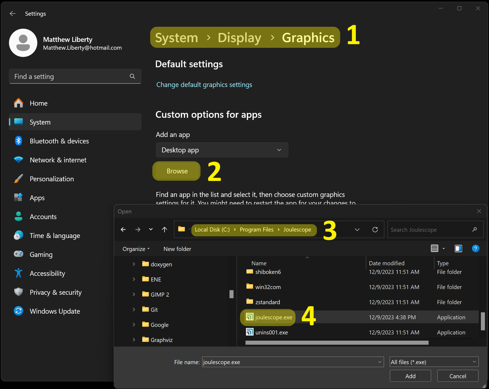
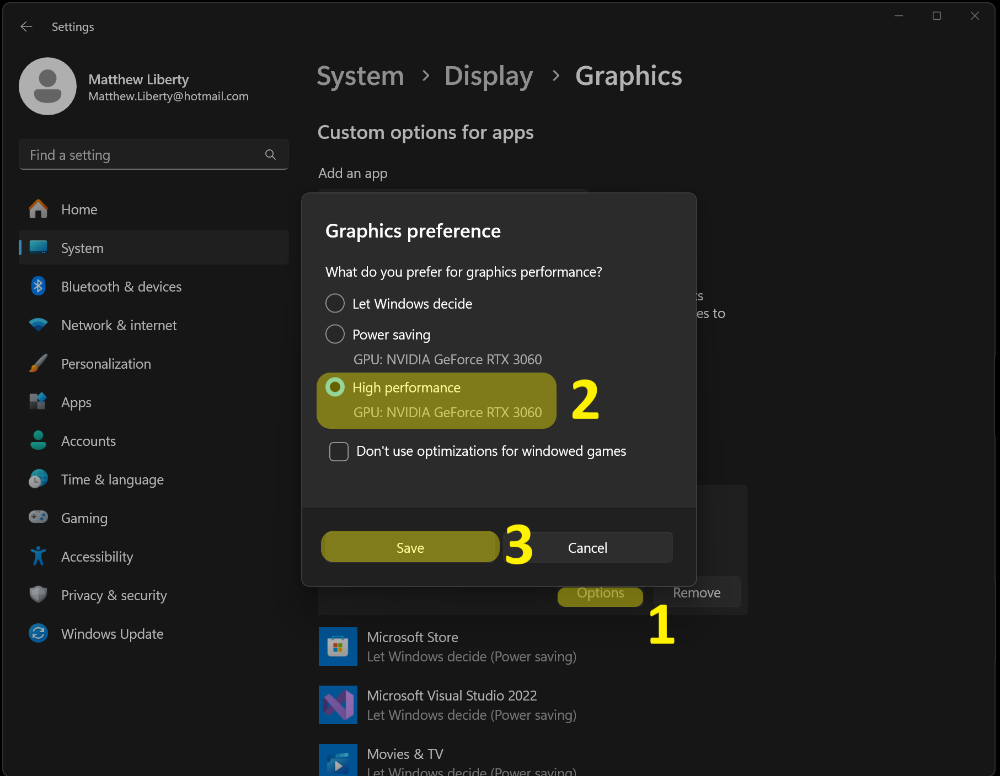

(ui-graphics-configuration)=

# Graphics configuration

The Joulescope UI will use the default graphics configuration. On macOS and
Linux, this works seamlessly.

Unfortunately, Windows has a known issue with integrated Intel graphics that
can cause application crashes. If your computer only has integrated Intel
graphics, we recommend that you update your Intel graphics driver to the
latest. If you still see crashes, you can try using the software OpenGL
renderer. The UI will prompt you to make the switch, which only takes effect
after you close and reopen the application. You can later configure the OpenGL
renderer by selecting **Widgets** → **Settings** → **Common** → **opengl**.

Even Windows computers with discrete graphics cards sometimes select Intel
graphics depending upon the power settings. In this case, you can manually
configure the Joulescope UI to use the high-performance discrete graphics
card. Open Windows Settings. Select **System** → **Display** → **Graphics**.
Select the joulescope.exe executable.

This will add the Joulescope UI to the list. Select **Joulescope UI** and
press **Options**. Select **High performance** and press **Save**.

The next time you start the Joulescope UI, it will use the discrete graphics
card.
