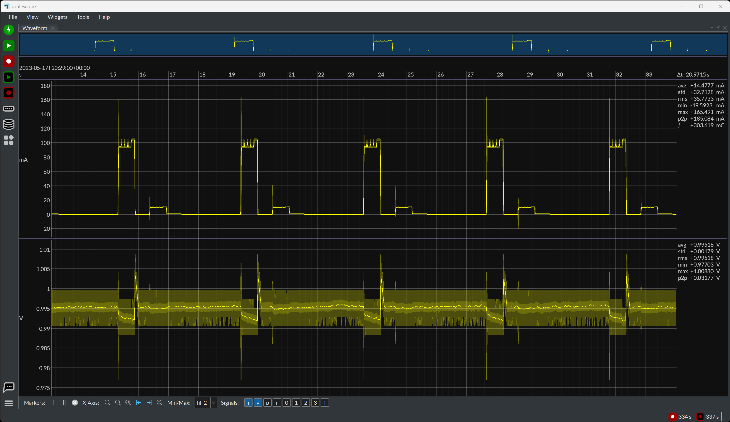
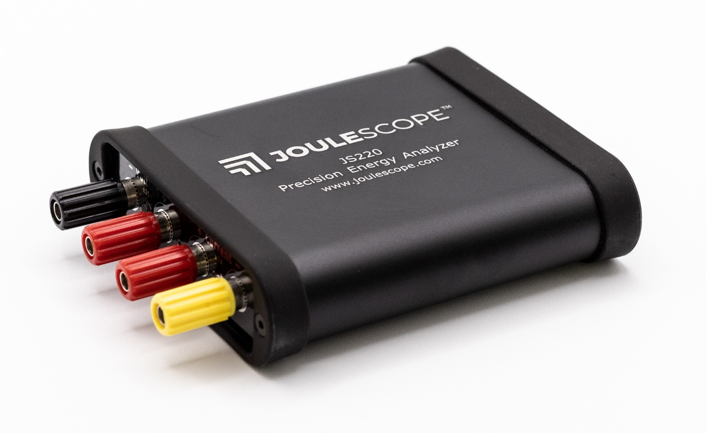

(ui)=

# Joulescope UI User's Guide


Revision 1.9

Last revised 2026 Nov 16






```{toctree}
:numbered:
:maxdepth: 2

introduction
key_benefits
installation
meet_ui
multiple_instruments
widgets/index
graphics
i18n
source_code
plugins
settings
troubleshooting
changelog
```
