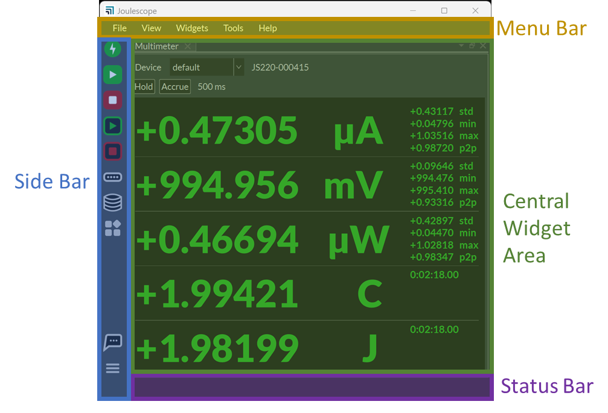
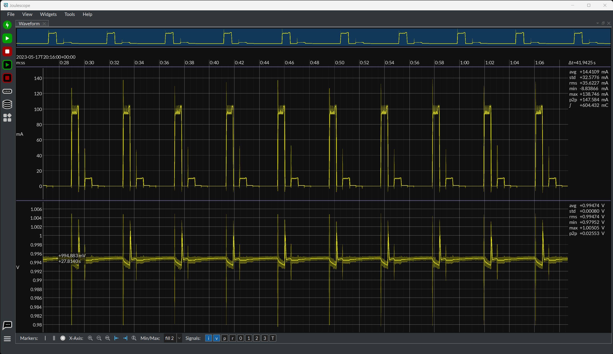
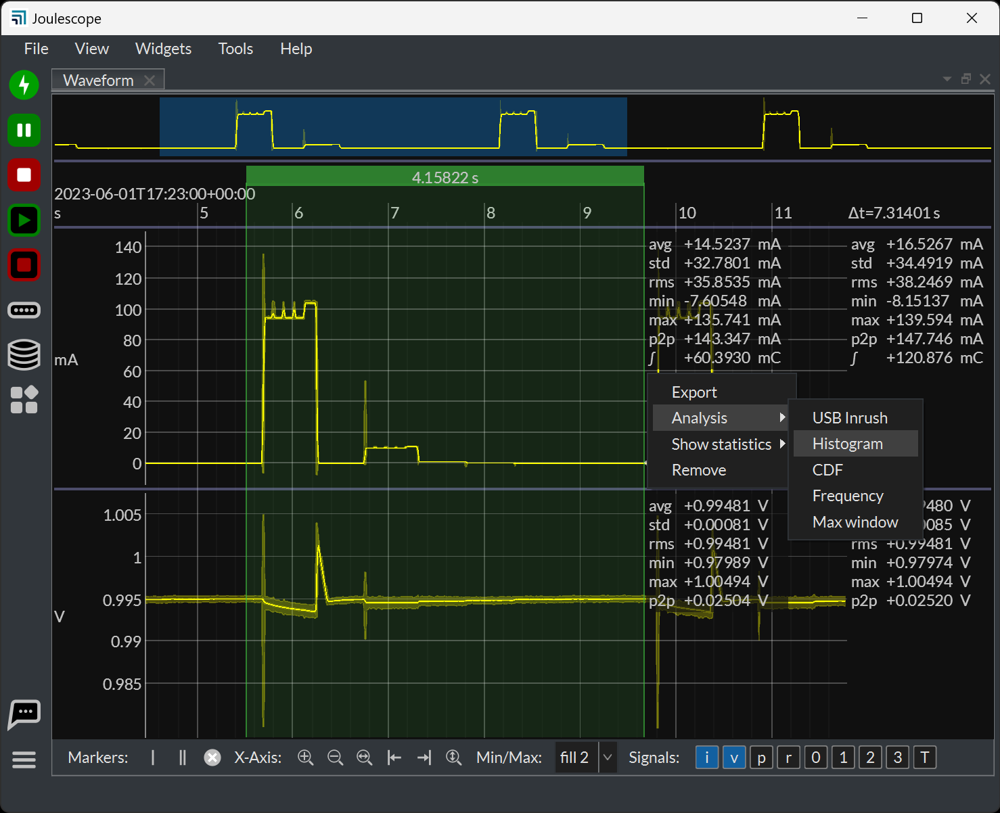
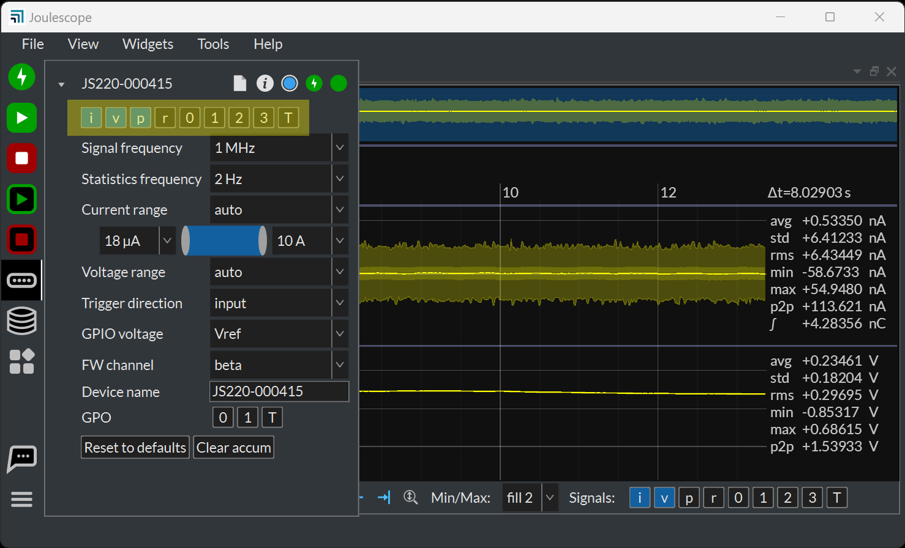
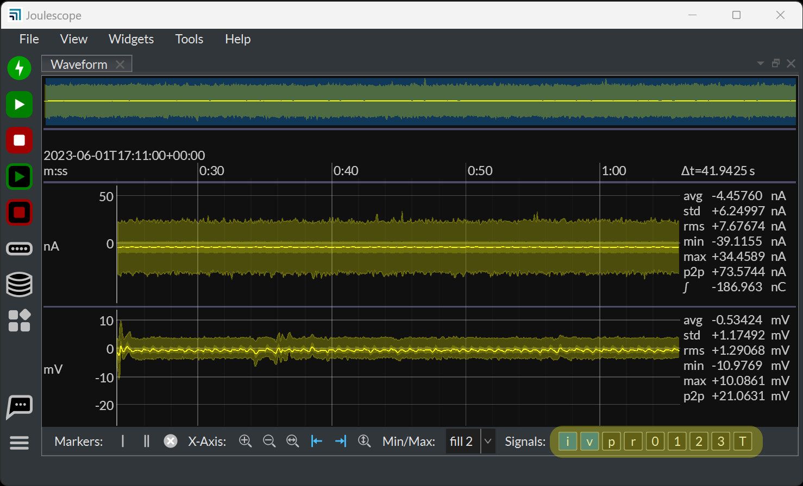
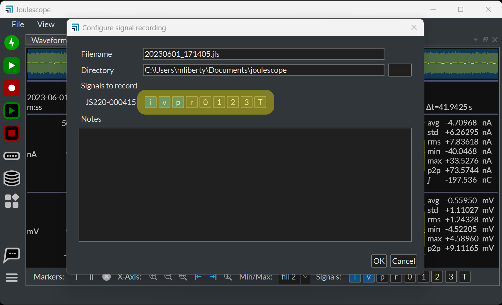
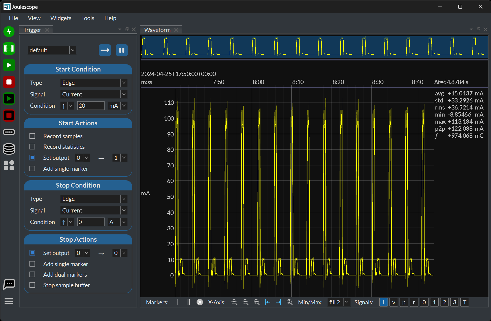

(ui-meet-the-joulescope-ui)=

# Meet the Joulescope UI

When you start the Joulescope UI for the first time or after updates, it
greets you with the **Quick Start Guide**. Please read through this and click
**OK** to continue. You will see the **Multimeter View**.

Before diving into the views, let’s take a quick look at the window structure:

The **Menu Bar** allows quick access to commonly used features and settings:

| **Item** | **Description**                                                 |
|----------|-----------------------------------------------------------------|
| File     | Open recordings and exit application.                           |
| View     | Select the active view and manage (add, delete, reorder) views. |
| Widgets  | Add a widget to the active view.                                |
| Tools    | Additional tools.                                               |
| Help     | Get help and more information.                                  |

The **Side Bar** allows quick access to commonly used features and settings:

| **Icon** | **Definition** | **Description** |
|----|----|----|
|  | Target power | Toggle the power to target devices. |
|  | Fuse engaged | Clear engaged fuses. Turns red & blinks when any fuse engaged. |
|  | Signal sample streaming | Enable/disable sample streaming (pause waveform display) |
|  | Signal sample recording | Enable/disable sample stream recording. |
|  | Statistics display | Enable/disable statistics streaming (pause multimeter display) |
|  | Statistics recording | Enable/disable statistics stream recording. |
|  | Device control | Show device control settings for every connected instrument. |
|  | Memory buffer settings | Show memory buffering settings. |
|  | Application settings | Show all application settings. |
|  | Get help | Show a number of ways to get help with links. |
|  | Additional settings and actions | Additional settings and actions. |

The **Status Bar** shows current activity. For example, it shows the recording
duration for any active recordings.

The **Central Widget Area** is where you can add, remove, and rearrange
widgets. You can also undock widgets into other Windows.

When in doubt about a UI feature, hover the mouse over it, which often
displays a **Tooltip**. Note that this only works when the Joulescope UI is
also the active window. If you click on another application, you have to click
on the Joulescope UI to make it active.

Want to configure something? Right-click (control-click on macOS) with the
mouse to bring up a context-sensitive menu that varies based upon what you
click.

## Multimeter View

The **Multimeter View** provides the present operating state at a glance.

The multimeter view displays several quantities:

- Electrical current in amperes (A)
- Electrical voltage in volts (V)
- Power in watts (W)
- Charge in either coulombs (C) or amp-hours (Ah).
- Energy in joules (J) or watt-hours (Wh).

This display, along with all other value displays in the Joulescope software,
uses the SI standard prefixes for orders of magnitude:

| **Prefix** | **Power** | **Name** |
|------------|-----------|----------|
| G          | 10⁹       | giga-    |
| M          | 10⁶       | mega-    |
| k          | 10³       | kilo-    |
| m          | 10⁻³      | milli-   |
| µ          | 10⁻⁶      | micro-   |
| n          | 10⁻⁹      | nano-    |
| p          | 10⁻¹²     | pico-    |

The multimeter view updates every half second (0.5 seconds) by default. The
software computes and displays the statistics over each half-second time
window. The large numbers are the mean (also called average) value of that
quantity over the window. The software also displays:

- std: The standard deviation
- min: The minimum value
- max: The maximum value
- p2p: The peak-to-peak value, which is equal to (max – min)

Note that charge and energy only display the time since the integration
started since these other statistics are not meaningful.

Every update represents only the data recorded over the last half-second.

Press the **Hold** button to pause the display update. The charge and energy
accumulators will continue to run properly in the background. You can press
the Statistics Display  button, which
holds all widgets that display these statistics.

Press the **Accumulate** button to compute the statistics indefinitely until
you press the button again. While **Accumulate** is active, the software
extends the statistics to combine each new window without discarding results
from previous windows.

## Oscilloscope View

The software includes an **Oscilloscope View** that displays waveforms over
time. To enter this view, select **View** → **Oscilloscope**.

The Oscilloscope view consists of the **Waveform Widget**. The **Waveform
Widget** has several regions moving top to bottom:

- **Waveform summary**: shows the waveform to the full available time extents.
  The blue region highlights the time domain visible below.

- **x-axis**: Displays the time in UTC. The first line shows the relative UTC
  offset. The next line shows the values relative to the offset.

- **Signal waveforms**: The plot for each selected signal showing the signal
  value over time.

- **Control**: Settings that affect the waveform display.

When you first select the **Oscilloscope View** with a connected Joulescope,
it will display the live streaming data from the instrument. You can click the
Play  button at the top left to pause the waveform
buffer. Press again to resume.

You can easily navigate the collected data. Move the mouse over the plot of
interest, and use the scroll wheel to zoom. Hold the left mouse button and
drag the mouse cursor to pan. Alternatively, hold the shift key while using
the mouse scroll wheel.

For the y-axis, the display automatically adjusts to display the available
data. However, you can manually control the y-axis view range. Hold the Ctrl
key (command ⌘ on macOS) and use the mouse wheel to zoom. Hold Ctrl, hold the
left mouse button, and drag the mouse cursor to pan. Alternatively, hold
Shift + Ctrl while using the mouse scroll wheel. To return the automatic view
range behavior, right-click on the plot area and select **Y-axis auto range**.

Right-click on any region for more options. You can add annotations,
including:

- **x-axis single markers**: Display the average value and range for all
  samples represented by a pixel.

- **x-axis dual markers**: Display the statistics over a region of interest.
  Right-click on the dual markers for additional analysis options.

- **y-axis single markers**: Display the y-axis value

- **y-axis dual markers**: Display the y-axis values and delta.

- **Text annotations**: Add shapes and text to denote areas of interest.

The software computes statistics quantities over the full-time window shown in
the present view for each waveform. The software displays the statistics on
the right edge of the window. The statistical quantities are:

- avg: The mean (also called average) value
- std: The standard deviation
- rms: The root-mean-square value
- min: The minimum value
- max: The maximum value
- p2p: The peak-to-peak value (max – min)
- ∫: The integral over the time window

The control area contains a variety of buttons that affect the display. You
can hover the mouse cursor over each to display a tooltip. The tooltip
contains additional information for each option.

You can use x-axis dual markers to perform further analysis. Right-click one
of the dual markers and select **Analysis** for the available options:

## Energy and Charge

Joulescopes measure current and voltage at 2,000,000 samples per second. It
then multiplies current by voltage to compute power. Joulescopes then
integrate current to compute charge and integrate power over time to compute
energy. The Joulescope UI displays charge and energy in both the **Multimeter
View** and **Oscilloscope View**. This value starts accumulating when the
software starts. Use **Tools** → **Clear Accumulators** to reset them to zero
at any time.

The energy value and charge value provide a simple measurement to observe
changes, especially for software. You can baseline the performance of an
operation by recording the measured energy or charge value. You can then make
changes, repeat the test, and observe the new energy or charge value. The
**Oscilloscope View** enables you to investigate in further detail.

## Signal Management

Instruments and recordings provide signals that can then be viewed or
recorded. The Joulescope UI contains several features to manage signals.

Each device allows signal customization. Click the **Device Control** icon on
the **Sidebar** to manage the signals provided by each device:

The Waveform Widget separately allows you to select which Signals it displays:

When you record a JLS file, the dialog allows you to select the signals to
record:

Recording more signals requires more storage space. To keep your storage space
to a minimum, only select the signals you need.

## Triggers

Joulescope UI 1.1 and newer include a **Trigger** widget. The **Trigger**
widget can detect start and stop conditions, and perform start and stop
actions. The Trigger can run in either **Single** or **Continuous** mode.
After configuring the desired operation, click the button at the top right to
start the Trigger operation.

Joulescope UI 1.1 performs the trigger condition detection on the host. This
detection includes communication latency from the Joulescope to the host
computer. The **Set output** operation may have a significant delay (on the
order of 100 milliseconds) between the actual condition and the output change.
We do plan to move the condition detection to the JS220’s FPGA for
significantly reduced latency.
