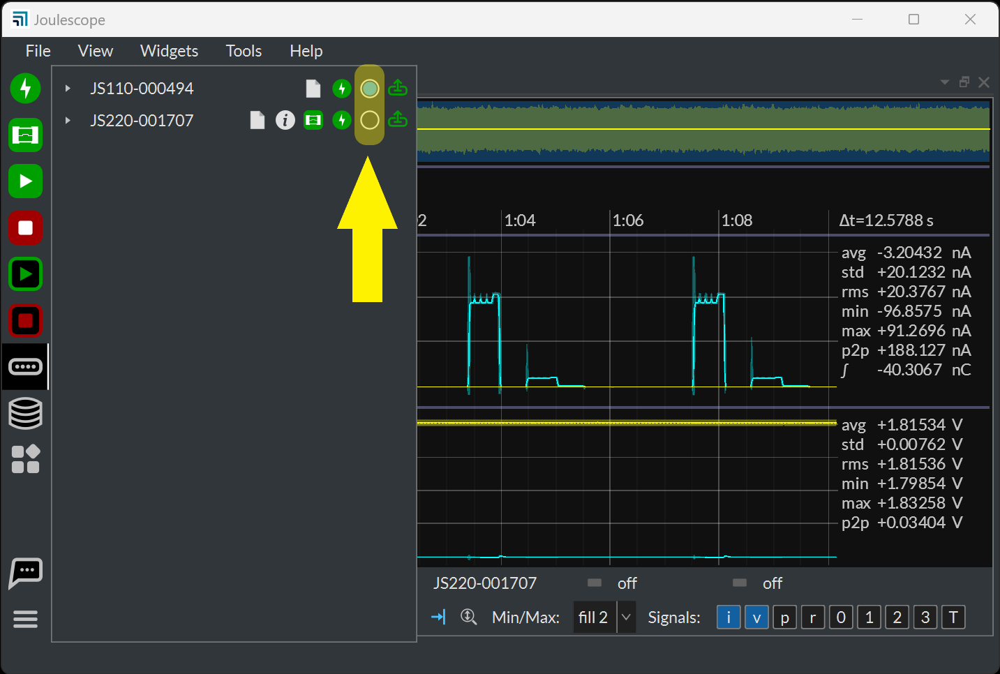
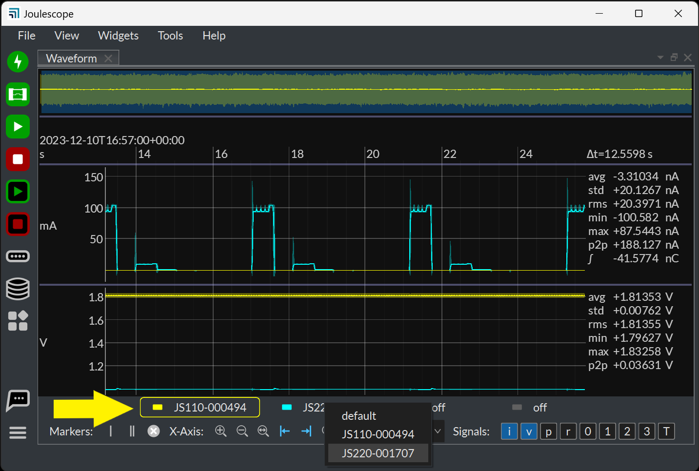

(ui-multiple-instrument-support)=

# Multiple Instrument Support

The Joulescope UI supports multiple simultaneously connected Joulescope
instruments. The UI includes the concept of a **default** device.

The UI will automatically select the initial **default** device. Change the
**default** device using the **Device Control** widget.

When multiple instruments are connected, the **Waveform** widget displays an
additional channel control widget.

Click on the color bar to enable or disable the channel. Right-click on the
channel name to select a different device. Click on the channel to select the
active channel.

The Waveform widget uses the active channel to compute the right-hand side
statistics and marker statistics. Changing the active channel will change the
statistics computations. The active channel also determines the y-axis labels
for the current range signal.
