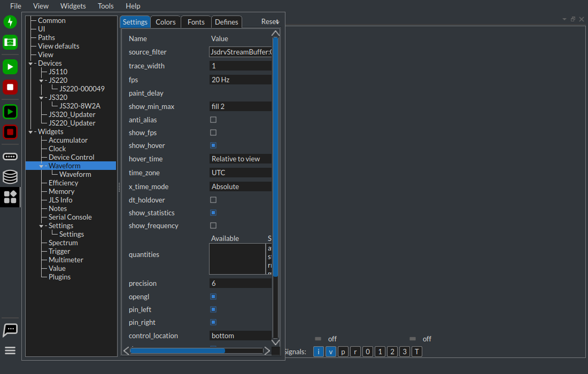
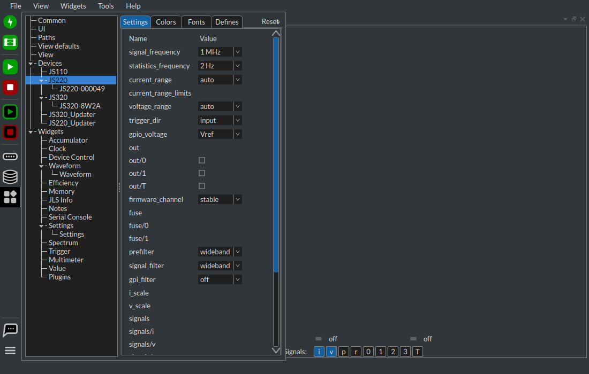
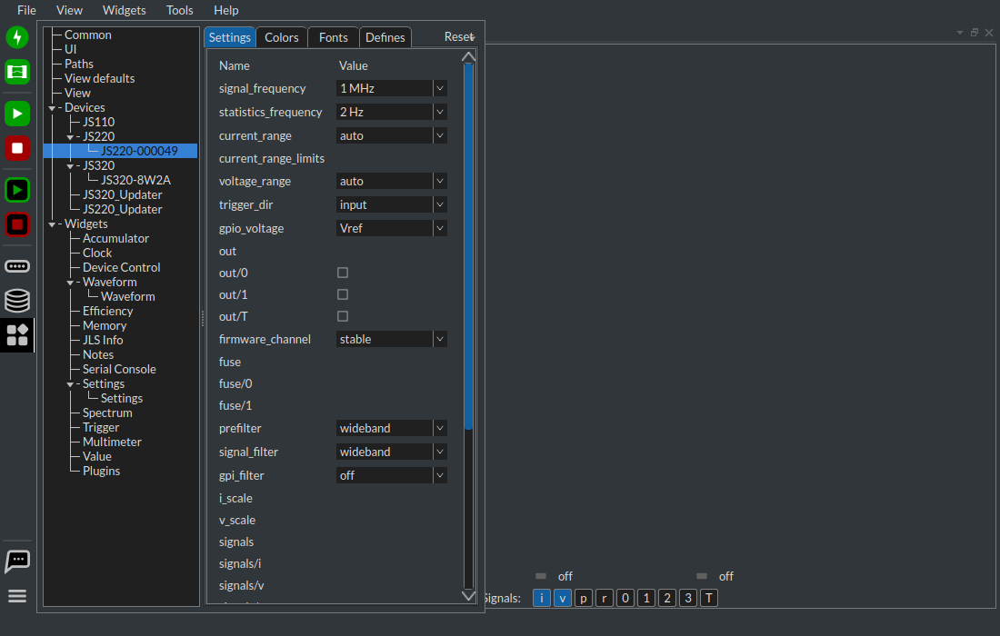
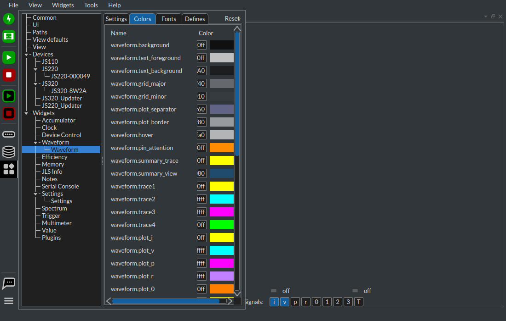

(ui-settings)=

# Settings

The Joulescope UI remembers its settings: the application settings, each
view, each instrument and each widget.  It saves them when it exits normally
and restores them the next time it starts.  This chapter explains where each
setting lives, how defaults work, and how to save, share and reset your
settings.

(ui-settings-levels)=

## Defaults and instances

Each kind of device and widget has **defaults**, and each connected device
and open widget is an **instance** with its own settings.  For example,
**Waveform** holds the defaults for Waveform widgets, and each Waveform
widget in a view has its own settings.

The UI copies the defaults when it creates an instance:

* A **widget** gets the defaults when you add it to a view.
* A **device** gets the defaults the first time the UI sees an instrument
  with that serial number.  After that, the UI remembers that instrument's
  settings by its serial number.

Changing a default setting does not change existing devices or widgets.
It only applies to devices and widgets created afterward.  To change an
existing widget, change its own settings, or reset it to the defaults (see
{ref}`ui-settings-reset`).  Colors, fonts and defines are different: a
default color applies right away to every existing and new widget, unless
that widget changed the same color itself.

| Level | Applies to | Examples |
|---|---|---|
| Common | The whole application | Charge and energy units, OpenGL rendering, software update channel |
| View defaults | New views | Color scheme |
| View | The active view | Color scheme |
| Device defaults, such as **JS220** | Instruments the UI has not seen before | Sampling rate, current range |
| Device, such as **JS220-000049** | One instrument, by serial number | Sampling rate, current range |
| Widget defaults, such as **Waveform** | New widgets | Trace width, statistics shown |
| Widget, such as one **Waveform** | One widget in a view | Trace width, statistics shown, colors |

(ui-settings-widget)=

## The Settings widget

The **Settings** widget shows every setting.  To open it, click the
**Settings** button on the **Side Bar**.

The tree on the left selects what to change:

* **Common**, **UI** and **Paths**: the application settings.
* **View defaults** and **View**: the defaults for new views, and the
  active view.
* **Devices**: each kind of instrument, such as **JS220**.  Select it to
  change the device defaults.  The connected instruments are listed below
  it, such as **JS220-000049**.  Select one to change its settings.
* **Widgets**: each kind of widget, such as **Waveform**.  Select it to
  change the widget defaults.  The widgets in the active view are listed
  below it.  Select one to change its settings.

The tabs on the right show the selected item's **Settings**, **Colors**,
**Fonts** and **Defines**.  Changes take effect immediately.  Hover over a
setting to show its description.

Select **Waveform** under **Widgets** to change the defaults for new
Waveform widgets:

Select **JS220** under **Devices** to change the defaults for JS220
instruments the UI has not seen before:

Select a connected instrument, such as **JS220-000049**, to change its
settings:

You can also change settings from other places:

* Right-click (control-click on macOS) on a widget and select **Settings**
  to change the settings for that one widget.  This shows the same tabs
  without the tree.
* The **Device control** button on the **Side Bar** shows the commonly
  used settings for each connected instrument.
  See {ref}`ui-multiple-instrument-support`.
* The **Memory buffer settings** button on the **Side Bar** shows the
  memory buffer settings.
* Many widgets show commonly used settings on their control bar.  See
  {ref}`ui-widgets`.

(ui-settings-colors)=

## Example: change the Waveform colors

The Waveform widget draws each signal in its own color.  To change the color
of the power trace:

1. Right-click on the Waveform widget and select **Settings**, or select
   its **Waveform** instance in the **Settings** widget.
2. Select the **Colors** tab.
3. Find **waveform.plot_p**.  Click the color swatch to choose a color, or
   type the color as `#RRGGBBAA` hex.

The **waveform.plot_** colors apply when the widget shows one instrument:
`i` for current, `v` for voltage, `p` for power, `r` for current range,
`0` to `3` for the general-purpose inputs and `T` for the trigger input.
When the widget shows multiple instruments, it colors each instrument with
**waveform.trace1** to **waveform.trace4** instead.

Colors belong to the color scheme of the active view, dark or light.  A
color you change in the dark scheme does not change the light scheme.

To change the colors of every Waveform widget, select **Widgets** →
**Waveform** in the **Settings** widget, the defaults rather than an
instance, and edit its **Colors** tab.  The default colors apply right away
to existing and new Waveform widgets, except for any color that you changed
on the widget instance itself.  **View defaults** works the same way for
the colors of every view.

:::{note}
Joulescope UI 1.8.0 shows the **Colors**, **Fonts** and **Defines** tabs
only for widget instances.  Upgrade to 1.8.1 or later to edit the widget
defaults.
:::

(ui-settings-reset)=

## Reset settings

The **Settings** widget shows each setting, color, font and define that
differs from its default in **bold**.  You can reset at three levels:

* **One setting:** right-click (control-click on macOS) on its bold name
  and select **Reset to default**.
* **One tab:** click **Reset** at the right end of the tabs, or right-click
  on the tab, and select **Reset Colors to defaults**, for example.
* **Everything for one item:** right-click on the item in the tree, or
  click **Reset**, and select **Reset to defaults…**.  This one asks you to
  confirm.

What "defaults" means depends on what you selected:

| Selected | Command | Result |
|---|---|---|
| A device or widget, such as **JS220-000049** or one **Waveform** | **Reset to defaults** | The current device or widget defaults, such as **JS220** or **Waveform** |
| The active **View** | **Reset to defaults** | The current **View defaults** |
| Device, widget or view defaults, such as **Waveform** | **Reset to factory defaults** | The values that ship with the Joulescope UI |
| **Common**, **UI** and **Paths** | **Reset to factory defaults** | The values that ship with the Joulescope UI |

A reset leaves the name and the widget state alone, such as the Waveform
markers and the view layout.  Resetting a device closes it first.  Press
Ctrl+Z (⌘Z on macOS) to undo a reset.

The **Reset to defaults** button in **Device control** resets that
instrument to the device defaults.

To return every setting in the application to its default at once, use
**File** → **Config** → **Clear and restart**, described below.

:::{note}
Reset and the bold names require Joulescope UI 1.8.1 or later.
:::

(ui-settings-config)=

## Save, share and reset

The UI saves its configuration when you exit normally.  If the UI is closed
abnormally, for example when the computer restarts, it loses the changes
made since it started.

The **File** → **Config** menu manages the configuration:

| Item | Action |
|---|---|
| **Export** | Save the current configuration to a JSON file.  Use it as a backup, or to copy your settings to another computer. |
| **Import and restart** | Replace the configuration with an exported file, then restart the UI. |
| **Import and exit** | Replace the configuration with an exported file, then exit. |
| **Clear and restart** | Return every setting to its default, then restart the UI. |
| **Clear and exit** | Return every setting to its default, then exit. |

Import and clear replace the whole configuration: the application, views,
devices and widgets.  Clearing does not delete your recordings or logs.

The UI stores its configuration in `joulescope_ui_config.json` in this
directory:

| Operating system | Configuration directory |
|---|---|
| Windows | `%LOCALAPPDATA%\joulescope\config` |
| macOS | `~/Library/Application Support/joulescope/config` |
| Linux | `~/.joulescope/config` |

(ui-settings-file-mode)=

## Opening a recording directly

When you open a JLS recording directly, for example by double-clicking it,
the Joulescope UI opens a separate window that only views recordings.  This
window has its own configuration, `joulescope_ui_file_config.json` in the
same directory, separate from the main UI:

* Settings changed in this window, such as the Waveform colors, do not
  change the main UI, and settings changed in the main UI do not change this
  window.
* Select **File** → **Settings** to change its settings.
* **File** → **Config** exports, imports and clears this window's
  configuration only.

When you open a recording from the main UI with **File** → **Open**, it
opens in the main UI's **File** view and uses the main UI's settings.

(ui-settings-safe-mode)=

## Safe mode

If a setting prevents the UI from starting or working correctly, start it in
safe mode.  On Windows and macOS, hold Shift while starting the Joulescope
UI.  On Linux, start it with `python -m joulescope_ui ui --safe_mode`.  The
**Safe Mode Configuration** dialog lets you choose whether to load the configuration on
start, save it on exit, or clear it on exit, and whether to start normally,
report an issue or close.  Safe mode also uses software OpenGL rendering.

If the UI fails to start, it shows an error window.  Fill in your contact
information and a description, click **Submit**, and then select
**Revert to previous configuration** or **Revert to defaults**.
