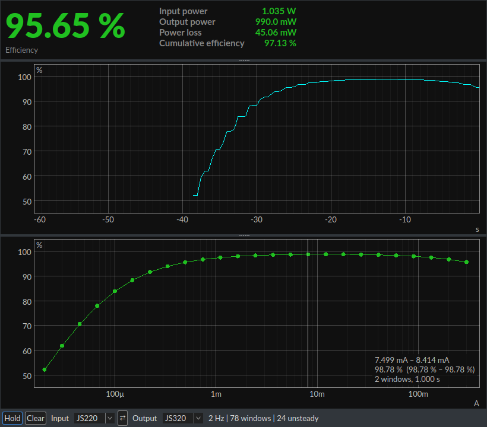

(ui-efficiency)=

# Efficiency

The **Efficiency** widget measures the efficiency of a power converter, such
as a DC-DC regulator, with two Joulescopes: one on the converter input and
one on the output.  It shows the efficiency at the statistics rate, its
history, and an efficiency curve against the output current that builds up
as your load changes.  The Efficiency widget is available in Joulescope UI
1.8.1 and later.

Connect the instruments as described in
{ref}`Theory: Efficiency <theory-efficiency-wiring>`.
That page also explains the measurement, how to check your setup, and what
limits the accuracy.




## Add the widget

Connect both Joulescopes, then select **Widgets → Efficiency**.  The widget
selects the default device as the input instrument and another connected
device as the output instrument.

Check the instruments in the control bar at the bottom of the widget:

| **Control** | **Description** |
|---|---|
| Hold | Freeze the display.  The widget ignores new data until you click Hold again. |
| Clear | Clear the cumulative efficiency, the history and the efficiency curve. |
| Input | The instrument on the converter input. |
| ⇄ | Swap the input and output instruments. |
| Output | The instrument on the converter output. |
| Enable signals | Shown only when an instrument signal that the widget needs is disabled.  Click to enable it. |

The rest of the control bar shows the status.  The widget needs the power
signal from both instruments, and the current signal from the output
instrument for the efficiency curve.  It enables nothing on its own: if a
signal is disabled, the status says which one, and **Enable signals**
enables it.


## Readout

The top of the widget shows the latest measurement:

| **Value** | **Description** |
|---|---|
| Efficiency | Output power / input power over the latest window. |
| Input power | The average input power over the window. |
| Output power | The average output power over the window. |
| Power loss | Input power - output power. |
| Cumulative efficiency | Total output energy / total input energy since you opened the widget or clicked Clear. |

The window is the statistics period of the input instrument, set by its
**Statistics frequency** in the Device Control widget, so the readout
updates together with the Multimeter.  The widget integrates both
instruments over the same time interval, even though their clocks run
independently (see {ref}`Theory: Efficiency <theory-efficiency-alignment>`).

Right-click and select **View → Show voltage and current** to also show the
input and output voltage and current.


## Efficiency vs time

The middle plot shows the efficiency of each window, newest at the right.
A gap means that a window was invalid, for example because an instrument
lost samples.  Hover over the plot to see the time and efficiency of a
window.  Use the mouse wheel to zoom in on recent history, and double-click
to show the full duration.  Right-click to change the duration, from 10
seconds to 1 hour.

Windows that contain a load change can read low or above 100%, because the
converter's capacitors store and release energy
(see {ref}`Theory: Efficiency <theory-efficiency-storage>`).


## Efficiency curve

The bottom plot shows the efficiency against the output current, like a
converter datasheet.  The widget builds it from steady windows, where the
input and output power each vary by less than the **Steady load
threshold**, and groups them into logarithmically spaced current bins.  Each
point is the energy-weighted efficiency of its bin, and the vertical line
shows the lowest and highest window in the bin.  Bins with fewer windows
than **Efficiency curve minimum windows** are faded and left off the line.
Hover over a point to see the bin's current range, efficiency and window
count.

To measure a curve, change the load in steps and dwell at each level for at
least several windows.  The status shows the number of windows the curve
excluded as unsteady.  Right-click and select **Hold the efficiency curve**
to keep the curve while the readout and the time plot continue.


## Settings

Right-click the widget and select **Settings** for all settings:

```{list-table}
:header-rows: 1
:widths: 32 18 50

* - Setting
  - Default
  - Description
* - Show voltage and current
  - off
  - Show the input and output voltage and current in the readout.
* - Show efficiency vs time
  - on
  - Show the efficiency vs time plot.
* - Efficiency vs time duration
  - 10 min
  - The history duration.
* - Show the efficiency curve
  - on
  - Show the efficiency curve.
* - Efficiency curve x-axis
  - Output current
  - Plot the curve against the output current or the output power.
* - Efficiency curve x-axis scale
  - Logarithmic
  - Logarithmic or linear.
* - Efficiency curve bins per decade
  - 20
  - The current or power resolution of the curve.
* - Efficiency curve window
  - Statistics
  - The duration of each curve measurement.  A shorter window captures
    fast load sweeps, but includes more energy storage error.
* - Steady load threshold
  - 5%
  - The largest power variation within a window that the curve accepts.
* - Efficiency curve minimum windows
  - 5
  - Bins with fewer windows are faded.
* - Show the efficiency curve min and max
  - on
  - Show the lowest and highest window efficiency in each bin.
```

Changing a curve setting clears the curve.


## Status messages

| **Message** | **Meaning** |
|---|---|
| Select the input and output instruments | Connect two Joulescopes, then select them in the control bar. |
| Select different input and output instruments | The input and output are the same instrument. |
| Disabled: ... | A signal the widget needs is disabled.  Click **Enable signals**. |
| No data from ... | One instrument stopped sending data while the other continues. |
| JS110 input includes its burden voltage | The JS110 measures voltage before its current shunt, so use it as the output instrument (see {ref}`Theory: Efficiency <theory-efficiency-instruments>`). |
| Efficiency above 100%: swap input and output? | Several windows in a row measured more than 105%.  The instruments are probably swapped. |
| Hold, Paused, Curve hold | The display is frozen by Hold, by the paused signal stream, or the curve by Hold the efficiency curve. |
| n invalid | Windows that could not be measured, such as when an instrument lost samples. |
| n unsteady | Windows the curve excluded because the load changed. |


## Export

Right-click and select **Export** to save comma-separated value (CSV) files:

* **Efficiency vs time (CSV)**: one row per window in the history, with the
  UTC time, the efficiency, the input and output power, the power loss and,
  when shown, the voltage and current.  Invalid windows have empty values.
* **Efficiency curve (CSV)**: one row per bin, with the output current (or
  power) and the bin limits, the efficiency with its minimum and maximum,
  the window count and duration, and the input and output energy.

The first lines of each file start with `#` and record the instruments and
the settings.
