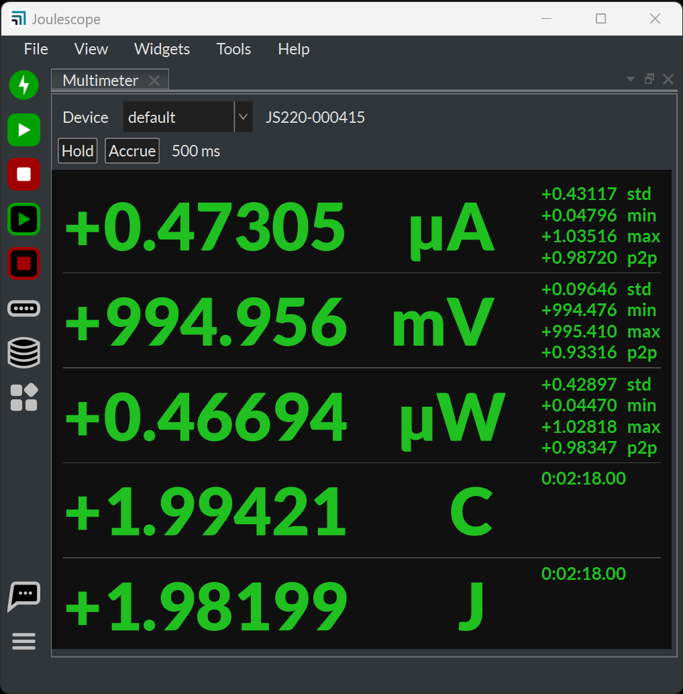

(ui-multimeter)=

# Multimeter

The **Multimeter** widget shows the present operating state of one
instrument: current, voltage, power, charge and energy.  It is the main
widget of the Multimeter view.




## Display

From top to bottom, the widget shows:

* **Device**: the instrument to display.  **default** follows the default
  device.  When **default** is selected, the name of the device it resolves
  to appears next to the selection.  "Not present" means that the selected
  device is not connected.
* **Hold** and **Accrue** buttons, with the accrue duration.
* One row for each quantity: current (A), voltage (V), power (W), charge and
  energy.

For current, voltage and power, the large value is the mean over the
statistics window.  The small fields to the right show:

| **Field** | **Description** |
|---|---|
| std | The standard deviation. |
| min | The minimum value. |
| max | The maximum value. |
| p2p | The peak-to-peak value, max - min. |

Charge and energy show the total since the instrument started accumulating,
with the duration as their only field.  Durations longer than 60 seconds
display as hours, minutes and seconds.

Each value uses an SI prefix chosen automatically from the largest of its
values, so that the mean and its fields share one prefix.  See
{ref}`ui-meet-the-joulescope-ui` for the prefixes.


## Update rate

The widget updates once per statistics window of the instrument.  The
instrument computes the statistics over every full-rate sample, so a short
pulse between updates still contributes to the mean, min and max.  Set the
rate with the instrument's **Statistics frequency** in the **Device
Control** widget, from 1 Hz to 100 Hz.  The default is 2 Hz, a half-second
window.


## Hold and Accrue

**Hold** freezes the display.  The instrument continues to measure, and
charge and energy continue to accumulate.  Click **Hold** again to resume.
The **Statistics display** button on the **Side Bar** holds every widget
that displays statistics at once.  While it is active, the **Hold** button
is disabled.

**Accrue** combines every new statistics window with the previous ones,
instead of showing only the latest window.  The mean becomes the average
since you pressed **Accrue**, min and max become the lowest and highest
values since then, and the standard deviation combines all windows.  The
header shows the accrue duration and the time accruing started.  Click
**Accrue** again to return to the latest window.  Changing the device
restarts accruing.  **Accrue** does not affect charge and energy, which
always accumulate.


## Mouse and context menu

* Click a value to copy it, with its units, to the clipboard.
* Right-click a row and select **Preferred prefix** to fix the SI prefix for
  that quantity: auto, k, none, m, µ or n.  A fixed prefix is underlined.
* Right-click and select **Source** to choose the device.
* Right-click and select **Settings** for all settings.


## Settings

```{list-table}
:header-rows: 1
:widths: 32 18 50

* - Setting
  - Default
  - Description
* - Show the device selection header.
  - on
  - Show the Device selection.
* - Show the accrue header.
  - on
  - Show the Hold and Accrue buttons.
* - Show the statistics fields at the right.
  - on
  - Show std, min, max and p2p.
* - Show a leading + or - sign.
  - on
  - A minus sign always shows.
* - Show the statistics section title for each signal.
  - off
  - Show the device and quantity above each row.
* - The units to display.
  - default
  - Show charge and energy in C and J (SI), or in Ah and Wh (Xh).  default
    uses the application setting.
* - The precision to display in digits.
  - 6
  - 3 to 6 digits.
* - Divide the quantity by this value.
  - empty
  - Divide every value by a number, optionally with units, such as
    `3600 s`.
```


## Value and Accumulator widgets

The **Value** widget shows one quantity from the Multimeter as a single
large value, which is useful in a crowded view.  Select the quantity with
its **The signal to display.** setting.  It has the same settings as the
Multimeter, but hides the device selection, the accrue header and the fields
by default.

The **Accumulator** widget shows the charge or energy of one instrument, and
its duration, as one line of text.  Right-click to switch between charge and
energy and between C and J or Ah and Wh units.
