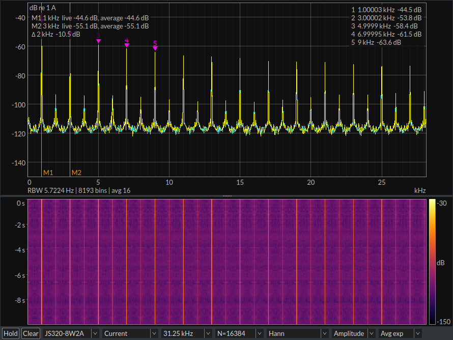

(ui-spectrum)=

# Spectrum

The **Spectrum** widget shows the live frequency spectrum of one signal,
like a spectrum analyzer, with a waterfall that shows how the spectrum
changes over time.  Use it to find a switching regulator's frequency, a
periodic wakeup, or a noise source, and to watch them change while you
probe your circuit.



The figure shows the spectrum of a 1 kHz square-wave current.  The peaks at
1, 3, 5, 7 and 9 kHz are the square wave's odd harmonics.  Markers M1 and
M2 measure the first two, and the waterfall below shows that they are
steady.

The Spectrum widget analyzes the live signal stream.  To analyze a range of
captured data instead, use dual markers on the Waveform and select
**Analysis → Frequency**, see {ref}`ui-waveform`.


## Layout

* **FFT pane** (top): the spectrum.  The y-axis shows the level, the x-axis
  the frequency.  The top left shows the hover and marker values, and the
  top right lists the largest peaks.  The status line is below the
  frequency axis.
* **Waterfall pane** (bottom): the spectrum history, newest at the top.
  Color shows the level, with the color bar on the right.  The waterfall
  columns line up with the frequencies above.
* **Control bar** (bottom).

Drag the boundary between the panes to resize them.  Right-click and select
**View** to show or hide either pane.


## Control bar

| **Control** | **Description** |
|---|---|
| Hold | Freeze the spectrum and the waterfall.  Click again to resume. |
| Clear | Clear the average, max hold and min hold traces, and the waterfall. |
| Source | The instrument to analyze. |
| Signal | The signal to analyze, such as Current or Voltage. |
| Span | The analyzed frequency span, from the full span down to 1/1024 of it. |
| FFT length | The number of samples in each FFT, from 64 to 1048576. |
| Window | The FFT window. |
| Scaling | Amplitude or PSD. |
| Average | Off, exponential, or cumulative. |

Changing the span, FFT length, window, scaling or averaging restarts the
traces and the waterfall.


## Span, FFT length and resolution

The full span is half the instrument's sample rate, which you set with
**Signal frequency** in the **Device Control** widget.  At 1 MHz, the full
span is 500 kHz.  A narrower **Span** decimates the signal before the FFT,
and the Span selector shows the resulting span in Hz.

The resolution bandwidth (RBW) is the width of each frequency bin, as
measured by the window's equivalent noise bandwidth:

```{math}
RBW = ENBW \times \frac{span \times 2}{N}
```

where N is the FFT length.  A narrower RBW separates tones that are close
together and lowers the noise floor in each bin, but each FFT takes longer
to collect, so the display responds more slowly.  For fine resolution at
low frequencies, reduce the span rather than only increasing the FFT
length: a narrower span also reduces the computation.  When the span is
reduced, the top 10% of the span is hidden, because the decimation filter
rolls off there.

The status line shows the RBW and the number of frequency bins.

The widget removes the mean from each FFT segment before analysis.  Current
often has a large DC value, which would otherwise spread into the
low-frequency bins.


## Window

| **Window** | **Use** |
|---|---|
| Hann | The default.  A good general-purpose window. |
| Flat top | The most accurate tone amplitude, with the widest peaks. |
| Blackman, Blackman-Harris | Lower leakage, to see small tones near large ones. |
| Hamming, Bartlett | Traditional general-purpose windows. |
| Rectangular | No window.  Exact only for signals periodic in the FFT length, such as transients that fit within one segment. |


## Scaling and units

* **Amplitude** shows the RMS amplitude in each bin.  A tone reads its RMS
  value at its peak.  Use it for tones and harmonics.
* **PSD** shows the power spectral density, in units² per Hz.  It does not
  depend on the RBW, so use it to compare noise levels.

Right-click and select **Y-axis units** for dB or linear.  dB is relative to
1 signal unit, for example `dB re 1 A`.


## Traces and averaging

The FFT pane can show four traces.  Right-click and select **Traces** to
show or hide each one:

| **Trace** | **Default** | **Description** |
|---|---|---|
| Live | shown | The latest spectrum. |
| Average | shown | The average spectrum, using the **Average** mode. |
| Max hold | hidden | The maximum of each bin since the last Clear. |
| Min hold | hidden | The minimum of each bin since the last Clear. |

**Average** modes:

* **Exponential** averages the most recent spectra, set by **Average
  count**.  It follows changes while smoothing noise.
* **Cumulative** averages everything since the last Clear.
* **Off** shows no average.

Averaging works on power, not on dB values, so the average noise level is
correct.  **Overlap** in the settings sets how much successive FFT segments
overlap, 50% by default.


## Waterfall

Each waterfall row combines the spectra over a short time.  The waterfall
covers **Waterfall duration**, 10 seconds by default.  **Waterfall
detector** sets how each row combines its spectra: average, or max, which
keeps short bursts visible.  If the waterfall memory cannot hold the full
duration, the status line shows the duration it holds.

By default, the color range follows the FFT pane's dB y-axis.  Turn off
**Waterfall intensity follows the FFT y-axis** to set the range with
**Waterfall intensity min (dB)** and **Waterfall intensity max (dB)**.
**Waterfall colormap** selects inferno, viridis or grayscale.


## Markers and peaks

Right-click the spectrum and select **Add marker**, or **Add marker at
peak** for the nearest peak.  The top left shows each marker's frequency
and trace values.  With two markers, it also shows their frequency and level
difference.  Drag a marker to move it.  Right-click a marker and select
**Remove marker**, or select **Clear markers** to remove them all.

The widget marks the largest peaks in the visible range with numbered
triangles and lists them at the top right.  **Number of peaks to display**,
**Peak threshold (dB)** and **Peak excursion (dB)** in the settings control
which peaks appear.  A peak must rise at least the excursion above the
lowest value on each side, which ignores noise on the sides of a tone.


## Navigate

| **Action** | **Mouse** |
|---|---|
| Zoom frequency | Wheel |
| Pan frequency | Drag |
| Zoom the y-axis | Shift + wheel |
| Reset the view and y-axis autoscale | Double-click |
| Show values | Hover |

Zooming and panning only change the view.  They do not restart the averages.
Right-click and select **View → Logarithmic frequency** for a logarithmic
frequency axis.


## Status line

The status line under the frequency axis shows, separated by `|`:

* **No signal**, **Hold** or **Paused**, when the widget is not updating.
  **Paused** means that the **Signal sample streaming** button on the
  **Side Bar** has paused the signal stream.
* **RBW** and the number of bins.
* **gaps**, when the instrument lost samples.
* **avg**, the number of averaged spectra.
* **waterfall**, when the waterfall holds less than its duration.
* **overruns**, in the warning color, when the computer could not keep up
  and the widget dropped data.  Reduce the FFT length or the span, or close
  other widgets.


## Settings

Right-click and select **Settings** for all settings, including those on the
control bar:

```{list-table}
:header-rows: 1
:widths: 40 15 45

* - Setting
  - Default
  - Description
* - Overlap
  - 50%
  - The overlap between successive FFT segments.
* - Y-axis units
  - dB
  - dB or linear.
* - Average count
  - 16
  - The number of spectra for the exponential average.
* - Show the live trace.  Show the average trace.  Show the max hold
    trace.  Show the min hold trace.
  - live and average
  - The traces to show.
* - Logarithmic frequency axis
  - off
  - Show frequency on a logarithmic axis.
* - Automatically scale the y-axis.
  - on
  - Scale the y-axis to the data.
* - Show the FFT spectrum.  Show the waterfall history.
  - both
  - The panes to show.
* - Waterfall duration
  - 10 s
  - The waterfall history duration.
* - Waterfall rows
  - 200
  - The number of rows in the waterfall duration.
* - Waterfall detector
  - average
  - Average or max for each row.
* - Waterfall memory (MB)
  - 64
  - The memory limit for the waterfall history.
* - Waterfall colormap
  - inferno
  - Inferno, viridis or grayscale.
* - Waterfall intensity follows the FFT y-axis
  - on
  - Match the waterfall color range to the FFT y-axis.
* - Number of peaks to display
  - 5
  - 0 to 10.
* - Peak threshold (dB)
  - -200
  - Ignore peaks below this level.
* - Peak excursion (dB)
  - 10
  - The minimum rise above the surrounding values.
* - Trace width
  - 1
  - The line width in pixels.
* - Maximum update rate (Hz)
  - 30
  - The maximum display update rate.
```
