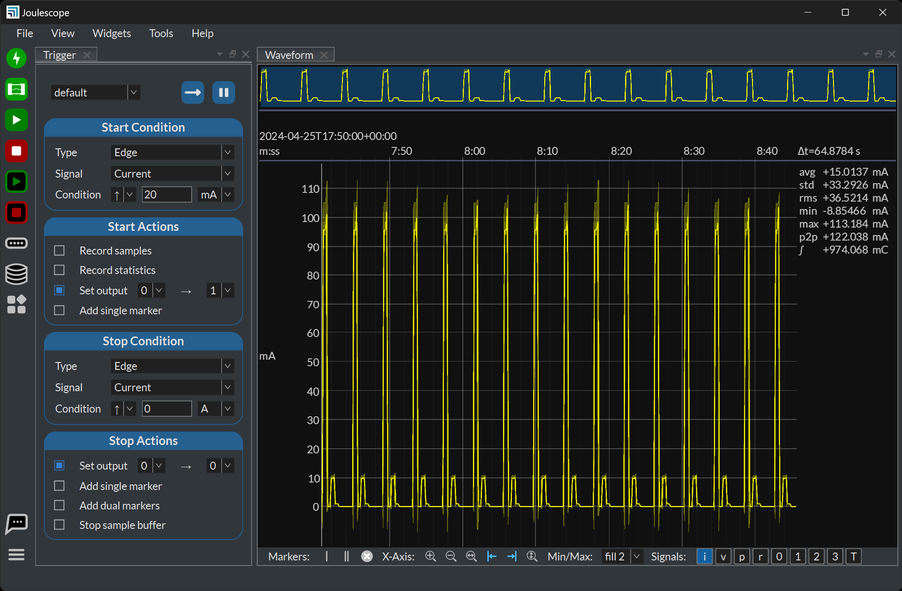

(ui-trigger)=

# Trigger

The **Trigger** widget watches an instrument for a start condition, performs
start actions, then watches for a stop condition and performs stop actions.
Use it to record only the interesting part of a long test, to drive an
output when the current crosses a threshold, or to mark events on the
Waveform.

## Run the trigger

The header row contains:

* **Source**: the instrument for the start and stop conditions.
* **Run mode**: **Single** performs one trigger sequence and then returns to
  inactive.  **Continuous** repeats the sequence until you stop it.
* **Status**: click to arm the trigger.

The status button shows the trigger state:

| **State** | **Description** |
|---|---|
| Inactive | The trigger is not running.  Click the status button to arm it. |
| Searching | Watching for the start condition. |
| Active | The start condition occurred.  Watching for the stop condition, with a rotating indicator. |

Click the status button while searching or active to stop the trigger.
While the trigger runs, its configuration is locked.  When the stop
condition occurs, single mode returns to inactive and continuous mode
returns to searching.  In continuous mode, the default recording file
names include a timestamp, and the `{count}` field in a file name pattern
gives the sequence number.

## Conditions

The start condition and the stop condition have the same options:

* **Type**: **Edge** detects a crossing.  **Duration** detects a condition
  that holds for a time.
* **Signal**: an enabled signal of the source instrument.  The general
  purpose inputs 0 to 3 and the trigger input T are digital signals.
  Duration conditions also offer **Always**, which occurs once the duration
  elapses, and **Never**, which waits until you stop the trigger.
* **Condition** and value:

| **Type** | **Analog signals** | **Digital signals** |
|---|---|---|
| Edge | ↑ rising above, ↓ falling below, or ↕ crossing the value in either direction. | ↑ rising, ↓ falling, or ↕ either edge. |
| Duration | Above (>) or below (<) the value, or between or outside two values, continuously for the duration. | 0 or 1, continuously for the duration. |

* **Units**: the units of the value, such as µA or mA for current.
* **Duration**: for duration conditions, the time the condition must hold.
  The timer restarts whenever the condition becomes false.

## Start actions

Enable each action with its checkbox:

* **Record samples**: record the sample data to a JLS file.  **Config**
  selects the signals and file, **Start buffer** includes data from before
  the start condition, and **Stop delay** continues recording after the stop
  condition.
* **Record statistics**: record the statistics data to a CSV file, with the
  same options.
* **Set output**: set a general purpose output to 0 or 1.
* **Add single marker**: add a single marker at the start time to the
  Waveform in the active view.

## Stop actions

* **Set output**: set a general purpose output to 0 or 1.
* **Add single marker**: add a single marker at the stop time.
* **Add dual markers**: add dual markers from the start time to the stop
  time, which show the statistics of the triggered event.
* **Stop sample buffer**: pause the sample buffer after a delay, so the
  Waveform keeps the event in view.

## Timing

The Joulescope UI detects the conditions on the host computer, using the
sample data timestamps, so the event times and markers are accurate.  The
actions, however, happen when the host detects the condition.  This
includes the communication latency from the Joulescope to the host, so
**Set output** may change its output on the order of 100 milliseconds after
the actual condition.
