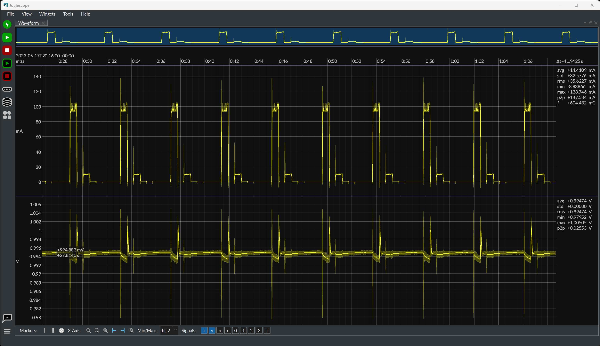
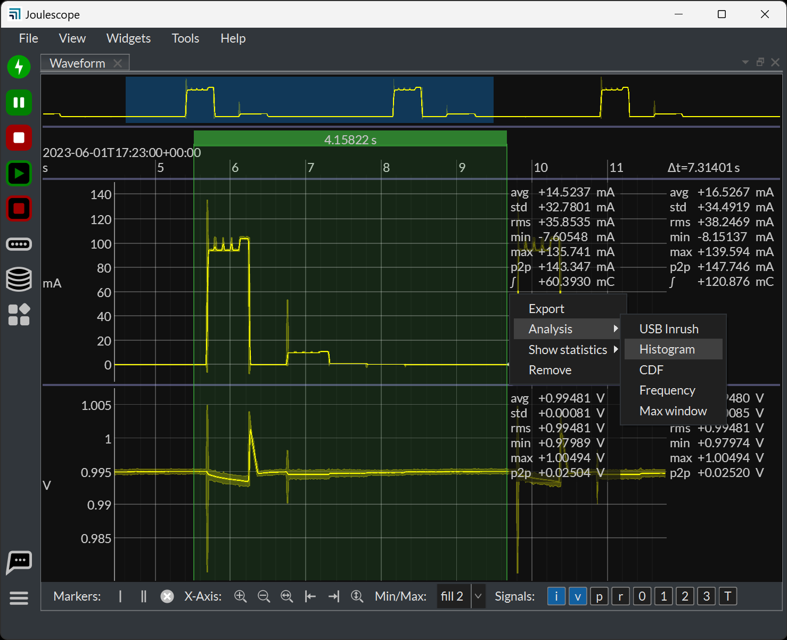

(ui-waveform)=

# Waveform

The **Waveform** widget plots signals over time, like an oscilloscope.  It
is the main widget of the Oscilloscope view.  It displays the live sample
data from your instruments, or the data in a JLS recording that you open.




## Layout

From top to bottom:

* **Summary**: the full available time range, with the visible range
  highlighted.  Right-click it to choose the signal it shows.
* **x-axis**: the time.  By default it shows the UTC time of day, with an
  offset on the first line and the values relative to the offset below.
* **Plots**: one plot for each selected signal.  Drag the space between
  two plots to change their heights.
* **Traces**: up to four traces, each with its own source, so that you can
  compare instruments or recordings on the same plots.  Click a trace's color
  bar to show or hide it, and right-click its name to select its source.
* **Control bar**: buttons for markers, zoom and the displayed signals.

To the right of each plot, the statistics column shows the statistics over
the visible time range:

| **Statistic** | **Description** |
|---|---|
| avg | The mean value. |
| std | The standard deviation. |
| rms | The root-mean-square value. |
| min | The minimum value. |
| max | The maximum value. |
| p2p | The peak-to-peak value, max - min. |
| ∫ | The integral over the time range: charge for current, energy for power. |

The area beside the x-axis at the top of this column shows Δt, the duration
of the visible time range.  Right-click it to enter an exact duration or to
change its units.


## Signals

Use the signal buttons on the control bar to show or hide each plot:

| **Button** | **Signal** | **Default** |
|---|---|---|
| i | Current | shown |
| v | Voltage | shown |
| p | Power | hidden |
| r | Current range | hidden |
| 0, 1, 2, 3 | General purpose inputs | hidden |
| T | Trigger input | hidden |

A plot only shows data when the instrument provides that signal.  Enable
signals for each instrument in the **Device Control** widget, see
{ref}`ui-meet-the-joulescope-ui`.


## Navigate

| **Action** | **Mouse** | **Keyboard** |
|---|---|---|
| Zoom time in or out | Wheel over a plot or the x-axis | Up and Down, or + and - |
| Pan time | Drag a plot or the x-axis, or Shift + wheel | Left and Right |
| Show all data | Zoom all button | `*` |
| Zoom a y-axis | Ctrl + wheel over the plot, or wheel over its y-axis | |
| Pan a y-axis | Ctrl + drag the plot, or drag its y-axis | |
| Reset all y-axes | Y zoom all button | |

On macOS, use the command key (⌘) for Ctrl.  Zooming or panning a y-axis
switches that plot to a manual range.  Right-click the plot and select
**Y-axis auto range** to return it to automatic.  The general purpose input
and trigger input plots have a fixed range.

While streaming, the **Pin left** and **Pin right** buttons keep the oldest
and newest data in view.  With both pinned, the view shows the whole buffer.
Pinned views do not pan: click the pin buttons, or press Shift+Space, to
unpin.  Ctrl+A pins both sides.


## Markers and annotations

Markers measure the data at a point or over a range:

* **Single marker**: shows the value at its time, summarized over the
  samples that one pixel represents.  Add one with the control bar, the
  right-click menu, or the `S` key.
* **Dual markers**: show the statistics between the two markers, and their
  time difference.  Add them with the control bar, the right-click menu, or
  the `D` key.
* **Horizontal markers**: right-click a plot or its y-axis and select
  **Annotations → Horizontal** to add a single horizontal marker, which
  shows its value, or dual horizontal markers, which also show their
  difference.
* **Text annotations**: right-click a plot and select **Annotations → Text
  → Add** to mark an area of interest with a shape and text.  Click it to
  edit it.

To move a marker, click it, move the mouse, and click again to drop it.
Ctrl+click a dual marker to move both markers together.  Press `1` to `9`
to select a marker.  Delete or Backspace clears all annotations.

Vertical (time) markers apply to every plot.  Horizontal markers and text
annotations belong to one plot.  When viewing a JLS recording, right-click
and select **Annotations → Save** to save the annotations next to the
recording.

Right-click a marker for more options:

* **Show statistics**: Auto, Left, Right or Off.
* **Show time**: show the marker time.
* **Label**, **Copy text to clipboard** and **Remove**.
* Dual markers only:
  * **Interval**: set the exact time between the markers.
  * **Zoom**: zoom so the markers fill 10% to 100% of the view.
  * **Export**: save the samples between the markers.
  * **Analysis**: analyze the samples between the markers.



The **Analysis** submenu provides:

| **Tool** | **Description** |
|---|---|
| Frequency | The frequency spectrum over the range.  For a live spectrum, use the {ref}`ui-spectrum` widget. |
| Histogram | The distribution of values: discrete probability, frequency distribution or probability density. |
| CDF | The cumulative distribution function, or its complement. |
| Max window | Find the window with the maximum value, and mark it with dual markers. |
| USB Inrush | Test USB inrush current.  The markers must be at least 100 ms apart. |


## Plot options

Right-click a plot for:

* **Annotations**: add or clear markers and text.
* **Anti-aliasing**: smooth the average trace when zoomed out, so that short
  pulses do not flicker as the view scrolls.  The filter preserves the mean,
  but short pulses appear wider and lower.  It does not change the min/max
  extents, the statistics or exported data.  Off by default.
* **Save image to file**, **Copy image to clipboard**.
* **Export visible data**, **Export visible data as CSV**, **Export all
  data**.

Right-click a y-axis for:

* **Range**: Auto, Manual, or Exact to enter the limits.
* **Scale**: Linear or Logarithmic, for current and power.  With a
  logarithmic scale, **Logarithmic zero** sets the smallest decade shown.
* **Preferred prefix**: fix the SI prefix of the axis.
* **Name**: rename the plot.

Right-click the x-axis for:

* **Mode**: Absolute shows the time of day.  Relative positive counts from
  the first sample.  Relative negative puts 0 at the newest sample.
* **Time Zone**: UTC or Local.
* **Δt holdover**: keep the visible duration when streaming starts.

The **Min/Max** control on the control bar sets how the plots show the range
of the samples within each pixel: off, lines, fill 1, or fill 2, which also
shows the standard deviation.


## Settings

Right-click and select **Settings** for all settings.  Commonly used
settings:

```{list-table}
:header-rows: 1
:widths: 32 18 50

* - Setting
  - Default
  - Description
* - The trace width.
  - 1
  - The line width in pixels.
* - The target frames per second.
  - 50
  - The maximum display update rate.
* - Show the minimum and maximum extents fill.
  - fill 2
  - The same as the **Min/Max** control.
* - Anti-alias the average trace when zoomed out.
  - off
  - The same as **Anti-aliasing** in the plot menu.
* - Show the statistics on mouse hover.
  - on
  - Show the time and value under the mouse.
* - The time format for mouse hover.
  - relative to view
  - Off, relative to the view, relative to the buffer, or absolute.
* - Show the plot statistics on the right.
  - on
  - Show the statistics column.
* - The quantities to display by default.
  - all
  - The statistics to show.
* - Show frequency for dual markers and statistics.
  - off
  - Also show frequency.
* - The precision to display in digits.
  - 6
  - 3 to 6 digits.
* - Show the summary waveform at top.
  - on
  - Show the summary above the x-axis.
* - Use OpenGL rendering.
  - on
  - See {ref}`ui-graphics-configuration`.
* - Control location
  - bottom
  - Show the control bar at the top or bottom, or hide it.
```
